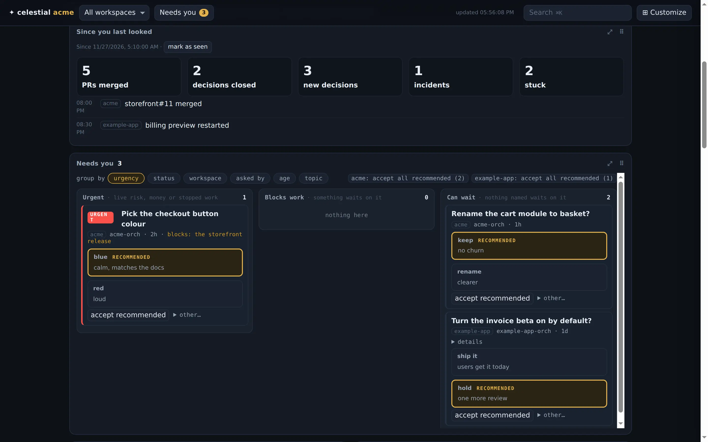
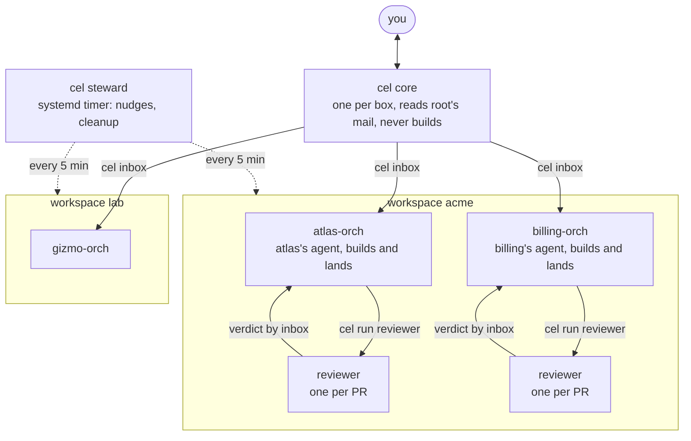
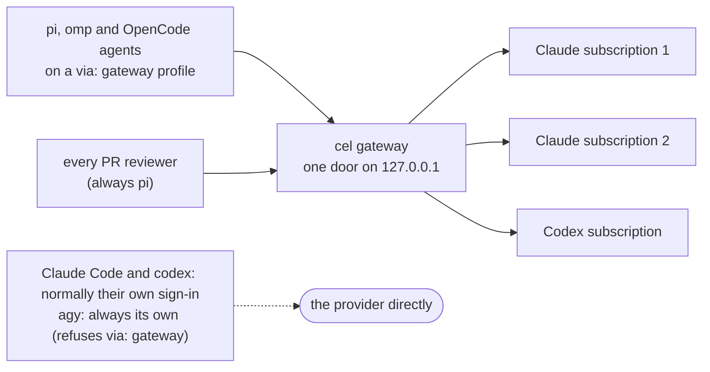

# Celestial — an AI software factory

**One coding agent per product: it builds, tests, opens PRs, gets each one reviewed and lands it — in a pane you can see and steer.**

One clone per dev box. Celestial organises work into *workspaces*, equips
coding agents (Claude Code, oh-my-pi, pi, codex, OpenCode and the Google
Antigravity CLI), and runs each product's agent in a visible
[herdr](https://herdr.dev) pane or Rex session.
The product agent plans, writes, tests and opens pull requests itself; every
PR gets its own reviewer agent, and the product agent lands it through one
checked path (`cel solo land`) under your workspace policy. You stay at the
controls: inspect the work, answer blockers and make the decisions that need a
human.

[](LICENSE)



*The dashboard (`cel dash`) on fictional fixture data.*

---

## Why

Running one coding agent is easy. Running one per product across several
workspaces — each opening PRs, each PR reviewed, services on ports, tickets
moving — needs a production system. Celestial supplies the coordination,
visibility and housekeeping around the agents:

- **Every agent runs in a visible pane.** No invisible background agents;
  if it isn't in a pane, it didn't happen.
- **Policy is injected, not hoped for.** Each workspace declares merge rules,
  ticket schemes, runtimes and reviewers once; every agent launched there gets
  them in its system prompt.
- **Every PR is reviewed and landed the same way.** A per-PR reviewer records
  a verdict bound to the exact head; `cel solo land` merges only that head,
  green, under the workspace's merge policy.
- **The box cleans up after itself.** A steward tick collects merged
  worktrees, nudges stalled reviews, and names anything waiting on a human.

## Give this to your agent

You already have a coding agent — Claude Code, oh-my-pi, pi, codex, OpenCode,
the Antigravity CLI.
Paste this into it and let it do the install:

```
Install Celestial on this machine and get it running:
1. git clone https://github.com/geoffwellman/celestial.git ~/celestial
2. Add  eval "$(~/celestial/bin/cel shellenv)"  to my shell rc and load it.
3. Run cel setup, then cel doctor. Fix everything red; ask me for anything
   that needs my account (gh auth login, claude setup-token, pi /login).
4. Ask me: a workspace name, my GitHub org, and the repos I want in it.
   Run cel ws new <name> --org <org>, add the repos to workspace.yaml, run
   cel ws sync <name>, then cel doctor again.
5. Start the box coordinator with cel core, then run cel fleet and
   cel dash --ensure. Show me both outputs and the dashboard URL, and tell
   me the one command I use from now on.
```

Setup installs third-party code and may invoke `sudo`; read the block before
you paste it, and read [requirements](docs/requirements.md#requirements) first. If you would
rather type it yourself, the same install is below.

## Quick start

```sh
git clone https://github.com/geoffwellman/celestial.git ~/celestial
eval "$(~/celestial/bin/cel shellenv)"  # add this line to your shell rc
cel setup                               # review the manifests before installing
cel doctor                              # verify prerequisites and account setup

cel ws new acme --org your-gh-user      # scaffold a workspace
cel ws sync acme                        # clone its repos, link skills, check tools
cel core                                # the box coordinator: routes every product
cd ~/ws/acme && cel run solo --product <p>   # or let `cel ws up` start each product's agent
```

`cel core` is the agent a person keeps open — one per box, across every
workspace. It reads root's mail, holds cross-product priorities, starts and
restarts product agents, and never builds. Each product's agent is where the
work happens. What `cel ws up` starts is declared in
[`workspace.yaml`](docs/configure-teams.md#the-shape-a-workspace-declares).

Requires GNU/Linux; automatic prerequisite installation targets apt-based
distributions. Fresh binary installs support x86-64 and arm64. See
[requirements](docs/requirements.md#requirements) before running setup. Setup installs third-party
code and may invoke `sudo`; it does not supply provider subscriptions or log
you into GitHub, Linear or agent accounts.

## Setups at a glance

### One box: core, product agents, reviewers



Every setup is built on this one. You talk to `cel core`, one per box, which
reads `root`'s mail in every workspace and directs each product's agent; each
product's agent builds and lands its own PRs and starts one reviewer per PR.
Every agent runs in a visible Herdr pane or Rex session
([sessions](docs/sessions-herdr-and-rex.md#sessions-herdr-and-rex)), and the
[steward](docs/background-services.md#the-steward--the-only-scheduled-process)
ticks over the box without calling a model.
Selected by: `cel core` once per box; one `products:` entry per product (a repo
that is in no product is its own product); `layout: { orchestrators: auto }`
so `cel ws up <workspace>` starts every product's agent; and a `review:` block
so there are reviewers at all.

### How agents reach models: the gateway



A profile with `via: gateway` reaches its model through `cel gateway`, which
holds several Claude and Codex subscriptions and keeps each agent on one
account. Reviewers always go through it; OpenCode requires it; Claude Code and
codex normally use their own sign-in; agy refuses it.
Details: [Gateway](docs/gateway.md#gateway--several-subscriptions-behind-one-door).

### Every setup

A **feature team** is short-lived agents one product's agent leads for one
feature; a **team workspace** is one workspace several people share. Every
setup builds on the first row. [docs/setups.md](docs/setups.md) draws each
other one, says when to choose it and names the config that selects it.

| Setup | In one line |
|---|---|
| [One box](#one-box-core-product-agents-reviewers) | `cel core` per box directs one agent per product; each PR gets its own reviewer |
| [One product, solo](docs/setups.md#one-product-solo-the-default) (the default) | the product's agent branches, gates, opens the PR and lands it once its reviewer approved that head |
| [Solo lanes](docs/setups.md#solo-lanes-several-goals-on-one-product) | two or three large goals on one product, one agent each |
| [Feature team](docs/setups.md#a-feature-team-led-by-the-products-agent) | builders, qa and design under the product's agent, which stays the only integrator |
| [Team workspace](docs/setups.md#a-team-workspace-shared-by-several-people) | several people share `workspace.yaml`; each box keeps its own routing and keys |
| [The gateway](#how-agents-reach-models-the-gateway) | several subscriptions behind one loopback door |

## A tour of the docs

**[Configure your teams](docs/configure-teams.md)** walks through a complete
`workspace.yaml` (products, models, review), running a feature team from start
to close, sharing a workspace with your team, and the shape `cel ws up`
restores.

**[How it works](docs/how-it-works.md)** covers the three layers on disk,
workspaces and products, `cel core`, a workspace with its own GitHub account,
solo lanes and the `/cel-<verb>` commands inside an agent.
**[Solo mode](docs/solo-mode.md)** is the build-review-land loop and every
check `cel solo land` makes; **[Feature teams](docs/feature-teams.md)** are
roles, focus packs, events and verdicts under the product's lead.

**[Runtimes](docs/runtimes.md)**: install, pin, launch, skills, resume, inbox
wake and guard coverage for Claude Code, omp, pi, codex, OpenCode and agy.
**[Sessions: Herdr and Rex](docs/sessions-herdr-and-rex.md)**: the terminal
hosts, Rex restarts and upgrades, per-agent memory scopes and reviewer
retirement.

**[The review loop](docs/review-loop.md)**: the per-PR reviewer, extra
reviewers by focus, QA agents that run the change, and what a reviewer may
run. **[The inbox](docs/inbox.md)**: how agents talk without typing into your
pane, and how each runtime wakes on mail.

**[Watch and steer](docs/watch-and-steer.md)**: `cel fleet`, liveness, the
dashboard, publishing, `cel gc` and box space.
**[Docker image retention](docs/docker-retention.md)** is the keep-pattern
and lock contract for producers, and the
[disk headroom controller](docs/disk-headroom.md) the recurring 20 GiB
recovery runbook.

**[What runs in the background](docs/background-services.md)**: the steward
(the only scheduled process) and its per-tick steps, the suite lock, servers,
hooks, services and PR previews.

**[Profiles](docs/profiles.md)**: runtime, model and effort per role, team
workspaces, per-box routing and subscription quotas.
**[Gateway](docs/gateway.md)**: several Claude and Codex subscriptions
behind one door. **[Tickets](docs/tickets.md)**: Linear wiring and the ticket
lifecycle.

**[What lives where](docs/what-lives-where.md)**: what is committed where,
cleanup safety, exactly what `cel gc` keeps, and the private HTTP services.
**[Architecture](docs/architecture.md)** is the code-and-state view for
contributors.

**[Requirements](docs/requirements.md)**: prerequisites, pins, npm tools and
how npm-global agents follow node. **[Skills and plugins](docs/skills.md)**:
the optional EGM plugin and the vendored skills.
**[Releasing a product](docs/releasing.md)**,
**[Versioning & updates](docs/versioning.md)** and the
[release checklist](docs/release-checklist.md) cover `cel release`, channels
and `cel update`.

## Commands

`cel help` prints the same list with every flag; this is the map.

| Command | What |
|---|---|
| **The box** | |
| `cel setup [--agents a,b\|all]` / `cel doctor` | install tools, agents and externals, link core / verify the box (non-zero on problems) |
| `cel update [--check [--agents]·--rollback·--channel main·release·--restart-orchestrators·--skip-agents·--components]` | move to the newest release tag (or to `origin/main` on the main channel), re-link and re-render, update installed agents to their pins, then verify; see [Versioning & updates](docs/versioning.md#versioning--updates) |
| `cel version` · `cel agents` · `cel shellenv` | the build you run / runtimes, install status and injection strategy / the PATH line for your shell rc |
| `cel plugins list · install` | opt-in pinned full plugins ([EGM](docs/skills.md#optional-elephant-goldfish-model-plugin)) |
| `cel fleet [--json] [--workspace w]` | the whole box in one deterministic read: per product its mode, agent and lane liveness and memory, and root's mail per workspace |
| `cel dash [--port n] [--ensure·--restart]` | the box's one dashboard |
| `cel sessions [--json]` · `cel sessions rex-upgrade [--check]` · `cel sessions retire-reviewer <repo>#<n>` | live Herdr and managed Rex agent sessions / the managed rex upgrade / retire a finished Rex reviewer ([Sessions](docs/sessions-herdr-and-rex.md#sessions-herdr-and-rex)) |
| `cel budget [--json]` | live helpers (reviewers, team members, other) against `budget.max_live_agents` (default 8) and team members against `budget.max_team_members` (default 4); product agents and core shown, not counted; and the memory floor |
| `cel quota [provider] [--json]` | the signed-in subscriptions — every window, its percentage and when it resets — above the credit left per API provider; a route below its floor, or on a spent 5h window, is vetoed before a pane spawns |
| `cel gateway install · status · login · logout · panel · refresh · pi-models · omp-scope · opencode-models · rotate-key` | [several subscriptions behind one door](docs/gateway.md#gateway--several-subscriptions-behind-one-door) |
| `cel steward [--no-gc]` · `cel steward --install [--interval m] \| --remove` | one proactive tick over the whole box / run it on a timer (the thing that makes any of it proactive) |
| `cel gc [--reap h] [--orphans] [--box] [--dry-run]` | reclaim merged worktrees, closed PRs' reviewers and checkouts, idle agents; `--orphans` reaps processes with no owner; `--box` sweeps docker and toolchain caches ([what it keeps](docs/what-lives-where.md#what-cel-gc-keeps)) |
| `cel box space [--json]` · `cel box diag` | what is large, what is reclaimable and what is nobody's to delete / two bounded lines for a disk alert |
| `cel box docker-safety` · `cel box sweep-docker [--dry-run]` | the versioned Docker retention contract / the Docker-only fail-closed sweep |
| `cel build-slot -- <cmd>` | run a heavy build in the box-wide slot: one at a time by default (`build.slots` / `CEL_BUILD_SLOTS`); sets `CARGO_BUILD_JOBS` to half the cores unless already set; the slot is held while anything the command forked still runs |
| `cel watchdog [status·print·install·uninstall]` | a system timer that restarts the user manager after an OOM kill, then `cel dash --ensure` and `cel pages --ensure`; `install` needs passwordless sudo, `print` gives the owner the one-time commands; `cel doctor` warns while it is not installed |
| `cel services [--json]` · `start · stop · restart · logs · open <name>` | everything this box runs on a port ([Services](docs/background-services.md#services)) |
| `cel serve start · list · stop · adopt` | the ledger of agents' own servers ([Servers](docs/background-services.md#servers--started-on-demand-kept-alive-by-the-steward)) |
| `cel publish <file>` · `cel pages [--public] [--ensure]` · `cel pages tunnel · bundle` | self-hosted documents |
| `cel effects install · status` | optional Canvas UI dashboard effects (Chrome) |
| **Workspaces** | |
| `cel ws new · add · sync · list · push · env` | workspace setup |
| `cel ws up · down · reset · status <name>` | a workspace has a declared shape and this puts it back: `up` reconciles (herdr workspace, declared panes, an agent per product that wants one, and a rename for any live agent herdr has lost the name of) and is safe to run twice; `down` stops the agents it owns and closes its **panes**, refusing over work that is neither pushed nor landed; `reset` is down-then-up; `status` is `up --dry-run` as a table. It never removes a worktree |
| `cel profiles` · `cel people [--workspace w] [--json]` | profiles, role bindings and the exact launch flags each resolves to / who is who in a [team workspace](docs/profiles.md#team-workspaces) |
| `cel learn add · list · reinforce · stow` | durable facts the workspace has established — pinned / aging / perishable — budgeted into every agent's policy block |
| `cel release <product> <version\|bump> [--repo r] [--dry-run]` · `cel release status` | [cut a release of a product](docs/releasing.md#releasing-a-product) |
| `cel spike <name>` / `cel promote <spike>` | throwaway repo → real repo |
| **Agents** | |
| `cel core` | the box coordinator: one agent over every workspace, root's mail; `cel console`, `cel run core` and `cel run console` are aliases |
| `cel run solo --product <p> [--lane <name>]` | start a product's agent, or a further lane for a parallel goal |
| `cel run [root·orchestrator·reviewer]` | start an agent, role injected; `orchestrator` starts the product's solo agent; no role is Direct mode |
| `cel mode [<p>] [solo]` | show a product's mode, or set it to solo |
| `cel here <verb>` | what `/cel-<verb>` runs inside an agent |
| `cel team start · add · ack · event · verdict · status · retire · close · cap` | a [feature team](docs/feature-teams.md#feature-teams) under the product's lead |
| `cel inbox send · read · count · watch · wait` | agent messages that never type into a pane; `--all-workspaces` for core |
| `cel inbox open [--ranked] · resolve · whoami · prune · migrate` | decisions stay open until resolved; reading one does not answer it |
| `cel decide ask · list · answer · drop · withdraw · confirm` | the owner's one queue of decisions, every workspace; `ask --pr <repo>#<n>` holds that PR's nudges |
| `cel drive list · tail · send · receipt` | see an orchestrator's conversation (from its session file) and mail it as owner, with a receipt |
| `cel afk on · off · status · log · resolve-thread · rebase-retry` | away from keyboard: the factory may land approved, green, gate-verified PRs and rebase ones pushed behind - nothing else |
| **PRs** | |
| `cel solo review · land <repo>#<n>` | record a reviewer's verdict bound to the head (`--focus f` for an extra reviewer; `--qa f --evidence file...` for a QA agent, which may also say `blocked`) / merge a PR approved by every required reviewer and QA agent, green |
| `cel solo approvals <repo>#<n>... [--json]` | each reviewer a PR needs and its word on the current head, by land's rule |
| `cel preview <repo>#<pr>` | run an open PR's head ([Previews](docs/background-services.md#previews-cel-preview)) |
| `cel forge repo · whoami <repo>` | a repo's forge (GitHub or Forgejo) and the account this workspace acts as on it |
| `cel forge pr view · checks · reviews · list · create <repo>[#<n>]` | a PR in Celestial's words on GitHub or Forgejo alike (`--json` for the normalised value) |
| `cel forge pr close <repo>#<n> [--comment-file f]` · `cel forge pr ready <repo>#<n>` | close a PR (the comment posted first, the branch kept) or take it out of draft (Forgejo: the `WIP:` title prefix removed; a no-op if it is not a draft) - only the product's own agent (`CEL_ROLE` solo or orchestrator, its product from `CEL_PRODUCT` or its `<product>-orch` mailbox), on its OWN product's repos and its own account's PRs (or a migrated Forgejo PR, author Ghost). A process with no agent identity is refused: the owner closes or readies PRs in the forge's web UI (Forgejo or GitHub) or with `gh` |
| `cel forge run list <repo> [--branch b] [--sha <head>] · view <repo> <run-id> · logs <repo> <job-id> [--tail N] [--raw]` | CI runs, a run's jobs and a job's log, read-only for every role: Forgejo Actions over its API (no web login, no token in the agent's hands), GitHub through `gh run`; ids are the API's (the web page's run number shows as `web #N`), `--sha` lists a commit's runs with their job ids, and `view`/`logs` also take a run's or job's web page when it maps exactly; `logs` drops per-line timestamps unless `--raw` |
| `cel forge run rerun <repo> <job-id>` | run one job again on the same head (an approval of it stands) - only the product's own agent on its own product's repos; the owner reruns in the forge's web UI or with `gh run rerun` |
| `$CEL_ROOT/core/skills/verify/bin/cel-verify <worktree> [--gate cmd]` | the verify skill's executable (not on PATH): a structured verdict for a branch - gate result, red-then-green, diff, CI, review. The complete gate output of every attempt is kept as a private artifact (`$CEL_VERIFY_ARTIFACT_DIR`, default `~/.local/state/cel/verify`) and its path, size and sha256 are in `gate.artifact` beside the exact exit code; a killed verifier records no verdict rather than faking one (exit 3), and an artifact root inside any git work tree or not 0700/owned by you is refused (exit 4) |

Retired on 2026-11-08 with per-ticket fan-out, and refused for one release so a habit gets an answer: `cel-fanout`, `cel run worker|scout|spike`, `cel mode <p> fleet`, `cel work`, `cel history`.
A product's own solo agent, its lanes and its [feature teams](docs/feature-teams.md#feature-teams) do that work now.

## Requirements

GNU/Linux with Bash, GNU coreutils, Git, jq, Python 3, curl 7.55.0 or newer,
Node (mise's `lts`; CI uses 24.x) and [herdr](https://herdr.dev); Rex and a
systemd user session are optional. `cel setup` installs what is missing
through apt where it can. The full list, the pinned agent versions and what
setup does and does not lock: [docs/requirements.md](docs/requirements.md).

## Development and security

See [architecture](docs/architecture.md),
[contributing](CONTRIBUTING.md), [security policy](SECURITY.md), and the
[release checklist](docs/release-checklist.md). CI runs the shell/HTTP suite,
source-and-history hygiene checks and a pinned credential scanner. Private
release vocabulary stays outside this repository; the public generic check
alone is not proof that a particular organisation's information is absent.

## Licence

[MIT](LICENSE) © Geoff Wellman
