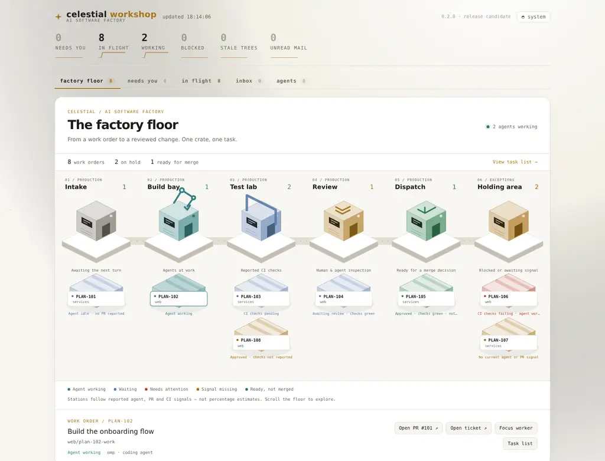

# Celestial — an AI software factory

**Turn work orders into reviewed software with a visible, steerable team of coding agents.**

One clone per dev box. Celestial organises work into *workspaces*, equips
coding agents (Claude Code, oh-my-pi, codex, opencode, pi), and puts
orchestrators and workers into visible [herdr](https://herdr.dev) panes.
Work moves through delegation, implementation, checks and review under your
workspace policy. You stay at the controls: inspect the work, answer blockers
and make the decisions that need a human.

The dashboard is your factory floor. Isometric workstations show each reported
task as a work order in intake, build, test, review, dispatch or the holding
area. Select a crate to inspect its branch, agent and PR, or focus its worker.
Positions follow real reported signals, not invented progress bars; dispatch
means **ready for a merge decision**, not already shipped.

[](LICENSE)



*Illustrative work orders in the live dashboard. No agent execution is simulated.*

---

## Why

Running one coding agent is easy. Running twelve — orchestrators delegating
to workers in worktrees, reviewers gating merges, services on ports, tickets
moving — needs a production system. Celestial supplies the coordination,
visibility and housekeeping around the agents:

- **Every agent runs in a visible pane.** No invisible background subagents;
  if it isn't in a pane, it didn't happen.
- **Policy is injected, not hoped for.** Each workspace declares merge rules,
  ticket schemes, runtimes and reviewers once; every agent launched there gets
  them in its system prompt.
- **The fleet cleans up after itself.** A steward tick collects merged
  worktrees, reaps idle agent processes, nudges stalled reviews, and names
  anything waiting on a human.
- **Every work order has a place on the floor.** The isometric dashboard
  distinguishes active work, waiting, blocked work and missing signals.
  Its task list remains available when you need a denser operational view.

## Give this to your agent

You already have a coding agent — Claude Code, oh-my-pi, pi, codex, opencode.
Paste this into it and let it do the install:

```
Install Celestial on this machine and get it running:
1. git clone https://github.com/geoffwellman/celestial.git ~/celestial
2. Add  eval "$(~/celestial/bin/cel shellenv)"  to my shell rc and load it.
3. Run cel setup, then cel doctor. Fix everything red; ask me for anything
   that needs my account (gh auth login, claude setup-token, pi /login).
4. Ask me: a workspace name, my GitHub org, and the repos I want in it.
   Run cel ws new <name> --org <org>, add the repos to workspace.yaml, run
   cel ws sync <name>, then cel doctor again.
5. Start the console with cel console, then run cel fleet and
   cel dash --ensure. Show me both outputs and the dashboard URL, and tell
   me the one command I use from now on.
```

Setup installs third-party code and may invoke `sudo`; read the block before
you paste it, and read [requirements](#requirements) first. If you would
rather type it yourself, the same install is below.

## Quick start

```sh
git clone https://github.com/geoffwellman/celestial.git ~/celestial
eval "$(~/celestial/bin/cel shellenv)"  # add this line to your shell rc
cel setup                               # review the manifests before installing
cel doctor                              # verify prerequisites and account setup

cel ws new acme --org your-gh-user      # scaffold a workspace
cel ws sync acme                        # clone its repos, link skills, check tools
cel console                             # the desk you keep open: routes the box
```

`cel console` is the interface a person keeps open — one per box, across every
workspace. `cd ~/ws/acme && cel run root` is the alternative: it boots that
one workspace's layout with a standing root agent. Pick the console unless you
want a director that lives inside a single workspace and plans for it.

Requires GNU/Linux; automatic prerequisite installation targets apt-based
distributions. Fresh binary installs support x86-64 and arm64. See
[requirements](#requirements) before running setup. Setup installs third-party
code and may invoke `sudo`; it does not supply provider subscriptions or log
you into GitHub, Linear or agent accounts.

### The shape a workspace declares

`workspace.yaml` may say what should be running in a workspace, and `cel ws up`
puts it back:

```yaml
layout:
  orchestrators: auto        # auto: one per product that wants one | manual | none
  panes:                     # optional extra panes, opened at `up`, in order
    - label: dash
      cwd: .
      cmd: cel dash --ensure # optional; an empty pane when absent
    - label: notes
      cwd: .
```

`products[].orchestrator` (`auto`/`manual`) decides per product underneath the
workspace-wide switch. A workspace with **no** `layout:` block behaves as
`orchestrators: manual` with no extra panes — exactly what it did before.

`up` is a reconcile, not a launcher, and that is the point: when herdr loses a
live agent's name (it clears it on restart), every surface that resolves an
orchestrator by its alias reports the product as dead — and the answer to a
dead orchestrator is to start another one on top of the running one. So a live
agent in a product's own directory is that product's orchestrator whatever
herdr calls it: `cel fleet` shows `orch unnamed` rather than `-`, `cel doctor`
says which directory it is in, `cel ws up` renames it, and `cel run
orchestrator` refuses to start a second one over it without `--force`.

## How it works

Three layers on disk, and a factory floor of agents above them.

```
~/celestial                the plane: mechanism only (this repo, public)
├── bin/cel                one CLI for everything
├── core/roles/            role prompts, injected at launch
├── core/skills/           skills linked into every agent
└── agents.yaml            which agents, how to install, how to inject

~/ws/<name>                a workspace: private content + overrides (own repo)
├── workspace.yaml         repos, policy, tickets, runtimes, env, services
├── layouts.yml            herdr layouts (wins over the plane's)
├── externals.yaml         extra tools (additive overlay)
├── skills/                workspace-scoped skills
└── repos/<product>/       the actual product clones (gitignored here)

~/.local/share/cel         box state: registry, published pages (never in git)
```

### A workspace with its own GitHub account

`gh` keeps several accounts per host but only one is *active*, box-wide, so
`gh auth switch` for one workspace would re-identify every other workspace.
A workspace whose repos belong to a second account says so in
`workspace.yaml`:

```yaml
github:
  user: acct-b              # the gh account this workspace acts as
  ssh_host: github-acct-b   # optional: an ~/.ssh/config Host alias with acct-b's key
```

Every pane `cel run` / `cel-fanout delegate|scout` starts for that workspace
gets `GH_TOKEN="$(gh auth token --user acct-b)"`, evaluated in the pane (the
value never passes through cel), and every `gh` call the plane makes for the
workspace (steward sweeps, land/collect, reviewer PR lookup, `cel ws push`,
`cel gc`, `cel release`) runs with that account's token for that call only.
Nothing ever runs `gh auth switch`. If the account is not logged in, launches
and calls for that workspace refuse rather than fall back to the active
account. With `ssh_host`, `cel ws sync` clones over `git@github-acct-b:owner/repo.git`;
the `url:` in `workspace.yaml` keeps the canonical `git@github.com:` form.
Without a `github:` block nothing changes.

Two human steps, once per box:

1. `gh auth login` as acct-b (it is added beside the existing account; check with `gh auth status`).
2. An SSH key for acct-b, added to acct-b on GitHub, and an alias in `~/.ssh/config`:

   ```
   Host github-acct-b
     HostName github.com
     User git
     IdentityFile ~/.ssh/id_ed25519_acct_b
     IdentitiesOnly yes
   ```

`cel doctor` checks both for every workspace that declares `github.user`.

```
core                   one per box - coordinates products, owns root's mail; never builds
   └── orchestrator        one per product (1..n repos) - plans, delegates, judges, lands
          ├── worker          one ticket, one worktree, one PR
          ├── scout           reads and reports; never writes code
          ├── spike           tries and reports; throwaway code, never shipped
          └── reviewer        one PR, one review per round
   └── solo                or, per product: one agent that plans, builds and ships itself
          └── reviewer        one per PR it opens
```

A **workspace** is not a tier. It is the scope that holds configuration and
grouping: policy, ticket tracker, environment, worker profiles, dashboard. A
**product** is the unit an orchestrator owns — one repo, or several that ship
together. A product that contains all of a workspace's repos is simply "the
workspace orchestrator"; there is no third tier below it, and never was a need
for one. `cel run root` is optional: a standing director for a workspace that
wants one. `root` remains the mailbox name for "the top, whoever is listening",
which is `cel core` otherwise.

`cel core` (also `cel run core`, and its old name `cel run console`) starts
the box's coordinator: one agent pane, standing in no workspace, that reads
`root`'s mail in every workspace, holds cross-product priorities and
blockers, reads state and code read-only, directs product agents by inbox,
starts and restarts them, and switches a product's mode with `cel mode`. It
does not build, delegate workers or land PRs - the guard refuses those and
names the product agent's route. It runs from agents.yaml `defaults.core`
(omp on gateway Opus), resumes its last session, and refuses a second copy;
`cel core --restart` relaunches it in its own pane, `--fresh` starts a new
conversation. Mail sent to `core` lands in `root`.

### Solo lanes: several big goals, one agent each

Fleet mode breaks work into many small tickets. When a product instead has
two or three large feature sets that each want one agent holding the whole
picture, run them as lanes of a solo product:

```
cel run solo --product celestial --lane ui      # pane and mailbox celestial-ui
cel run solo --product celestial --lane api     # pane and mailbox celestial-api
```

Each lane is a full solo agent - its own pane, mailbox, directory
(`.cel/solo/<product>/lane-<name>`) and resumable session - working in the
product's repos through its own branches and worktrees, opening and landing
its own PRs (`cel solo land`, same review and CI checks). Reviewers it starts
report back to it. The product's main agent (`<product>-orch`) keeps running
beside them. Lanes are told about each other and coordinate overlapping files
by inbox; nothing stops two lanes editing the same file, so give them goals
that touch different parts of the code. `cel fleet` lists a product's live
lanes; `/cel-restart` in a lane restarts that lane only; `cel mode <p> fleet`
is refused while any lane is live.

A lane remembers explicitly named `--profile` and `--model` choices only after
a successful launch; a bare `--restart` keeps those saved choices. An
explicit new profile clears the old model override unless you also name a new
model. Workspace/profile defaults remain dynamic; dry runs, invalid choices
and failed launches do not replace saved choices. These overrides belong to
that lane, never the shared workspace profile.

To persist a model already used by a **managed Rex lane** without restarting
or changing its native session, name its exact current runtime PID and launch
model (not a requested in-session model change):

```sh
cel run solo --product <product> --lane <lane> --model <exact-model> --remember-current-model <pid> --dry-run
cel run solo --product <product> --lane <lane> --model <exact-model> --remember-current-model <pid>
```

This bounded command verifies the lane's live Rex receipt, PID start time,
runtime and actual `/proc` model argument before writing only its `launch-model`
override. It does not start/stop an agent, edit global profiles or alter native
session identity. It cannot be combined with restart, fresh, profile, thinking
or backend changes. Model syntax validation is offline; it is not a provider
availability check.

### Choose Herdr or Rex for new sessions

The terminal host is independent of the agent runtime and model. Herdr stays
the default; select Rex for a new session with:

```sh
cel run solo --product celestial --lane ui --session-backend rex
cel run reviewer --repo celestial --pr 123 --session-backend rex
cel core --session-backend rex
cel sessions --json
```

Or set `session_backend: rex` in a workspace's `workspace.yaml` for its new
`cel run` sessions. `--session-backend herdr` overrides it. Existing live agents
are never moved: a restart retains their current terminal host. After a process
has exited, normal new-launch defaults apply; keep `--session-backend rex` in
recovery commands unless the workspace default is Rex. Rex must already be
installed; Celestial does not restart its server or adopt unrelated Rex
sessions. Each new agent gets its own named Rex session, and the command
prints its session and terminal IDs. Use `rex ls`, `rex capture -s <session>
-b <block>` and Rex's native controls, not Herdr commands, for those terminals.

Role prompts, model/profile selection, workspace and gateway environment,
inbox identity and review gates are unchanged. Pi/OMP report their real turn
state and native conversation file through the inbox extension. Claude's
`SessionStart`/`UserPromptSubmit` hooks report its native UUID and idle/working
state; its existing inbox `Stop` hook reports idle only when there is no mail
to continue processing. Reports require the receipt's live runtime PID ancestry;
neither a guessed PID nor a backend environment label suffices. An explicit
Claude `--resume` UUID is also captured directly from launch arguments.
These hooks never type into a pending owner draft or wake idle Claude sessions.
Runtimes without native observation stay conservatively busy. A restart never
silently discards an unreported native conversation: it refuses unless `--fresh`
is explicit. Managed Rex sessions appear alongside Herdr agents in Celestial's
inventory; automatic Herdr pane cleanup never closes a Rex terminal.

Fleet delegation (`cel-fanout`) continues to use Herdr. The backend option is
for sessions launched with `cel run` (including solo lanes and reviewers).

### Scoped OpenCode gateway migration

The verified OpenCode gateway path uses a prepared, per-agent configuration:
exact `ompgw-codex/gpt-6.1-sol`, medium effort, published 500K context/128K
output limits, and the existing gateway credential reference. It does not
import credentials or edit global OpenCode settings. Admission validates the
exact role, plugin, provider, URL, route and model contract before writing a
role file or starting a terminal. Roles live under
`.cel/opencode/<agent>/role-<role>.md`, not another product's shared role file.

```sh
cel run solo --product <product> --profile <scoped-profile> --session-backend rex --fresh --handoff /absolute/checkpoint.md
```

The native `--prompt` kickoff instructs the new agent to read the handoff in a
NEW OpenCode session; an archived OMP log is consultation material, never a native resume. Subsequent
continuation consumes only OpenCode's own `ses_...` ids through `--session`;
other runtime paths/UUIDs refuse and require an explicit fresh handoff. The
native plugin reports the primary session's state/id, preserves task lineage
and compaction without taking over the main receipt, and delivers idle inbox
mail through the native session API rather than terminal typing. Medium is
stored in the native user model and sent as Responses reasoning effort—there
is no fabricated TUI thinking flag. The provider-scoped final fetch boundary
pins the agent-owned affinity header instead of inheriting the launching
core's key or accepting a downstream native-header overwrite. Existing shared
guard policy is enforced through native tool hooks; `--auto` does not waive
explicit denials. Never dump environments or credentials as identity evidence.

### Commands inside an agent

Core, orchestrators and solo agents all take the same small set of commands,
typed in the agent's own pane instead of remembering CLI flags. Each runs
`cel here <verb>` - a thin wrapper over one `cel` command - scoped to the
pane's own product unless one is named (core names one: `<product>` or
`<workspace>/<product>`). The output is posted into the conversation without
starting a turn, so the agent sees what its owner ran.

| In the agent | Runs | Does |
| --- | --- | --- |
| `/cel-mode [product] [solo\|fleet]` | `cel mode` | show or switch the product's mode (restart at end of turn) |
| `/cel-status [product]` | `cel fleet --workspace <w>` (core: `cel fleet`) | agent, workers, PRs |
| `/cel-inbox` | `cel inbox read --for <me> --all-workspaces` | unread mail now (core: root's) |
| `/cel-decide` | `cel decide list` (others: `--workspace <w> --asker <me>`) | open owner questions |
| `/cel-review [repo#]<pr>` | `cel run reviewer` | start a reviewer pane (not core) |
| `/cel-land [repo#]<pr> [flags]` | `cel solo land` or `cel-fanout land <id>` | merge through the mode's checked path; fleet finds the delegation by the PR's head branch (not core) |
| `/cel-restart` | the `cel mode` restart waiter | restart this agent on its own session once its turn ends |
| `/cel-focus <product>` | `herdr agent focus <product>-orch` | core only |

omp and pi register them through the inbox extension
(`tools/hooks/inbox.omp.ts`); Claude Code gets `~/.claude/commands/cel-*.md`
links from `cel setup`/`cel update`. The `cel-` prefix is deliberate: omp has
built-in `/review` and `/restart`, Claude Code built-in `/status` and
`/review`.

`cel run <role>` starts any station with its role injected and permissions
pre-approved; workers are spawned by orchestrators through the `fanout` skill,
which cuts worktrees from origin's real default branch, refuses diverged refs,
and makes every worker land its work as a PR — finished work is never
invisible. `policy.pr_open: draft | ready` decides whether that PR opens as a
draft (default) or ready for review with the workspace reviewer requested.
`pr: none` on a repo entry (overriding `policy.pr` for that repo only) skips the
PR: its workers rebase onto origin/main and push to main, fast-forward only,
and `cel-fanout collect` records the row landed once its commits are on main.
Set as the workspace-level `policy.pr: none`, it applies to every repo that does
not declare its own `pr:`.

### Solo mode

Not every product wants a factory. A product can be built by **one agent** that
plans, writes, tests and ships it itself, using everything its own runtime
offers — its own git worktrees, its harness's subagents in parallel, several
branches and PRs at once — with none of Celestial's fan-out (no delegated
workers, no ledger rows):

```yaml
products:
  - name: atlas
    repos: [atlas-app]
    mode: solo          # fleet (default) | solo
```

`cel mode [<product>] [solo|fleet]` reads or switches it. A switch edits that
one line of `workspace.yaml` in place (comments and layout untouched) and
restarts the product's live agent into the new role **on the same session**,
once its current turn ends — so an agent can switch its own mode.
`--no-restart` leaves the live agent alone until its next launch. Switching to
solo is refused while the product still has fleet work in flight (running,
finished, collected, blocked or orphaned delegations): land or release it
first. `cel run solo` starts a solo agent for one launch without changing the
setting.

The solo agent is still *the product's agent*: same directory, pane name and
mailbox (`<product>-orch`) as an orchestrator, so mail, decisions, the
steward and the dashboard reach it unchanged. It launches with `CEL_ROLE=solo`;
the guard then lets it write code, commit, push, open PRs and start a
reviewer for its own PR, and refuses fan-out verbs, starting other agents, and
`gh pr merge`. `role_profiles: { solo: <profile> }` binds its model; without
one it uses the orchestrator's binding.

Its PRs follow the workspace's PR and review policy, with the PR itself as
the key instead of a delegation:

- the reviewer records `cel solo review <repo>#<n> approved|changes --head
  <sha> --by <alias>` (an approval must equal the PR's current head; verdicts
  live in `<ws>/.cel/solo-reviews.json`) and sends findings to
  `<product>-orch`. The solo agent itself can never record a verdict on its
  own PR, and only it (or a person) lands one - not a reviewer or worker;
- `cel solo land <repo>#<n>` merges with the same checks as `cel-fanout land`
  (`lib/land.sh`): `merge: self`, the workspace account's own open non-draft
  PR, an approval of the exact head, no red check, no conflict, and every
  protected check green on that head. It merges only that head
  (`--match-head-commit`). There is no local gate run: the solo agent runs the
  repo gate before pushing, and CI on the head is the evidence the squash body
  cites.

The rest of the box sees a solo product for what it is: `cel fleet` draws it as
`solo <agent state>  worktrees N` (JSON: `mode`, `solo_worktrees`), the
dashboard tags its agent row, the steward tells the agent - once per head - when
a PR of its is approved and green but unmerged, and `cel gc` removes its
worktrees under `<ws>/.cel/solo/<product>/` once their PR has merged or closed
and nothing in them is unsaved (a worktree with no PR yet is kept).

## Factory vocabulary

The floor has its own words. They are used in the prose below, and none of
them renames a command:

| Word | Means |
|---|---|
| ticket | a work order — the unit a worker is given |
| verdict | the QA gate on a branch: gate result, red-then-green, diff, CI, review |
| land | ship it — squash, merge, clean up |
| steward | the conveyor: the timer that keeps the floor moving without you |
| console | the floor manager's desk: one per box, routes, never builds |

## The console

`cel console` is Celestial's own interface — drawn by the plane, not an agent
pretending to be one. It takes the whole terminal: the alternate screen, like
`htop` or `vim`, so nothing it draws lands in your scrollback and quitting
gives you back the screen you had. Panels, top to bottom:

- **Fleet** — `cel fleet --json` as a table, one block per workspace, coloured
  by state and refreshed every 10 seconds (`--refresh`) and after every command
  you run. ↑/↓ select a row, Ctrl+F focuses that unit's orchestrator pane,
  Ctrl+O opens its dashboard, and **Enter (or a double-click) opens the unit
  view**. Command history is Ctrl+P / Ctrl+N and the Ctrl+R picker, as in a
  shell. Every other keyboard action on this screen is a Ctrl chord: a letter
  you type is always a letter typed.
- **Waiting on you** — every open decision and blocker addressed to `root`,
  across all workspaces, oldest first with their ids. Ctrl+T switches the
  selection here; Enter (or a double-click) opens the item.
- **Detail** — a place, not a popup: the whole message, who sent it and when,
  and the **thread** around it — everything else in that workspace's mailbox
  with the same `ref`, or from the same sender within the hour. `r` resolves,
  `p` starts a reply with the cursor inside the quotes, `g` goes to the sender,
  `Esc` comes back. Bare letters act *here* and only here, because the detail
  view has no command line.
- **Inbox tail** — the newest mail, prefixed with its workspace. Ctrl+T cycles
  the selection fleet → waiting → inbox, and Enter (or a double-click) opens
  the message here too. A decision or a blocker also rings the bell and raises
  a desktop notification.
- **Unit view** — one product, whole: its orchestrator (state, pane, slots,
  workspace and repos) with `[focus]` and `[message]`; every worker it has out
  as a row — ticket, id, state, live agent, quiet time, verdict in colour,
  commits ahead and PR number; that workspace's open decisions; and the last
  ten lines of its mail — and, since CEL-25, the **board** and the **PRs**
  between them. Ctrl+T cycles the focus round the six panels; panels that would
  not fit collapse to their title and a count, because nothing may render below
  the last row of the screen. ↑/↓ pick a row, Enter opens it, `Esc` goes back.
  `n` nudges the selected worker, `R` restarts an orchestrator that is not
  live, `a` answers the waiting item and closes it — each a *proposal* on the
  command line, never a keypress that changes the box.
- **Board** — the product's tickets, from `cel-linear board --json`, grouped by
  state in the team's own workflow order: `ABC-49  In Progress  @worker  2h
  title…`, with the worker column saying what *this box* is doing about a
  ticket the team thinks is in progress. Enter opens the ticket — description
  head, last two comments, the worker on it — and `s` proposes "pick up ABC-49
  next" to the orchestrator, `m` moves it with the team's states offered as
  numbered options, `o` opens it in a browser.
- **PRs** — the open pull requests on the product's repos, one `gh pr list` per
  repo: `#12  ABC-49-slug  review APPROVED  ci ✓  2h  title…`. Enter shows the
  checks by name, the review state and the worker behind the branch. `l` lands
  it — only when the review is APPROVED and the checks are green, and through
  `cel-fanout land` on the *delegation*, because merging by hand leaves a
  worker holding a branch nobody will collect. `v` starts a reviewer.
- **Since you last looked** — one line under the unit view's header, computed
  from the console's own cursor for that workspace: `since 09:41: 3 status from
  bundle-orch (last: "…") · 2 PRs merged · 1 decision waiting`. It is the
  console's mark, not the mailbox's read marker — looking at a panel must not
  mark anyone else's mail as read.
- **Timeline** — `T` (or Ctrl+Y) from the main screen: the box's own history in
  one column, newest *last*, from the mailboxes, the delegation ledger and the
  pull request lists at once — `12:47 alpha  merged  #2008 ABC-105`. Enter
  opens whatever the line is about; `Esc` comes back.
- **Worker view** — the answer to *why*. It runs `cel-fanout why <id>` when it
  opens and shows what it said: the facts line, the pane tail, the mail from
  that worker, the PR and a `next:` sentence. `p` prompts it, `f` focuses its
  pane, `c` collects, `x` releases, `t` tries the preview, `w` asks again.
  Anything that changes state is *proposed* on the command line and runs when
  you press Enter, never on the keypress alone.
- **Output** — the last command's full output, rendered rather than dumped: the
  console knows the shape of what it ran, so `--json` comes back as the same
  tables the panels use and anything else that parses as JSON as `key: value`
  lines. `r` toggles `[raw]` — the bytes exactly as the command printed them. scrolling with PageUp/PageDown
  or the wheel; Ctrl+L collapses it and gives the room back.
- **Command line** — it edits like a shell: a real cursor (←/→, Home/End,
  Ctrl+A / Ctrl+E), Ctrl+W, Ctrl+K, Ctrl+U, Tab completion over the cel
  vocabulary and live workspace and orchestrator names. ↑/↓ walk the history,
  filtered by whatever is already typed, and Ctrl+R opens a history picker you
  can type into. Under it are two lines that never overwrite each other: a
  **status** message that clears itself after 8 seconds (`--status-secs`,
  0 = never) and a permanent **legend** for the focused panel. `?` + Enter lists every
  binding.

The mouse works: click a row to select it, double-click for that panel's
primary action (open the unit, open the message), roll the wheel over a panel
to scroll it, click `[resolve]` `[reply]` `[go to]` in the detail view — or
`[worker]` / `[unit]`, which take you to the page of whoever sent it — and the
buttons in the unit and worker views.
Mouse reporting and the alternate screen are turned off on every exit path
there is — quit, Ctrl+C, SIGTERM, a crash — because a terminal left in mouse
mode is a terminal you cannot select text in.

What you type is either a **command** (it starts with `cel`, `cel-fanout`,
`cel-linear`, `gh` or `herdr`) — which runs as-is, after the same allowlist the
agent console is held to — or a **sentence**, which is sent to a small model.
Anything it returns is *proposed*: it lands on your command line and runs when
you press Enter again, or disappears on `Esc`. The model never executes
anything.

A sentence the console can already answer comes back as an **answer** rather
than as homework. The state the model is given carries every worker, its
verdict, its quiet time and its PR, so "which workers are idle", "why is ABC-49
stalled" and "what is waiting on me on alpha" are answered from it and nothing
runs. Otherwise a sentence can come back as a **chain** of up to five commands when it needs a
sequence — every line is put to the allowlist *before any of them runs*, and
then they run in order, stopping at the first one that exits non-zero. And a miss is not a dead end: the model is asked a
second time for up to three candidates, each with a one-line reason, and they
are listed in the OUTPUT panel:

```
no command for that - did you mean:
1  cel inbox read --for root --workspace alpha     -- what the steward left there
2  cel fleet                                       -- state of every workspace
3  cel-fanout status --workspace alpha             -- what is in flight
```

Type `1`, `2` or `3` and Enter — or click one — to put it on the command line.
It is still only a proposal.

The model is optional, and everything above works without it. It is a router,
not a chat: it knows the vocabulary table and the current fleet, and it can
only pick commands from that table. To wire one in, write
`~/.local/share/cel/config.yaml` (chmod 600 — it may hold a key):

```yaml
console:
  provider: openrouter          # openrouter | anthropic | openai | deepseek
  model: anthropic/claude-haiku-4-5
  key_env: OPENROUTER_API_KEY   # read from the environment, else console.key
  router:                       # optional; without it, the chat model routes
    provider: openrouter        # openrouter | typesafe
    model: typesafe/jev-1.13    # on typesafe: jev-latest
    key_env: OPENROUTER_API_KEY # else console.key_env, else console.key
    run_confidence: 0.75        # at or above this, the chain is proposed as usual
    propose_confidence: 0.5     # at or above this, proposed with the intent named
  rows_inline: 6                # more rows than this and the console answers instead
  summary_timeout: 4            # seconds the English summary may take before the
                                # counted lines stand on their own
```

### The router

Routing a sentence is a classification problem — ten intents, one of them
right — and a **decision model** answers exactly that: it does not generate
text, it picks one option from a set you define and returns the whole
probability distribution with it. Configure `console.router` and the sentence
goes there first: "what is happening with bundle" came back in 0.4 s against
6.5 s for the chat model, because the model picks a *label* and the console
fills in the command itself.

That last part is the safety property. The router never writes a command line.
It answers `product_status 0.98`, and the console — not the model — finds the
product in the fleet it already holds, takes the workspace that owns it and
builds the three commands. A slot it cannot fill (no product named, a ticket
no worker carries) is a **miss**, and a miss falls through to the chat model
rather than guessing: a guessed `--workspace` is somebody else's mailbox.

Every question goes in **one request**. The decisions endpoint evaluates them
in parallel, so asking five costs what asking one costs: beside the intent the
console asks which workspace and which product the sentence is about (used
*only* where no name was typed — an id always comes from the sentence, never
from the model), whether carrying it out would discard work, kill a process or
change GitHub state, and whether the state even holds the answer.

Confidence then **routes** rather than merely gating:

- at or above `run_confidence` (0.75) the chain is proposed as it always was;
- at or above `propose_confidence` (0.5) it is proposed with the intent named
  — `I think you mean product_status - Enter runs it`;
- below that, the console asks one question back, built from the top two
  intents in the model's own probability order: `did you mean (1)
  product_status or (2) fleet?`

A sentence the model calls destructive is proposed rather than run however
sure it was of the label: sure is not the same as safe. (`min_confidence` from
before this still works and is read as `run_confidence`.)

### Answers instead of transcripts

Ask about one stalled worker and the console used to print the whole worker
table. When a command returns more than `rows_inline` (6) rows, three things
now share the work and none of them does another's job:

- the **decision model** picks *which* rows answer the question — `choice`
  returns a probability for every option, so ranking twenty-two rows is one
  request — and scores how urgent each is, from `nothing to do` to `stuck or
  failing - needs you now`. It writes nothing;
- the **console** computes every number exactly from the fleet JSON it already
  holds: the counts, the ages, the tally of everything left out;
- the **chat model** turns those counted facts into two to four plain lines.

```
  3 of 22 workers need you.
  ABC-49    stuck - needs you now, stalled 41m   (worker ABC-49-slug)
  ABC-51    waiting on a person, finished 2h, PR #61   (worker ABC-51-slug)
  ABC-53    stuck - needs you now, refused 5m   (worker ABC-53-slug)
  19 others: 14 landed, 3 running normally, 2 released.  `a` shows them all.
```

No number in the prose may be absent from the facts it was given — an invented
count is refused and the counted lines stay. Those lines are drawn first and
the English is swapped in only if it arrives inside `summary_timeout` (4 s),
so the console never waits on a model for an answer it already has. `a` (or
`r`) shows the full transcript, unchanged.

The chat model keeps the two jobs that need prose — the answer written from
what the commands printed, and every sentence the router could not place — so
a router that is down, misconfigured or absent costs nothing but latency.
`--no-router` on the command line and `console.router.enabled: false` in the
config bypass it entirely.

Endpoints come from `agents.yaml`'s provider table; the request is one plain
`fetch` with no SDK. With no provider configured, a sentence gets one line
saying so and the command line carries on working.

`cel console --render-once` prints the panels as plain text and exits — no
alternate screen, no mouse — for pipes and for when a full-screen UI is the
last thing you want; `--status "…"` renders a status line with it. `cel
console --ask "<sentence>"` prints the chain one command per line, or the
answer when the state holds one (exit 0), or the numbered options on a miss
(exit 1). `--ask` also prints what the router chose and how long it took on
stderr (`router: product_status 0.98 in 0.4s`). `--render-once --unit <product>` and `--render-once --worker <id>`
print the two depth views the same way. The agent pane that `cel run console
--agent` used to start is now `cel core`.

## The review loop runs itself

Declare a reviewer in `workspace.yaml` with a gateway-backed Claude or Codex model:

```yaml
review: { runtime: pi, model: sonnet }
```

`sonnet` resolves to the highest versioned Claude Sonnet ID in the live gateway
catalog; `opus` maps to `claude-opus-5-5`. Explicit advertised Claude IDs and
`ompgw-claude/<model>` IDs are preserved. `cel run reviewer` checks that the
gateway is installed, ready, has a Claude account, and advertises the selected
model before opening a pane. Missing gateway/model data refuses launch; pi's
ambient provider and Anthropic login are never used. Configure a reachable
Claude account with `cel gateway` before starting reviewers.

A Codex-family id (`gpt-6.1-sol`, or spelled `ompgw-codex/gpt-6-astra`) runs
the reviewer on the gateway's codex provider instead - `review: { runtime: pi,
model: gpt-6.1-sol }` or `cel run reviewer ... --model gpt-6.1-sol`. The launch
refuses when the gateway does not publish that id or holds no usable codex
account; an id is never substituted.


Orchestrators start one reviewer pane per PR on pi. Its inbox extension wakes
the idle reviewer when new mail arrives, so request-changes and re-review
round trips do not wait for someone to type. `review.runtime` stays in the
workspace schema for compatibility but no longer selects the reviewer
runtime; `review.model` selects the requested Claude model. A reviewer delivers
one verdict per round and **records it in the delegation ledger** — `cel-fanout
review <id> approved|changes --head <sha> --by <alias>` — which is where a review exists,
bound to the exact commit the reviewer names (`--head`, 40 characters, required);
`cel-fanout land` accepts that verdict, only for the PR's current head and only
when recorded with an explicit head, on repos where the PR author and the
reviewer share one GitHub account, and GitHub approval remains the authority
where they do not. `review.post: github` opts a repo into posting the review
to GitHub as well, for reviewers that have an identity of their own; the
default is `inbox`, because an agent approving its owner's PR under the
owner's account is the owner approving himself in public. Reviewers prompt
workers directly on request-changes; workers fix, push, and prompt back for
re-review; you hear about it only on approval or escalation. A steward tick
(every 5 minutes by default, deterministic, token-free) backstops the whole
thing: verified disposable worktrees are removed, positively identified idle
workers can be reaped, stalled PRs are nudged, and blocked agents or preserved
unlanded work are named until dealt with. Unknown state is a reason to retain
work, not evidence that it is safe to delete.

## Agents talk without hijacking your keyboard

`herdr agent prompt` types into a pane, so a status report landing while you
are mid-sentence merges with your draft. Routine agent-to-agent traffic goes
through `cel inbox` instead - a JSONL mailbox per workspace, with a read
cursor per *reader* so a standing root pane and the console can both drain
root's mail without stealing each other's place. Delivery is inbox-only, but
idle wake depends on runtime. Claude Code's global `UserPromptSubmit` hook
drains mail when the next turn is submitted; its launch-time `Stop` hook blocks
once for mail arriving during an active turn. Neither wakes an idle Claude
session. The Pi/OMP inbox extension watches mail, raises `ui.notify`, and
injects unread items into a turn; a runtime with a persistent `Monitor` may
also run `cel inbox watch`, but Claude Code does not expose `Monitor`.
Console `tell` is mail alone. `nudge` and `talk` are the owner's deliberate
interrupts; direct `herdr agent prompt` is otherwise limited to one-time
launch kickoffs. Escalations remain inbox items, not pane prompts.

**One name per mailbox.** A mailbox is named by the same string as the herdr
agent that reads it: `cel_alias_norm` (lowercase, `[a-z0-9_-]` only, starts
with a letter, at most 32 characters) is the single rule behind `cel run`,
the steward, every `cel inbox` sender, reader, counter and watcher, and an
explicit `CEL_INBOX_ME`. It is idempotent - normalising a name twice is
normalising it once - so mail to a worker's full `repo-branch` name and mail
to its 32-character alias reach the same mailbox, even when the cut falls
right after a dash (that dash is kept: it is the alias herdr already holds).
Before this, such a name came out one character shorter the second time and
the mail sat in a phantom mailbox nobody opened. `cel inbox migrate
--workspace <w>` repairs mail already split that way. It is a dry run by
default and it does not guess: the canonical name must be a live agent or own
a worktree (a sender name or a cursor is typed by whoever runs a command, so
it can disprove a phantom but never prove a target); a legacy name with any
trace of its own is `unsafe` (two real recipients) and left alone; one with no
trace is `unverified`, because a genuine dead recipient looks exactly the same,
and is migrated only when the operator attests it with `--apply --only
<legacy-name>`. Applying keeps every message and id and each reader's unread
position, exactly once. It is journalled: the mailbox and cursors are saved
under `<inbox>/migrate-backup/` first, and if the run is killed the next send,
read or `migrate --apply` finishes it before touching the mailbox.

**Mail to `root` is for a person: `escalation`, `decision`, `blocked`.**
Ticket status is the ledger's job — `cel-fanout status` is the authority and
`cel fleet`, the dashboard and the console all render it — so nothing reports
it to root as mail. One box's root mailbox had taken 553 messages in nine
days, 466 of them status, and 72 escalations were sitting under them; `cel
inbox send root --kind status` now warns and still sends, because a role file
in the wild may still do it.

A mailbox nobody reads is a **fault**, not silence. `cel fleet --json` carries
`mail: {to_root_unread, oldest_secs, reader}` per workspace — `reader` is the
live pane whose alias matches the mailbox, or a running console, or empty —
`cel doctor` says `alpha: root has 13 unread, oldest 7h, nobody reading it`,
and the steward raises one rolled-up `blocked` item per workspace (which takes
the desktop-notification path, as an `escalation` now does too) when an unread
escalation is older than `CEL_ROOT_UNREAD_SECS` with nobody alive to read it.

What is left gets **ranked**. `cel inbox open --for root --ranked`, the
console's digest and the dashboard card show the top `inbox.top_n` (3) of the
unread, then `and N more`. A decision model scores each message once against
four concrete levels (`0 informational` … `3 blocking work right now`) and
supplies *only* that level; counts, ages, ordering, the cut and the caching
are the code's. Below `triage.min_confidence` (0.6) a message keeps its kind's
default rank, so an unreachable model degrades to the old ordering rather than
losing messages.

## Work items — the thing being made

The factory used to track its **machines** and not its **products**: `cel
fleet` showed workers, `cel-fanout status` delegations, `cel-linear board`
tickets, `gh pr list` pull requests. Nothing represented THE THING BEING MADE
as it moves from ticket to worktree to PR to merged to released, so "what
happened to ABC-49" had no single answer.

A **work item** is that noun. It is keyed by its ticket id when it has one and
by its delegation id when it has none, and it joins whatever the four systems
know — each part optional, because an item exists the moment any one of them
has heard of it.

- **`cel work [<workspace>] [--stage S] [--product P] [--json] [--fresh]`** —
  the board: every item grouped by stage, newest activity first inside each
  group, one line each with who or what holds it now, its age and the next
  action a person would take. With no workspace, every registered workspace.
- **`cel work <key> [--json]`** — one item: its four parts and its full event
  list.
- **`cel history [<workspace>] [--since 7d] [--key K] [--json]`** — the
  vertical timeline: events grouped by work item, groups ordered by most
  recent event, each group in time order, drawn with a spine so the eye
  follows one item down the page. No workspace named means every registry
  workspace. `--json` is always ONE array, whatever the number of workspaces:
  `[{key, title, stage, next, ws, product, last, events: [...]}, ...]`,
  newest group first across all of them, each item carrying its `ws`.

```
alpha - work history            7 days, 41 events
|
+- ABC-51  the console answers                       merged 2h
|    09:12  ticket    In Progress
|    10:31  worktree  worker started (pi/opus-pi)
|    12:04  pr        #66 opened
|    13:58  pr        approved by alpha-pr-66-review
|    14:22  pr        merged
|
```

**The stage is computed in code**, first match wins, and the order is the
factory's own sequence: `released`, `merged`, `landing` (PR approved AND
green - approved by GitHub or by the explicit-head ledger verdict `cel-fanout review`
records for the PR's current head, green meaning no red check and a passed gate verdict, else passing
checks: the same evidence `cel-fanout land` consumes), `review` (a PR is open), `building` (a worker holds it — including
`unconfirmed`, a dispatch whose prompt was never accepted, or a launch recorded by `cel-fanout recover`), `ready` (a
start-able ticket nobody has started), `backlog`. A gate that timed out or
produced no verdict is **not** a failure and never renders as one.

**The JSON shape is frozen here.** The console and the dashboard render this
document and add nothing to it; any field a view needs is added to the model,
not to the view.

```json
{ "key": "ABC-49", "keyed_on": "ticket|delegation|pr",
  "ws": "alpha", "product": "bundle", "title": "...",
  "stage": "building", "next": "collect", "last": "2026-01-02T00:00:00Z",
  "ticket":     { "id": "ABC-49", "state": "In Progress", "url": "...",
                  "created": "...", "updated": "..." },
  "delegation": { "id": "ABC-49-slug", "state": "collected", "branch": "...",
                  "repo": "widget", "worker": "wFC:p1", "profile": "opus-pi",
                  "worktree": "...", "verdict": {...}, "review": {...},
                  "landed_at": "...", "released_at": "..." },
  "pr":         { "number": 66, "state": "MERGED", "review": "APPROVED",
                  "checks": "SUCCESS", "url": "...", "repo": "widget",
                  "branch": "...", "opened": "...", "merged": "...", "updated": "..." },
  "events": [ { "at": "...", "source": "ticket|worktree|pr|mail|afk|reviewer", "what": "..." } ] }
```

`landed_at` and `released_at` are **read** from the delegation's `history` and
never stored twice. Every state transition a delegation makes appends
`{state, at, by}` to that array — half the lifecycle used to be unrecorded, so
no timeline could draw it. A row written before that (no `history`) has one
synthesised at READ time from `created` and its verdict/review stamps, and the
synthesised history is never written back to disk.

Events merge the ledger history, the ticket's stamps, the PR's opened /
reviewed / merged stamps, the reviewer registry (who reviewed it, and when),
the AFK act log (what the box did on its own overnight, and under which
pre-authorisation) and **all** of the workspace mailbox — the old console
timeline windowed to 24 hours and so lost every message about anything that
took longer than a day.

One `gh pr list` per repo and one `cel-linear board` per workspace, cached
together in `$CEL_CACHE/work-<ws>.json` for `work.cache_secs` (120 by default,
in `~/.local/share/cel/config.yaml`); `--fresh` bypasses it. The ledger and
the mailbox are local files and are never cached — with `gh` and `cel-linear`
both failing the view still renders what the box itself knows.

## Watch and steer

- **`cel fleet`** — the whole box in one deterministic read: every workspace,
  every product (a repo in no declared product is its own), whether its
  orchestrator is live, workers in flight across the product's repos against
  the cap, stalled and unlanded work, and root's mail. Token-free and free of
  agent judgement; `--json` for scripts. The console answers from this, never
  from memory.
- **Liveness: what the pane is doing, not how long it has been quiet.** The
  stall timers ask one question - how long since anything moved - and every
  real failure on this box in the two days to 2026-09-20 slipped through them,
  because the runtime's own status was wrong and the clock had not run out: a
  suite hung for three hours while herdr said `working`, a worker burned three
  cores while it said `idle`, another sat in `sleep` blocks reporting
  `working`, a fourth said `done` while waiting on a task it had started. Code
  filters first - only a worker whose pane text has not moved in
  `still_secs` (300) while the runtime says `working`, one reported
  `idle`/`done` against a `running` ledger row, or one the marker rule already
  caught is a candidate - and each candidate costs one decision request
  carrying the last 40 lines of its pane and three named facts, nothing else.
  The answer is `working`, `waiting_on_input`, `looping`, `crashed`,
  `finished` or `unclear` with a confidence: `looping` and `crashed` are
  reported at any age, `waiting_on_input` after 15 minutes, `finished` while
  the ledger still says running. It only ever REPORTS - no path from an answer
  to a kill, a release or a prompt - and the timers decide alone whenever
  there is no router, no key, a failing endpoint or an answer below
  `liveness.min_confidence`. `cel-fanout why` prints the reason in words with
  how much longer the timer would have taken; `cel fleet --json` carries
  `activity` and `activity_confidence`; the console's `live` column shows
  `working!loop` when the runtime and the pane disagree. Configure under
  `liveness:` in `~/.local/share/cel/config.yaml` (`enabled`, `model`,
  `min_confidence`, `still_secs`, `wait_secs`, `lines`); `cel doctor` says
  whether it is on and which model answers.
- **Memory is part of that read.** Every process whose working directory is
  under a worker's worktree is that worker's - its shell, its agent, its tools
  and its test runs - so summing their `VmRSS` gives what a worker actually
  costs: ~340 MB for a pi worker, ~370 MB mid-gate. `cel fleet` prints `mem`
  per product and `box 6.9G free of 24G` on each workspace's head line;
  `--json` carries `rss_mb` per worker, per unit and per orchestrator pane plus
  a `box` block. The console shows the same numbers per row, with the box's
  headroom on the status edge (warn under 15% available, bad under 8%) and `s`
  in the unit view to sort workers by memory. The steward raises one blocker
  under 10% naming the largest trees, and tells a product's orchestrator when
  one worker passes `CEL_MEM_WORKER_WARN_MB` (2 GB) - it never kills anything,
  because a sweep that reaped a worker mid-gate would destroy the work it was
  measuring.
- **`cel dash`** — one dashboard for the whole box: an attention queue ("needs
  you"), every in-flight branch joined with its agent + PR + CI state across
  every workspace, sticky filters, and a composer that mails an orchestrator.
  The old `/classic` page is retired and redirects to `/`.
- **`cel publish <file>`** — self-hosted pages server (tailnet-private by
  default, per-document promotion to a public tier). Published pages carry a
  feedback widget that routes straight back to the agent that published them —
  select text to comment on the exact passage. A public share carries the
  page's own screenshots, stylesheets and linked non-page files (same
  directory only, copied at share time, never symlinks); another page it
  links goes too only when named (`cel publish --public --include m.html`, or
  `"include"` in the promote call). The token serves exactly that list.
  `cel pages bundle <doc> [--include m.html]` adds them to a live share
  without changing its link or expiry.
- **`cel gc`** / **`cel steward`** — the cleanup and liveness machinery, also
  runnable by hand. `cel gc --orphans` reaps what the plane started and nobody
  owns any more: inbox watchers whose console exited, test fixtures whose
  worktree is gone, bare shells on ptys no pane owns, gate runners whose suite
  was killed. The steward does it once a tick and says so in one line.
- **`cel box space`** / **`cel gc --box`** — the box is a resource the factory
  spends. `cel box space` measures what is large, what of it is reclaimable,
  and which of three classes it is in: **ours** (worktrees, `~/.cache/cel`),
  **regenerable** (docker images and build cache, toolchain caches — deleting
  costs a re-download, never data) and **someone's** (restore dumps, dated
  backups — reported with an age and a suggestion, and never swept by
  anything). `cel gc --box` sweeps the first two after the worktree pass, on a
  fourteen-day age for docker with base images exempt; `--dry-run` covers it
  exactly as it covers the old work. The steward sweeps on a six-hour cadence
  and `cel doctor` warns below a free-space floor, naming the largest
  reclaimable class and the command that clears it.

## What runs in the background

Four kinds of thing run without you: **one timer**, **long-lived servers**, **a
per-turn hook**, and **the agents themselves**. Nothing else is hidden.

### The steward — the only scheduled process

`cel steward` is a single pass over the whole fleet. Its checks do not call a
model, but they can remove verified disposable worktrees, terminate eligible
idle workers, maintain servers and prompt agents. Those agents may then spend
tokens under their existing account permissions.

```bash
cel steward --install                  # systemd user timer, every 5 minutes
cel steward --install --interval 10    # a different cadence
cel steward --install --remove         # stop it
cel steward                            # one tick by hand
systemctl --user list-timers | grep cel-steward
journalctl --user -u cel-steward       # what it did, and when
```

A **systemd user timer** rather than a shell loop in a pane, because the
steward's whole job is to be running when nobody is watching, and a pane loop
dies silently with the herdr session. `Persistent=true`, so a tick missed while
the box slept runs on wake — a ticket moved to the trigger state overnight is
still waiting in the morning. Enable `loginctl enable-linger` or it stops when
you log out.

Each tick, in order:

| Step | What it does |
|---|---|
| **garbage collect** | retains dirty, unlanded, live or unverifiable work; reaps only ownership-verified workers observed idle for 12h (2h under memory pressure), never merely old processes |
| **review sweep** | for each repo, `gh pr list --author @me`: approved PRs, changes-requested with nobody working, and red gates with nobody working each nudge the owning orchestrator |
| **untracked PRs** | a PR older than a day whose branch carries no ticket id — invisible on the board, so it is surfaced |
| **blocked agents** | any agent waiting on input is named every tick, deliberately without dedup; that is your queue |
| **stalled workers** | the one failure no inbox watcher can see: a worker whose provider stream died sends no mail and reads as `idle`. A fatal pane marker (`server_error`, `F5 to Retry`) quiet for 15 minutes, or an agent gone from the roster, escalates to root naming the ticket, pane, stall age, whether the branch is pushed and what is uncommitted — louder when the work is unlanded, because that is when delay costs the work itself |
| **stale mailboxes** | unread mail older than 30 minutes is surfaced to the owning orchestrator for follow-up; it may simply be waiting for a submitted turn in a runtime without idle wake, and the steward never types into the recipient's pane |
| **page feedback** | feedback whose publishing pane is gone stays a warning until someone drains it |
| **ready tickets** | tickets in the workspace's `trigger_state` with no branch anywhere are handed to the product's orchestrator, else root — this is what makes "move it to Todo" start work |
| **servers** | `cel dash --ensure` - the one dashboard, never one per workspace; expired public shares are deleted, not merely refused |
| **ensure orchestrators** | every product declaring `orchestrator: auto` with no live pane is started with `cel run orchestrator`, at most once every 30 minutes so a crash-looping one is not relaunched every tick |
| **updates** | once a day, whether this plane is behind — the newest release tag on the `release` channel, the commits on `origin/main` on the `main` channel, rolled up into one root item naming how many and which build you are on |

Nudges are **rate-limited per subject** (4 hours; the update check, 24) through
`~/.local/share/cel/steward-state`, so a stuck orchestrator is reminded rather
than spammed.

### Servers — started on demand, kept alive by the steward

Each runs under `setsid`, so it outlives the pane or agent that started it, and
logs to `~/.local/share/cel/logs/`.

| Service | Where | Kept alive by |
|---|---|---|
| `cel dash` | one for the box: `dash: port:` in `~/.local/share/cel/config.yaml`, else `:7770`; a workspace's own `dash.port` is ignored (doctor names it) | the steward, every tick |
| `cel pages` | tailnet tier, `:7780` | `cel pages --ensure` |
| `cel pages --public` | internet-reachable tier, `:7781` | `cel pages --ensure` |
| `cel pages tunnel` | cloudflared/ngrok, for sharing without Tailscale | started by hand |

`--ensure` is idempotent: it starts the service only if it is not already
answering, so it is safe on a loop.

### Hooks — session-bound actions

Claude's global preferences install the submit hook; `cel run` adds the
active-turn Stop hook. Other hooks are configured where their runtime uses
them. Hook programs fail open on their own errors:

| Hook | Event | What it does |
|---|---|---|
| `inbox-drain.sh` | Claude `UserPromptSubmit` | drains the pane's mailbox when a turn is submitted; it does not wake an idle session |
| `inbox-stop.sh` | Claude `Stop` | blocks once for mail arriving during the active turn; it does not wake an idle session |
| `inbox-guard.sh` | Claude `Stop` | when configured, blocks once for unresolved decisions/blockers and gives resolution steps; it does not wake an idle session |
| `orchestrator-guard.sh` | `PreToolUse` | **read-only orchestrators**: from a root or orchestrator pane, refuses commits, pushes, merges, branch switches and edits under `repos/` (by shell or by the native edit tools). Workers are untouched. `CEL_GUARD=0` opts a pane out; `CEL_GUARD_ALLOW_ONCE=1` approves one call |
| `learn-stow.sh` | `SessionEnd` | decays and budgets the workspace's `learnings.md` |

Inbox hooks use explicit `CEL_INBOX_ME`/`CEL_INBOX_WS` when the launcher
provides them; otherwise the inbox command derives identity from the working
directory.

`cel inbox watch` streams one line per new item for a runtime task that can
monitor its output. Claude Code has no persistent `Monitor`: its hooks only
run at turn boundaries. Pi/OMP's inbox extension supplies idle wake. The
steward's stale-mailbox signal asks the owning orchestrator to check; it does
not imply a Claude hook failed.

Launch diagnostics compare the canonical **effective product plan**: SOLO
role/profile overrides (including `workspace.local.yaml`), the actual runtime,
and the existing terminal backend. Native resume IDs and one-shot kickoff
prompts are not permanent launch requirements. Routing content, argv and PID
start identity invalidate cached verdicts; preserving a running explicit model
choice requires a product-local profile binding, not a global drift exemption.

Pi can rewrite its process title to bare `pi`, including NUL-padding the old
argv storage. That means launch flags are **unknown**, not absent. A matching
owned Rex receipt and exact direct-child inbox watcher can establish observed
inbox evidence; neither proves guard enforcement or a complete current launch.
Without that evidence, doctor warns and the steward requests inspection without
automatically restarting the runtime. Observable genuinely missing hooks remain
actionable. Native OpenCode is not tested for Pi/OMP-only extension flags.
Doctor reports unknown launches by name and never turns an empty inventory or
the absence of known drift into an all-current confirmation.

### Services

`cel services` is one list of everything this box is running on a port: the
services a workspace declares under `services:` and every `cel-fanout try`
preview, joined.

```yaml
services:
  - name: builder                    # name + url only stays valid, and is
    url: http://localhost:4322       # observe-only: there is nothing to start
    cmd: pnpm --filter builder dev   # with a cmd it can be started and stopped
    cwd: repos/widget
    health: /                        # a path that must answer 200 within 2 s
    env: { MODE: dev }
    restart: auto                    # the steward tries once before it escalates
```

Each row carries `state` (`up` when the port is listening, `healthy` when the
health path answers, else `down`), the port, the pid and the resident memory of
the process tree in its cwd, how long it has been up, and **reach** — the URL
that works from somewhere that is not this box. `cel services start|stop|
restart|logs <name>` runs it in a herdr pane under the workspace's own pane and
remembers the pane in `<ws>/.cel/services.json`; a service without a `cmd` is
observe-only and says so.

Reach exists because every dev server and every preview binds `127.0.0.1`,
which from a laptop is the laptop. The dashboard already listens on the tailnet
IP, so it **proxies** them: `http://<tailnet-ip>:<dash-port>/svc/<port>/…` is
forwarded to loopback, WebSocket upgrades included, for ports that belong to a
known service or preview only, and only with the dashboard's own control token —
a tailnet neighbour cannot browse this box's loopback. `cel-fanout try` prints
that URL as its last line when the dashboard is up.

**One dashboard for the box.** There used to be one server per workspace,
each polling the same herdr and gh and each drawing the same box-level rows,
so one gateway read as several. Now `cel dash` runs one server covering every
registered workspace; a workspace's services panel lists only its own
services, and anything tagged `box` (and the subscriptions) appears once in
the **Box** panel. The old per-workspace ports answer with a redirect to it
for one release; `cel doctor` names the dashboard and any leftover
per-workspace server (`cel dash --restart` stops them).

The steward probes every service that declares `health:` once per tick. Two
consecutive down ticks raise one rolled-up blocker to root naming the service
and the last line of its pane; back up clears it. `restart: auto` restarts it
once first, and says so in the blocker.

Some services belong to the **box** rather than to any workspace — the auth
gateway is used by every workspace and owned by none. They are
declared one JSON file per service in `~/.config/cel/services.d/` (`CEL_SERVICES_D`),
in exactly the shape of a `services:` row plus a bare `port:` shorthand, `0600`
in a `0700` directory because `env` may carry a bearer. They appear in
`cel services` under a `box` block — after the workspace's own rows, or alone
when you run it from outside every workspace — carry `workspace: "box"` in
`--json`, start and stop by name, are probed by the same steward sweep, and
keep their state in `~/.local/share/cel/services/<name>.json` rather than in
any workspace. `env` values whose key looks like a credential are rendered
`***` everywhere. `cel gateway install` writes the gateway's, and `cel doctor` says
how many the box declares and how many are healthy.

In the console, `S` opens the SERVICES view — one row per service and preview,
`o` opens its reachable URL (printed as well as opened, so the link is
clickable through herdr from a laptop), `S` starts or stops, `r` restarts, `L`
reads its log, `x` stops a preview. The dashboard has the same rows as a card.

### The agents

Agents are terminal sessions, not services: Herdr by default, or Rex for
`cel run ... --session-backend rex`. They stop when their terminal does.
Fleet workers started by `cel-fanout delegate` remain Herdr panes;
`cel-fanout status` is the ledger of what was delegated, on which model, and
where it got to.

A worktree is a fresh checkout, so the gitignored files an app needs to *run* —
keys, a built wasm directory — are simply absent from it. `repos[].seed` in
`workspace.yaml` names them and `cel-fanout delegate` places them (symlink, or
`copy: true`) before the worker starts, telling it they are not its to commit.
With `repos[].preview` declared, `cel-fanout try <id>` then starts that ticket's
branch from its own worktree on a free block of ten ports and prints the url —
so trying a PR no longer means parking the one shared checkout on it. `--stop`
ends the preview, `release` ends it for you, and `cel-fanout status` shows the
port it is on.

`cel preview <repo>#<pr>` does the same for any open pull request, from any
agent or shell, without a ledger row: it checks out the PR head under
`.cel/previews/`, runs the block's optional `setup:` (install) and `seed:`
(fill `{data}`, the preview's own data directory) and then `cmd:`, and prints
the url - the tailnet address and, when the app listens there, a
`localhost:<port>` forward for clients that come in over ssh (Moshi).

```yaml
preview:
  setup: "bun install --frozen-lockfile"
  seed:  "cp -a ~/widget-data {data}"
  cmd:   "bun run dev -- --mock --host {host} --port {port} --data {data}"
  env:   { MODE: mock }
  url:   "http://{host}:{port}"
```

Every step runs under `env -i` - provider keys, gateway tokens, `GH_TOKEN`
and the workspace's own env never reach it - and a PR that tracks a `.env` or
`.dev.vars` file is refused. That is environment containment only - not
network isolation, and `HOME` is the real one, so files such as `~/.npmrc` or
a CLI's saved login stay readable - so a cmd that would otherwise call a paid
API says `--mock`. Each
preview is a `cel serve` server (8h TTL, `--ttl` to change): `cel preview
--list` shows them, `--stop` ends one, the same head is reused rather than
started twice, a new head replaces the old preview, and the steward stops a
preview - and removes its checkout - once its PR closes or merges.

The console runs one background watch of its own: `cel inbox watch --for root
--all-workspaces`, so a decision raised in any workspace raises a desktop
notification rather than waiting for someone to look. Like every watch it is
not a daemon — it lives and dies with the console.

## Any model, any CLI, per worker

`runtime:` picks the CLI for a role; a **worker profile** picks the CLI *and*
the model *and* the reasoning level, and any launch can be pointed at one:

```yaml
thinking: medium              # default level when no profile applies
worker_profiles:
  default:  { runtime: omp,    model: openai-codex/gpt-5.6-sol, thinking: low }
  astra:    { runtime: codex,  model: gpt-6-astra,              thinking: low }
  deepseek: { runtime: omp,    model: deepseek/deepseek-flash,  thinking: medium,
              fallback: openrouter/deepseek/deepseek-v4.1-flash }
```

Bind a profile to a role and it applies with no flag at all:

```yaml
role_profiles:
  root: opus                  # deepest model for planning and delegation
  orchestrator: default       # cheaper for coordination
  worker: default
  scout: opus                 # read-only research; needs web tools, not volume
```

This is the *only* way to configure root and the orchestrators, because neither
is launched by hand — root comes up from the layout when the workspace boots,
and the sub-orchestrators are started by root itself. A flag for those two is
really an instruction to an agent, and agents forget. `scout` is optional and
falls back to `worker`; bind it when investigations want a different CLI or
model from the one that ships tickets.

```bash
cel profiles                                        # resolutions + role bindings
cel run worker --repo r --branch b --profile astra  # override once
cel-fanout delegate r b spec.md --profile deepseek  # profile lands in the ledger
```

Three things make this more than a flag:

- **Every CLI spells it differently, and the plane knows.** `agents.yaml`
  records each runtime's model flag and how it takes a reasoning level — claude
  `--effort`, omp/pi `--thinking`, codex `-c model_reasoning_effort=…`, opencode
  not at all. A level a runtime doesn't accept is **clamped down its own
  ladder**, never passed through to be rejected at launch.
- **`fallback:` is checked before the pane spawns.** It names the same model
  reached a different way — a direct provider API, or an aggregator. If the
  primary's key is missing from the workspace environment, the fallback is used
  and *said out loud*. Without that check an unauthenticated worker starts,
  prints an auth error and idles, which from outside is indistinguishable from
  one thinking hard.
- **The choice is recorded.** `cel-fanout status` shows which model built which
  branch, so running two profiles at the same ticket is evidence rather than
  anecdote.

Keys live in the workspace's gitignored `env.local`; nothing but the model id
ever reaches this repo.

### Team workspaces

A team workspace has three layers:

| Layer | File | Committed | Holds |
|---|---|---|---|
| Team contract | `workspace.yaml` | yes | everything, including the default routing |
| Personal routing | `workspace.local.yaml` | no | routing overrides only |
| Secrets | `env.local` | no | keys |

The local file may change `role_profiles` (workspace-level and per
`products[]`/`repos[]` entry), add or replace `worker_profiles`, and override
`env:` keys. It may not change `policy`, `tickets`, `repos`, `products`,
gates, prefixes, merge or review settings, or `services` - and the policy
block rendered into CLAUDE.md/AGENTS.md always comes from `workspace.yaml`
alone. `cel doctor` fails if `workspace.yaml` is not committed.

Joining a team workspace: clone it (`cel ws add <url>`), copy
`workspace.local.example.yaml` to `workspace.local.yaml`, choose your
profiles, run `cel doctor`.

### Per-box routing

A team box under one login per person, each on a different provider, has a
problem `env.local` cannot solve: root and the orchestrators only ever get a
model from `role_profiles`, which lives in the workspace's own committed
file - one binding, shared by everyone who clones it. A login without the
credential that binding names has no route for either, short of an
uncommitted edit to a file everyone else also reads.

`workspace.local.yaml`, gitignored, sits beside `workspace.yaml` and overrides
`role_profiles` (workspace-level, and per `products[]`/`repos[]` entry,
matched by name) and adds `worker_profiles` - or replaces one whole, by name,
if it names one the committed file already has, so a local `sonnet` profile
never inherits a base `sonnet` profile's `via:`, `fallback:` or `thinking:`.
It is allowed to do only that: it cannot add a repo, change policy, or hide
anything a teammate reading `workspace.yaml` needs to know. Local always wins
over the committed file. `cel doctor` warns on anything else the file
declares (an unrelated top-level key, or a `products[]`/`repos[]` name with
no counterpart in the committed file) since the merge otherwise drops it
with no error.

```yaml
# workspace.local.yaml, gitignored, this box only
worker_profiles:
  sonnet: { runtime: claude, model: claude-sonnet-5, thinking: low }
role_profiles:
  orchestrator: opus   # a base profile - resolves fine, no local worker_profiles entry needed
  worker: sonnet        # a local profile - see worker_profiles above
```

`cel profiles` marks a binding or a profile that came from this file with
`(local)`.

### Subscriptions

The fleet does not run on API keys alone. It runs on two **signed-in
subscriptions** — Claude (through pi's OAuth and through Claude Code) and
Codex (ChatGPT, through omp) — and a five-hour window at 100% stops every
worker on that account just as hard as an empty balance does, without an error
message anywhere anyone looks.

`cel quota` asks both accounts directly and prints them above the API
balances: one row per signed-in account, each window with its percentage and
the local time it resets, and whether extra usage is still a path. A token is
never printed anywhere — an account is named by its provider and a short
stable id. The readings are cached for 60 seconds, so the console's status
edge (`claude 16%/41% · codex 9%/62%`, amber at 80, red at 100), the `q` QUOTA
view, `cel fleet --json` and the dashboard's Subscriptions card all read the
cache rather than calling a provider on every draw.

The steward checks the windows once a tick and raises **one rolled-up item per
account** — a status over `CEL_SUB_WARN_PCT` (80), a blocker at 100 — and
takes it down again when the window drops. A profile routed at a spent 5h
window is vetoed before its pane spawns, the same way a dry balance is.

## Gateway — several subscriptions behind one door

One Codex or Claude subscription maxes out. `cel gateway` puts **all of them**
behind one loopback door and spreads workers across them, and shows what each
one has left.

```bash
cel gateway install          # CLIProxyAPI as one box service, loopback only
cel gateway status           # one row per account: provider, id, plan, email
cel gateway login claude     # sign another subscription in (--no-browser: device flow)
```

Under it is **one** process, `cli-proxy-api`: it is both the credential vault —
one OAuth JSON per account in a `0700` auth-dir under the box state directory,
never inside a repo — and an OpenAI/Anthropic-shaped surface on `127.0.0.1`
that mints the OAuth itself and picks an account **by session key**. It
replaced omp's broker + gateway pair, which on this box had never run: every
worker queued on one account, and on 2026-09-20 one of them hit its five-hour
limit and stalled four workers while another sat at 16%. omp is still
installed — it is an agent runtime — but nothing under `cel gateway` calls it.

`cel gateway install` writes the proxy's `config.yaml` (it has no flag-only
mode) with four settings that are not negotiable: `host: 127.0.0.1`, because
one api-key unlocks every subscription in the vault; `routing.session-affinity:
true`, because it defaults to **false** and false means a worker switches
account mid-conversation; no management block at all, so there is no remote
control surface to get wrong; and an auth-dir in the box state dir. Health is
`GET /healthz`, unauthenticated — the real probe the old gateway never had.

A profile reaches it with one field:

```yaml
worker_profiles:
  gw: { runtime: pi, model: codex/gpt-5.5, via: gateway }
```

For Pi profiles, `cel run worker --profile gw` and `cel-fanout delegate|scout`
when bound to a gateway profile write the gateway's providers into
pi's own agent dir, `~/.pi/agent/models.json` by default (merged — the owner's other providers are untouched,
and the model list comes from the gateway's own `/v1/models`, with plain ids:
Claude models go through pi's `anthropic-messages` surface, everything else
through `openai-completions`). Every gateway launch passes `OMP_GATEWAY_TOKEN`
and `CEL_SESSION_ID` as `env K=V` words on the launch line, scoped to the
launched process - nothing is exported into the pane's shell, so a later command
in that pane never inherits one agent's session key. Pi resolves its key there
and the generated provider stores only the variable name. Delegated workers and
scouts use their own alias as the session affinity key.

**Pi and OMP never share an agent root.** Both read `PI_CODING_AGENT_DIR`, and
OMP's startup renames every Pi-style `--home-...--` session directory under its
root, with no check that a Pi process is live; Pi never re-creates a vanished
directory, so its later session writes fail (this lost the unsaved tail of two
live workers on 2026-10-17). Every launch therefore *pins*
`PI_CODING_AGENT_DIR` to the launched runtime's own resolved root - Pi
`~/.pi/agent`, OMP `~/.omp/agent` - and an inherited `PI_CODING_AGENT_DIR` is
ignored, never forwarded. Deliberate custom roots are explicit:
`CEL_PI_AGENT_DIR` (Pi) and `CEL_OMP_AGENT_DIR` (OMP). The same resolution feeds
the models writers, the child's environment and `cel doctor`. If the two roots
overlap - equal, aliased by symlink, or one inside the other - the launch is
refused (and `cel doctor` fails) with the roots named; nothing is moved.
This is prevention only: it does not repair a session already relocated, and a
running process keeps its old environment. Never start OMP against a root that
holds a live Pi's sessions; recovery of an already-affected worker belongs to the
retained-runtime lifecycle (explicit session file selection), not to a launch fix.

Three things are worth knowing before you rely on it:

- **Affinity defaults off upstream.** The config this writes turns it on; a
  hand-edited config that loses the line gives every worker a different account
  from turn to turn, which is worse than one account.
- **The proxy reports no usage.** Built-in usage accounting was removed
  upstream, so an account row carries no windows until the usage reader lands;
  "no usage probe" is not "0% used".
- **One api-key grants every subscription in the vault** to anything that can
  reach the port. The service binds loopback only, the config is `0600`, and
  nothing prints the key.

**The pinned release has a floor: 8.0.22.** `agents.yaml` pins CLIProxyAPI
8.0.29. Releases before 8.0.22 can bench a Claude account until the monthly
billing reset after a single 429 that carries an overage claim (upstream
#6465), so on a box with several accounts the pool shrinks for weeks. A
scratch run confirmed it: 7.3.14 never went back to the account inside 60s,
while 8.0.29 went back after the 3s Retry-After plus jitter. The config this
writes is unchanged. v8 reads the legacy layout as it is and does not rewrite
it on load, and the account files keep their names. Bumping the pin does
**not** upgrade a box that already has the gateway: setup keeps any base tool
already on `PATH`. Moving a box over is a deliberate step:

```bash
CEL_ROOT=<checkout> bash -c '. "$CEL_ROOT/lib/common.sh"; . "$CEL_ROOT/lib/install.sh"; install_pinned_binary base_tools cli-proxy-api'
cel services restart cel-auth-gateway
```

To roll back, copy the 7.3.14 binary back over `~/.local/bin/cli-proxy-api`
and restart the service. Restore the vault only if it is damaged, because
OAuth refresh tokens rotate and an old copy of a file holds tokens that are
already retired.

Its accounts land in the same places the signed-in subscriptions above do: the
QUOTA view's `via gateway` section, the dashboard's Subscriptions card, and
`cel gateway status --json` - one row per account, carrying `source: gateway`.

## Tickets

Set `tickets: { system: linear }` and the plane wires Linear's **official MCP
server** into Claude sessions at sync, while every other runtime shares
`cel-linear` (a thin GraphQL shim). The lifecycle contract —
In Progress on start, In Review + PR link on open, Done on merge — rides the
policy block into every agent.

## Commands

| Command | What |
|---|---|
| `cel setup` / `cel doctor` | install everything / verify the box |
| `cel fleet [--json]` | the whole box in one deterministic read: orchestrator liveness, workers n/cap, stalled and unlanded work per product, root's mail per workspace |
| `cel work [<ws>] [<key>]` | the work item: ticket + worktree + PR + mail as one thing, grouped by stage with the next action per row; `<key>` renders one item and its events; `--stage` · `--product` · `--json` · `--fresh` |
| `cel history [<ws>] [--since 7d] [--key K]` | the vertical timeline: every event grouped by work item, newest group first, drawn with a spine |
| `cel update [--check·--rollback·--channel]` | move to the newest release tag (or to `origin/main` on the main channel), re-link and re-render, then verify; `--check` prints what you have not got yet and exits 1 when behind; `--rollback` undoes the last update; `--channel main·release` picks which stream this box follows |
| `cel ws new · add · sync · list · push · env` | workspace setup |
| `cel ws up · down · reset · status <name>` | a workspace has a declared shape and this puts it back: `up` reconciles (herdr workspace, declared panes, an orchestrator per product that wants one, and a rename for any live agent herdr has lost the name of) and is safe to run twice; `down` stops the agents it owns and closes its **panes**, refusing over work that is neither pushed nor landed; `reset` is down-then-up; `status` is `up --dry-run` as a table. It never removes a worktree or touches the ledger — letting work go is `cel-fanout release` |
| `cel console` | the desk you keep open: fleet, decisions, inbox and a command line that also takes a sentence |
| `cel run [root·orchestrator·worker·reviewer]` | start an agent, role injected |
| `cel run orchestrator --product <p>` | start the orchestrator for a product (1..n repos) |
| `cel profiles` | worker profiles and the exact launch flags each resolves to |
| `cel steward --install [--interval m]` | run the steward on a timer (the thing that makes any of it proactive) |
| `cel quota [provider] [--json]` | the signed-in Claude and Codex subscriptions — every window, its percentage and when it resets — above the credit left per API provider; a route below its floor, or on a spent 5h window, is vetoed before a pane spawns |
| `cel learn add · list · reinforce · stow` | durable facts the workspace has established — pinned / aging / perishable — budgeted into every agent's policy block |
| `cel inbox open · resolve` | decisions stay open until resolved; reading one does not answer it; `--ranked` puts the most urgent unread first |
| `cel-fanout scout <repo> <brief>` | an investigation: disposable worktree, a report as the deliverable, no ticket, no PR |
| `cel-fanout spike <repo> <brief>` | a trial: throwaway code in a disposable worktree, a report as the deliverable, never shipped |
| `cel-fanout land <id>` | the one merge path — fleet-authored, approved, green, gate passed, `policy.merge` allows |
| `cel-fanout replace reserve <id> --original-head <sha40> --pr <n> --alias <worker> --worktree <path> --branch <new> --head <sha40>` / `replace attach <new> --head <sha40>` | orchestrator-only, audited replacement of a fleet PR whose branch carried private artifacts: reserves a child row for a clean candidate (artifact removal only, history included), then attaches the worker's ready PR; original kept as evidence, no approval carried, replayable |
| `cel-fanout request-review <id> --head <sha40> [--reviewer <login>] [--dry-run]` | request the workspace's configured `policy.reviewer` on a fleet-owned PR — only for a head an explicit-head approved review covers; adds that one reviewer and nothing else, verified in `requested_reviewers` |
| `cel-verify <worktree>` | a structured verdict for a branch: gate result, red-then-green, diff, CI, review. The complete gate output of every attempt is kept as a private artifact (`$CEL_VERIFY_ARTIFACT_DIR`, default `~/.local/state/cel/verify`) and its path, size and sha256 are in `gate.artifact` beside the exact exit code. Output streams into the artifact from the start; a killed verifier (TERM/INT/HUP) records no_verdict, a SIGKILLed one leaves the artifact and an `attempt.json` still marked `running` (no verdict is ever faked); an artifact root inside any git work tree or not 0700/owned by you is refused (exit 4) |
| `cel dash` | the box's one dashboard |
| `cel publish` / `cel pages` | self-hosted documents |
| `cel gc [--reap h] [--orphans] [--box]` | reclaim worktrees + idle agents; `--orphans` reaps processes with no owner; `--box` sweeps docker and toolchain caches |
| `cel box space [--json]` | what is large on this box, what is reclaimable, and what is nobody's to delete |
| `cel inbox send · read · count · watch` | agent messages that never type into a pane; `--all-workspaces` for the console |
| `cel steward` | one proactive tick over the whole fleet |
| `cel spike` / `cel promote` | throwaway repo → real repo |

## What lives where

The repo is **mechanism only**. Your setup never lands in it:

| | Where | Committed? |
|---|---|---|
| The tool | `~/celestial` | public repo (this one) |
| Which workspaces exist on this box | `~/.local/share/cel/registry.yaml` | never |
| Published pages | `~/.local/share/cel/pages*` | never |
| Workspace content + overrides | `~/ws/<name>` (own private repo) | yours |
| Secrets | `<ws>/env.local` (gitignored) | never |

Workspace files always win over plane defaults: `layouts.yml` over the plane's
layouts, `externals.yaml` additively, `env:`/`env.local` over your profile,
workspace `skills/` scoped to that workspace's repos only.

### Cleanup safety

GC protects every removal path with delegation and process checks. It requires
a clean attached Git HEAD and proven default-branch ancestry, or a merged PR
whose recorded head is exactly the local HEAD. A missing/broken default,
unknown discovery, running delegation or newer local commit blocks removal.
`cel-fanout release` also refuses uncertain work unless you explicitly choose
`--keep-worktree` or the destructive `--discard`.

The reaper uses herdr foreground-process evidence, a workspace role-file
ownership stamp and a durable observed-idle clock under
`~/.local/state/cel/gc-idle.json`. Its first observation never kills.
Working/blocked/unknown agents, root/orchestrators, manually launched processes
and unsupported ownership stamps are retained regardless of age. Cooperating
fanout operations share lifecycle locks; unrelated manual Git/herdr changes
cannot be made transactional with external tools. Atomic state replacement
prevents partial readers, but is not a promise of power-loss durability.

### Private HTTP services

Private pages and dashboard listeners are local/tailnet control surfaces, not
multi-user authenticated applications. Do not tunnel them onto the public
internet. Published private HTML is trusted active same-origin content.
Only the separate token-addressed public pages tier is intended for sharing.

Private requests require an exact trusted Host. Browser mutations also require
an allowed Origin and a per-process `X-Cel-CSRF` token; built-in controls supply
it automatically. For reverse proxies or extra tailnet names, configure
`CEL_PAGES_TRUSTED_ORIGINS` / `CEL_DASH_TRUSTED_ORIGINS` with comma-separated
exact origins such as `https://control.example` before starting the service.
Forwarded headers never grant trust. Wildcard binding does not grant arbitrary
Host access. Restart after configuration changes.

Local automation reads `{csrfToken}` from `GET /api/session`, then supplies
that value in `X-Cel-CSRF` with `Content-Type: application/json` on mutations.
The session endpoint has no CORS permission and is not available on the public
tier. Generated tokens rotate on restart; stale browser tabs need a reload.
Optional `CEL_PAGES_CSRF_TOKEN` / `CEL_DASH_CSRF_TOKEN` overrides require at least
32 URL-safe characters; treat them as secrets. This is anti-CSRF and
DNS-rebinding protection, **not account authentication**: a directly trusted
local/tailnet caller can obtain the token.

## Requirements

GNU/Linux with Bash, GNU coreutils, `/proc`, Git, Python 3 and
curl **7.55.0 or newer**. Tests and the Node services use Node **24.x**; YAML
processing uses Python `yq` (the jq wrapper), not the Go program of the same
name. [herdr](https://herdr.dev) supplies panes. A systemd user session is
required only for the optional steward timer. macOS and other kernels are
rejected before CLI dispatch.

`cel setup` installs missing prerequisites through apt when available;
otherwise it tells you what to install manually. Fresh application versions
and native checksums live in [`agents.yaml`](agents.yaml), external plugin
commits in [`externals.yaml`](externals.yaml), and Pi extension versions in
[`tools/pi/extensions.txt`](tools/pi/extensions.txt). External overlays must
declare `source` and a full 40-character Git `ref`; legacy version-only
declarations are rejected.

The current pi, omp and Claude Code pins are 1.2.0, 18.10.4 and 2.1.300.
Updating Pi on an already-configured box is explicit because `cel setup` keeps
installed runtime versions. Apply the pin in [`agents.yaml`](agents.yaml) with
its scoped npm installer (currently `npm install -g --ignore-scripts "@earendil-works/pi-coding-agent@1.2.0"`), then restart existing Pi panes and verify `pi --version`. Do not install the unrelated bare `pi` npm package.
Gateway-backed Pi upgrades are a matched rollout: `gateway_pi_models_write`
must emit the provider key, protocol, URL, and model list consumed by the same
revision's `cel run`, whose shell launch line exports that key. Update them
together and keep the generated-config/launch regression green.

For Pi 1.2.0's Anthropic provider, `gateway_pi_models_write` mirrors the
canonical reasoning metadata for the configured exact ID `claude-opus-5-5`:
reasoning, its supported thinking levels, and adaptive/mid-conversation
compatibility. Other gateway IDs remain unmarked; capabilities do not follow a
`claude-opus-` prefix. Recheck the pinned Pi catalog before changing the
mapping or runtime version.

Pins govern **fresh setup**, not a hermetic machine image. Existing executables
are retained (GitHub CLI must be at least 2.90), distribution packages follow
your package sources, and npm transitive dependencies, plugin build
dependencies and later upstream self-updates are not locked by Celestial.
Previously installed plugins from unrelated marketplaces are not silently
removed. Installation/download failures are reported rather than called
success. Review manifests and upstream code before installing.

## Development and security

See [architecture](docs/architecture.md),
[contributing](CONTRIBUTING.md), [security policy](SECURITY.md), and the
[release checklist](docs/release-checklist.md). CI runs the shell/HTTP suite,
source-and-history hygiene checks and a pinned credential scanner. Private
release vocabulary stays outside this repository; the public generic check
alone is not proof that a particular organisation's information is absent.

## Releasing a product

The plane runs a factory, so it can cut a release of the things the factory
makes — and releasing celestial itself is one ordinary instance of that, not
the only meaning. It owns no versioning semantics: a repo declares how it is
released in `workspace.yaml`, and `cel release` knows which workflow,
dispatches it, follows it and reports what came out.

```yaml
repos:
  - name: gizmo
    release:
      workflow: release.yaml          # file name in .github/workflows/
      input: bump                     # the dispatch input's NAME; its value is
                                      # the command's second argument
      accepts: [major, minor, patch]  # optional: the only allowed values
      tag: "v{version}"               # optional: how the resulting tag is named
  - name: widget
    release:
      workflow: release.yml
      input: version
      accepts: semver                 # the literal word: any x.y.z
      version_file: VERSION           # optional: what `status` reads as "current"
      changelog: changelog.d/         # optional: fragments, for --dry-run
```

```
cel release <product> <version|bump>     # dispatch it
cel release <product> <value> --repo <r> # when a product has two releasable repos
cel release <product> <value> --dry-run  # the plan and the pending notes; dispatches nothing
cel release status [<product>] [--all-workspaces] [--json]
```

A product is one or more repos; exactly one of them may declare a `release:`
block, or you name it with `--repo`. A repo with no block is not releasable
and says so. **Before anything is spent** the command checks, in order, that
the repo is releasable, that the value is one the workflow accepts (a listed
word, or semver and greater than the current version), that `gh` is there,
and that *you may dispatch it* — `gh repo view --json viewerPermission` must
say `WRITE`, `MAINTAIN` or `ADMIN`. Otherwise it refuses locally and tells you
where that product's releases come from, because the previous version of this
command passed every local check for anyone who was not the maintainer and
then took a 403 from GitHub at the last step, looking like it should have
worked. On a TTY the run is followed to its conclusion and the resulting tag
and Release URL are printed. `cel release status` gives one row per releasable
repo: current version, commits since that tag, any run in flight, the newest
Release.

Celestial's own workspace declares exactly this block for celestial
(`workflow: release.yml`, `input: version`, `accepts: semver`, `version_file:
VERSION`, `changelog: changelog.d/`, `tag: "v{version}"`), which is why
`cel release celestial 0.3.0` and — in a workspace where it is the only
releasable repo — the short `cel release 0.3.0` both do what they always did.

The pieces celestial uses on itself are ordinary, documented and reusable by
any repo that wants that shape: [`tools/release/cut.py`](tools/release/cut.py)
rewrites `VERSION` and assembles `changelog.d/` fragments into a dated
section, [`tools/release/notes.py`](tools/release/notes.py) prints one
section (including the pending one) without touching the tree, and
[`.github/workflows/release.yml`](.github/workflows/release.yml) is the
worked example of wiring them into a `workflow_dispatch` that opens the bump
PR and publishes the Release from the tag. Copy that shape, or declare
whatever workflow you already have — the plane only needs to be told its name
and its input.

## Versioning & updates

Celestial follows [semver](https://semver.org); `VERSION` + `v*` tags are the
truth and every release is announced on
[GitHub Releases](https://github.com/geoffwellman/celestial/releases) with
notes from [CHANGELOG.md](CHANGELOG.md) — **Watch → Custom → Releases** to get
notified. On the box, `cel version` tells you what you're running as
`celestial v0.2.0+31 (d43910c, main)`: the nearest tag, **the commits since
it**, the sha and the branch — the `+31` is the part people quote, because a
version alone says v0.2.0 for thirty-odd merges.

Cutting a version of celestial is the same verb every other product gets:
`cel release celestial <x.y.z>` (or the **Release**
workflow's `Cut` job in the Actions tab) runs the suite and the hygiene scans,
bumps `VERSION`, turns `[Unreleased]` into that version's section and opens a
`release: v<x.y.z>` pull request — main takes no direct pushes, so the bump is
reviewed like any other change. Merging it tags `v<x.y.z>` and publishes the
GitHub Release from the same notes, on its own. `--dry-run` shows what would
ship, `cel release status` shows the current version, commits since the tag
and the newest Release, and the
[release checklist](docs/release-checklist.md) has the long form. A change
worth a changelog line adds its own `changelog.d/<branch>.md` — first line the
category heading (`### Added`, `### Changed`, `### Fixed`, `### Removed`), the
rest the entry — and the cut assembles those fragments into the section and
deletes them, so two open pull requests never edit the same `CHANGELOG.md` line.

A box follows one of two **channels**, set in `~/.local/share/cel/config.yaml`
(box-level, created 0600) and switched with `cel update --channel
main|release`:

```yaml
update:
  channel: release      # release (default) | main
```

On `release` — the default, and what you want unless you are working on the
plane itself — `cel doctor`, the steward and `cel update --check` compare you
to the newest release tag and `cel update` lands on it. On `main` they compare
you to `origin/main`: `--check` names how many commits are ahead of your
build, lists their subjects oldest first and the `[Unreleased]` notes you
haven't got, and `cel update` fast-forwards to main's tip. Both channels
refuse to touch a dirty tree or one that is off `main`, record where they came
from, and undo with `cel update --rollback`.

## Licence

[MIT](LICENSE) © Geoff Wellman
