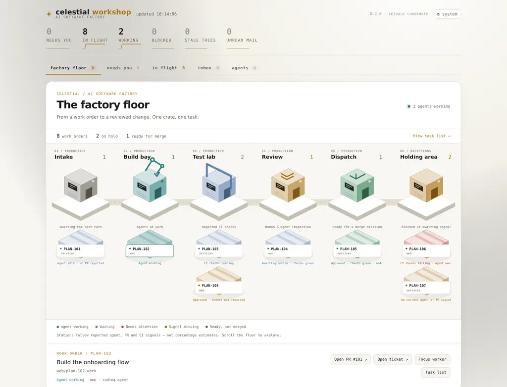
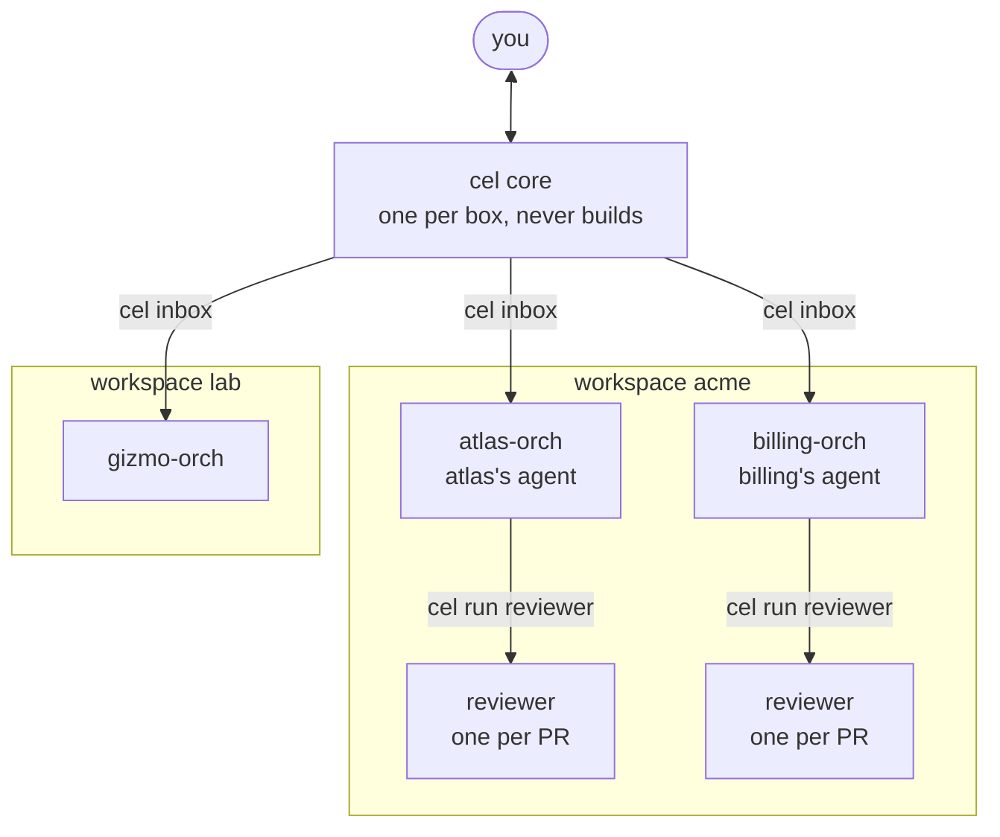
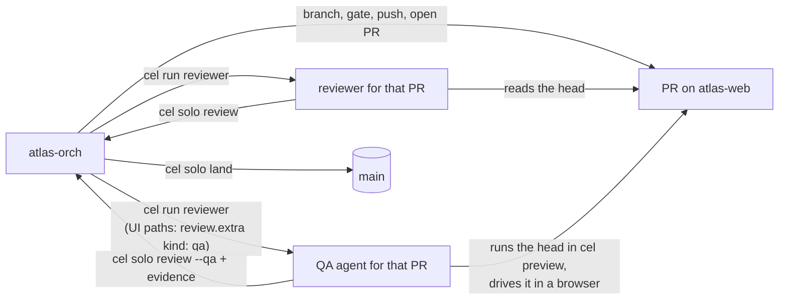
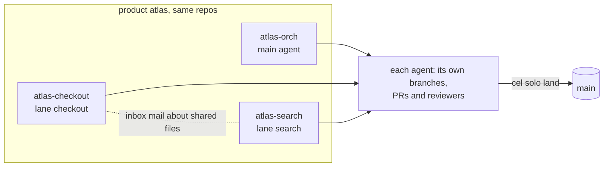
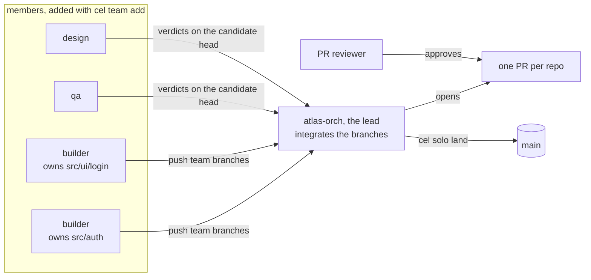
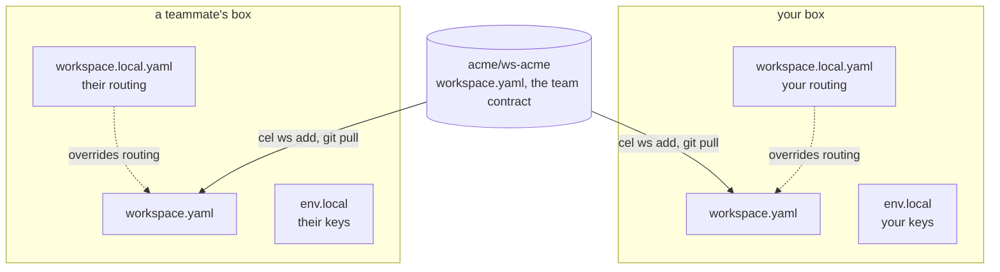
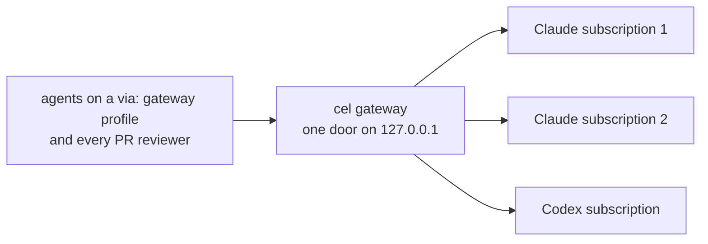

# Celestial — an AI software factory

**One coding agent per product: it builds, tests, opens PRs, gets each one reviewed and lands it — in a pane you can see and steer.**

One clone per dev box. Celestial organises work into *workspaces*, equips
coding agents (Claude Code, oh-my-pi, pi, codex, OpenCode and the Google
Antigravity CLI), and runs each product's agent in a visible
[herdr](https://herdr.dev) pane or Rex session.
The product agent plans, writes, tests and opens pull requests itself; every
PR gets its own reviewer agent, and the product agent lands it through one
checked path (`cel solo land`) under your workspace policy. You stay at the
controls: inspect the work, answer blockers and make the decisions that need a
human.

[](LICENSE)



*Illustrative work in the live dashboard. No agent execution is simulated.*

---

## Contents

- [Why](#why) · [Give this to your agent](#give-this-to-your-agent) · [Quick start](#quick-start)
- [Setups at a glance](#setups-at-a-glance) · [Configure your teams](#configure-your-teams)
- [How it works](#how-it-works): [core](#how-it-works), [solo lanes](#solo-lanes-several-big-goals-one-agent-each), [commands inside an agent](#commands-inside-an-agent), [solo mode](#solo-mode), [feature teams](#feature-teams)
- [Runtimes](#runtimes): install, launch, skills, resume, inbox wake and guard for each CLI
- [Sessions: Herdr and Rex](#sessions-herdr-and-rex): Rex restarts and upgrades, per-agent memory scopes, reviewer retirement
- [The review loop](#the-review-loop): extra reviewers, QA agents, what a reviewer may run
- [Agents talk without hijacking your keyboard](#agents-talk-without-hijacking-your-keyboard) (the inbox)
- [Watch and steer](#watch-and-steer): fleet, dashboard, gc, box space, Docker retention
- [What runs in the background](#what-runs-in-the-background): the steward, servers, hooks, services
- [Profiles](#profiles-runtime-model-and-effort-per-role) · [Subscriptions](#subscriptions) · [Gateway](#gateway--several-subscriptions-behind-one-door)
- [Tickets](#tickets) · [Commands](#commands) · [What lives where](#what-lives-where) ([what `cel gc` keeps](#what-cel-gc-keeps))
- [Requirements](#requirements) ([vendored skills](#vendored-skills)) · [Releasing a product](#releasing-a-product) · [Versioning & updates](#versioning--updates)

## Why

Running one coding agent is easy. Running one per product across several
workspaces — each opening PRs, each PR reviewed, services on ports, tickets
moving — needs a production system. Celestial supplies the coordination,
visibility and housekeeping around the agents:

- **Every agent runs in a visible pane.** No invisible background agents;
  if it isn't in a pane, it didn't happen.
- **Policy is injected, not hoped for.** Each workspace declares merge rules,
  ticket schemes, runtimes and reviewers once; every agent launched there gets
  them in its system prompt.
- **Every PR is reviewed and landed the same way.** A per-PR reviewer records
  a verdict bound to the exact head; `cel solo land` merges only that head,
  green, under the workspace's merge policy.
- **The box cleans up after itself.** A steward tick collects merged
  worktrees, nudges stalled reviews, and names anything waiting on a human.

## Give this to your agent

You already have a coding agent — Claude Code, oh-my-pi, pi, codex, OpenCode,
the Antigravity CLI.
Paste this into it and let it do the install:

```
Install Celestial on this machine and get it running:
1. git clone https://github.com/geoffwellman/celestial.git ~/celestial
2. Add  eval "$(~/celestial/bin/cel shellenv)"  to my shell rc and load it.
3. Run cel setup, then cel doctor. Fix everything red; ask me for anything
   that needs my account (gh auth login, claude setup-token, pi /login).
4. Ask me: a workspace name, my GitHub org, and the repos I want in it.
   Run cel ws new <name> --org <org>, add the repos to workspace.yaml, run
   cel ws sync <name>, then cel doctor again.
5. Start the box coordinator with cel core, then run cel fleet and
   cel dash --ensure. Show me both outputs and the dashboard URL, and tell
   me the one command I use from now on.
```

Setup installs third-party code and may invoke `sudo`; read the block before
you paste it, and read [requirements](#requirements) first. If you would
rather type it yourself, the same install is below.

## Quick start

```sh
git clone https://github.com/geoffwellman/celestial.git ~/celestial
eval "$(~/celestial/bin/cel shellenv)"  # add this line to your shell rc
cel setup                               # review the manifests before installing
cel doctor                              # verify prerequisites and account setup

cel ws new acme --org your-gh-user      # scaffold a workspace
cel ws sync acme                        # clone its repos, link skills, check tools
cel core                                # the box coordinator: routes every product
cd ~/ws/acme && cel run solo --product <p>   # or let `cel ws up` start each product's agent
```

`cel core` is the agent a person keeps open — one per box, across every
workspace. It reads root's mail, holds cross-product priorities, starts and
restarts product agents, and never builds. Each product's agent is where the
work happens.

Requires GNU/Linux; automatic prerequisite installation targets apt-based
distributions. Fresh binary installs support x86-64 and arm64. See
[requirements](#requirements) before running setup. Setup installs third-party
code and may invoke `sudo`; it does not supply provider subscriptions or log
you into GitHub, Linear or agent accounts.

### The shape a workspace declares

`workspace.yaml` may say what should be running in a workspace, and `cel ws up`
puts it back:

```yaml
layout:
  orchestrators: auto        # auto: one agent per product that wants one | manual | none
  panes:                     # optional extra panes, opened at `up`, in order
    - label: dash
      cwd: .
      cmd: cel dash --ensure # optional; an empty pane when absent
    - label: notes
      cwd: .
```

`products[].orchestrator` (`auto`/`manual`) decides per product underneath the
workspace-wide switch. The agent started is the product's solo agent. A
workspace with **no** `layout:` block behaves as `orchestrators: manual` with
no extra panes.

`up` is a reconcile, not a launcher: when herdr loses a live agent's name (it
clears it on restart), every surface that resolves a product agent by its
alias would report the product as dead — and the answer to a dead agent is to
start another one on top of the running one. So a live agent in a product's
own directory is that product's agent whatever herdr calls it: `cel fleet`
shows `orch unnamed` rather than `-`, `cel doctor` says which directory it is
in, `cel ws up` renames it, and `cel run orchestrator` refuses to start a
second one over it without `--force`.

## Setups at a glance

"Team" means two different things in Celestial. A **feature team** is a group
of short-lived agents that one product's agent leads for one feature
(`cel team`). A **team workspace** is one workspace shared by several people,
each on their own box. [Configure your teams](#configure-your-teams) sets up
both.

### One box: core, product agents, reviewers



Every setup is built on this one. You talk to `cel core`, one per box, which
reads `root`'s mail in every workspace and directs each product's agent; each
product's agent builds and lands its own PRs and starts one reviewer per PR.
Selected by: `cel core` once per box; one `products:` entry per product (a repo
that is in no product is its own product); `layout: { orchestrators: auto }`
so `cel ws up <workspace>` starts every product's agent; and a `review:` block
so there are reviewers at all.

### One product, solo (the default)



Choose this for almost everything: one agent holds the whole product, uses its
own worktrees and subagents, and lands each PR once its reviewer approved that
exact head and the checks are green - and, for a PR touching the paths
`review.extra` names, once each QA agent (or focus reviewer) has too. Selected
by `mode: solo` on the product, which is also the default when absent, and
`policy: { merge: self }` (with `merge: humans-only` the agent opens the PR
and stops). Details: [Solo mode](#solo-mode).

### Solo lanes: several goals on one product



Choose lanes when one product has two or three large goals that each want one
agent holding the whole picture, in different parts of the code. Nothing in
`workspace.yaml` starts a lane: start one with
`cel run solo --product atlas --lane checkout`. A repo one lane owns outright
can say so (`repos[].lane`), so its PR mail goes to that lane. Details:
[Solo lanes](#solo-lanes-several-big-goals-one-agent-each).

### A feature team, led by the product's agent



Choose a team when a feature has two or more parts that can be built at the
same time, or needs a specialist (device QA, design, data, a release check).
The product's agent stays the only integrator: builders push
`team/<feature>/<member>` branches and never open PRs, qa and design judge the
lead's candidate head, and the lead opens one PR per repo, gets it reviewed
and lands it with `cel solo land`. Selected by: `role_profiles` lines
`team-<role>` and `member` for the members' models, and the box's `budget:`
for how many may run. The product's agent runs the `cel team` commands.
Details: [Feature teams](#feature-teams).

### A team workspace, shared by several people



Choose this when several people, or one person on several boxes, work on the
same products. Everyone shares `workspace.yaml` through git: repos, products,
policy, review, the default routing, and `people:` - who is on the team.
Each person keeps a gitignored `workspace.local.yaml` that changes only
routing (which profile each role runs on), per-box `env:` and `me:` (which
person this login is), and an `env.local` with their own keys. A product's
`home:` names the one login that runs its agents, so two teammates' boxes
never both build it. Details: [Team workspaces](#team-workspaces) and
[Per-box routing](#per-box-routing).

### How agents reach models: the gateway



A profile with `via: gateway` reaches its model through `cel gateway`, which
holds several subscriptions and keeps each agent on one account. Reviewers
always go through it. Details:
[Gateway](#gateway--several-subscriptions-behind-one-door).

## Configure your teams

| | Feature team | Team workspace |
|---|---|---|
| What it is | members one product's agent leads for one feature | one workspace shared by several people |
| Configured in | `workspace.yaml` (`role_profiles`, `worker_profiles`) and the box config (`budget:`) | `workspace.yaml` (committed), plus `workspace.local.yaml` and `env.local` per person |
| Started by | the product's agent: `cel team start` | you: `cel ws new`, then `cel ws add` on each box |

### 1. Declare products, models and review

A complete `workspace.yaml` for one workspace with two products:

```yaml
# ~/ws/acme/workspace.yaml - committed: everyone who clones the workspace reads it
name: acme
kind: team                     # a label; cel ws new asks, and defaults to personal
org: acme                      # GitHub owner; cel ws push creates acme/ws-acme
tickets: { system: none, adhoc: "AH-<yymmdd>" }
policy:
  merge: self                  # product agents land their own approved, green PRs
  pr: required
  pr_open: ready               # open PRs ready for review, not as drafts
runtime: { root: claude, orchestrator: claude }   # the CLI when no profile applies
env: {}                        # plain settings only; keys go in env.local
repos:
  - name: atlas-web
    url: git@github.com:acme/atlas-web.git
    prefix: ATL                # branch prefix
    gate: npm test             # the check an agent runs before it pushes
  - name: atlas-api
    url: git@github.com:acme/atlas-api.git
    prefix: API
    gate: go test ./...
    review:
      extra:                   # this repo's own specialist reviewers, beside the ones below
        - focus: db-migration
          paths: ['migrations/**']
  - name: billing              # in no product, so it is its own product
    url: git@github.com:acme/billing.git
    prefix: BIL
    gate: npm test
    home: jo                   # a repo in no product names its home here
products:
  - name: atlas                # one agent, atlas-orch, owns both repos
    repos: [atlas-web, atlas-api]
    mode: solo                 # the default
    home: sam                  # only sam's login starts atlas's agents (team workspaces)
people:                        # who is on the team; ids are what home: names
  - id: sam
    login: sam-example         # their own forge login (GitHub or Forgejo)
    roles: [owner, approver]   # workspace-wide
  - id: jo
    login: jo-example
    products: { atlas: [product-lead], billing: [qa] }   # per product
layout:
  orchestrators: auto          # cel ws up acme starts one agent per product
review:                        # one reviewer per PR, through the gateway
  runtime: pi
  model: sonnet
  extra:                       # specialist reviewers by the files a PR touches (policy)
    - focus: security          # a pack in core/roles/focus/reviewer/
      paths: ['lib/auth/**', '**/*token*']
    - kind: qa                 # a QA agent: runs the head in a preview and uses it
      focus: browser           # a pack in core/roles/focus/qa/
      paths: ['web/**', '**/*.tsx', '**/*.css']

thinking: medium               # reasoning level when a profile names none
worker_profiles:               # a name for each CLI + model + effort you use
  opus: { runtime: pi, model: claude-opus-5-5, via: gateway, thinking: medium }
  sol:  { runtime: pi, model: gpt-6.1-sol, via: gateway, thinking: low }
role_profiles:                 # which profile each role launches on
  solo: opus                   # the product agents and their lanes
  qa: sol                      # QA agents (else the reviewer binding, else review.model)
  member: sol                  # any team member without its own line below
  team-builder: opus           # team-<role>: product, design, builder, qa,
  team-qa: sol                 #   platform, release or analyst
```

A team member's model comes from `role_profiles.team-<role>`, else
`role_profiles.member`, else `runtime.orchestrator` with that CLI's default
model. A product entry may narrow any binding for itself
(`products[].role_profiles: { team-builder: sol }`). The lookup tries
`team-<role>` on the product (or repo) and then the workspace before it tries
`member` anywhere, so a product-level `member` loses to a workspace-level
`team-<role>`: narrow a role for one product with `team-<role>` there. The model ids above are
examples: use what `cel gateway status` and your providers offer. More on
profiles: [Profiles](#profiles-runtime-model-and-effort-per-role).

`people:` and `home:` matter once several people share the workspace (step
3). Each person's `login` is their own forge account. Roles come from a fixed
list: `owner`, `product-lead`, `qa`, `design`, `release` and `approver`,
held workspace-wide (`roles:`) or per product (`products:`). `home:` names the
person whose login runs a product's agents: on any other login, `cel ws up`
and the steward skip that product, and `cel run solo` refuses it unless you
pass `--force`. A personal workspace leaves `people:` and `home:` out, and
nothing changes.

`review.extra` is review policy: every PR gets its plain reviewer, and a PR
that touches a file one of the `paths` globs matches also needs that entry's
agent - a focus reviewer (`kind: review`, the default) or a QA agent
(`kind: qa`), which builds the PR's head in a preview of its own and drives it
in a browser. A repo's own list adds to the workspace-wide one, so an
`atlas-api` PR answers to both. `cel run reviewer` starts them and
`cel solo land` waits for each one's approval of the head; see
[The review loop](#the-review-loop). It is read from `workspace.yaml` only -
`workspace.local.yaml` cannot add or drop one. A QA agent's model is
`role_profiles.qa`, else `role_profiles.reviewer`, else `review.model`; like
every reviewer it runs on pi.

How many helpers may run at once is a box setting, not a workspace one. It
lives in `~/.local/share/cel/config.yaml` and covers every workspace on the
box:

```yaml
budget:
  max_live_agents: 8           # helpers: reviewers, team members and other launched agents
  max_team_members: 4          # of those, team members
```

Both values above are the defaults. Product agents and core are never
counted. `cel budget` shows what is live against both limits.

Then, from the workspace:

```sh
cel ws sync acme               # clone the repos, render the policy into each one
cel doctor                     # check the box and the workspace
cel profiles                   # each profile's exact launch line
cel ws up acme                 # sam's login starts atlas-orch, jo's billing-orch
```

### 2. Run a feature team, start to close

You don't run these yourself: `cel team` refuses a shell with no agent role,
except `cel team status`. Ask the product's agent, for example
`cel inbox send atlas-orch "build login as a team"`, and it runs:

```sh
cel team start login --product atlas --repo atlas-web --brief-file brief.md
# push the integration branch, then post its head as the candidate
cel team event login candidate.updated --data '{"repo":"atlas-web","head":"<40-char sha>","branch":"ATL-login"}'
cel team add login builder --repo atlas-web --owns 'src/auth/**' --focus backend --task-file auth.md
cel team add login builder --repo atlas-web --owns 'src/ui/login/**' --focus frontend --task-file ui.md
cel team add login qa --repo atlas-web --focus browser --task-file qa.md
cel team add login design --focus ux --task-file design.md
cel team status login          # roster, candidate heads, verdict freshness, who owes next
# builders push team/login/<member> and report task.ready; the lead merges them,
# runs the gate, pushes and posts candidate.updated again; qa and design judge
# that head with: cel team verdict login --repo atlas-web --head <sha> pass --evidence report.md
cel team cap login "<cap> (decision <id>)"   # only if members may spend; zero otherwise
cel run reviewer --repo atlas-web --pr <n>   # one PR per repo, its own reviewer
cel solo land atlas-web#<n>
cel team close login           # retires every member; refuses over unpushed builder work
```

Members are admitted against the box budget, and `cel team add` is refused
rather than queued when it is full. Roles, focus packs, events and verdicts:
[Feature teams](#feature-teams).

### 3. Share a workspace with your team

One person creates the workspace and publishes it:

```sh
cel ws new acme --kind team --org acme --merge self
# edit ~/ws/acme/workspace.yaml as in step 1 - add everyone to people: and give
# each product a home: - then commit it
cel ws push acme               # creates the private repo acme/ws-acme and pushes
```

Each teammate, on their own box:

```sh
cel ws add git@github.com:acme/ws-acme.git   # clones to ~/ws/acme, registers and syncs it
cd ~/ws/acme
cp workspace.local.example.yaml workspace.local.yaml   # then edit it, below
# put your own keys in env.local
cel doctor                     # checks me: against your own forge login
cel people                     # who is who, and which person this login is
cel profiles                   # bindings and profiles from your file are marked (local)
```

```yaml
# ~/ws/acme/workspace.local.yaml - gitignored, this box only
me: jo                         # your id in people: - which products start here
worker_profiles:
  mine: { runtime: claude, model: claude-sonnet-5, thinking: medium }  # adds, or replaces one by name
role_profiles:
  solo: mine
  team-builder: mine
products:
  - name: atlas                # by name; role_profiles and orchestrator: manual are read here
    role_profiles: { team-qa: mine }
env:
  TMPDIR: /tmp/you             # per-box settings; keys still go in env.local
```

The local file may change only `role_profiles`, `worker_profiles`, `env:` and
the `role_profiles` of a `products[]` or `repos[]` entry, set `me:`, and turn
a product's agent off on this box (`products[].orchestrator: manual`).
Policy, repos, people, homes, review, gates and the box budget stay in the
shared files. To change the contract, edit `workspace.yaml`, commit and push;
teammates `git pull` and run `cel ws sync acme`.

`cel people` on jo's login, for the workspace in step 1:

```text
acme: 2 people; this login is jo

    sam              sam-example              owner, approver
  * jo               jo-example               atlas: product-lead; billing: qa

who runs each product's agents (products[].home):
  atlas            runs on sam's login - not started here
  billing          this login (jo)
```

On jo's login, `cel ws up acme` and the steward start billing-orch and leave
atlas alone, without a warning. `cel run solo --product atlas` refuses:

```text
cel run: atlas runs on sam's login (products[].home: sam); this login is jo - ask sam, or pass --force
```

A login with no `me:` starts no product that has a `home:`. Details:
[Team workspaces](#team-workspaces) and [Per-box routing](#per-box-routing).

## How it works

Three layers on disk, and a factory floor of agents above them.

```
~/celestial                the plane: mechanism only (this repo, public)
├── bin/cel                one CLI for everything
├── core/roles/            role prompts, injected at launch
├── core/skills/           skills linked into every agent
├── core/workspace-skills/ vendored skills linked only for the workspaces they name
├── vendored-skills.yaml   pins for the third-party skills in both
└── agents.yaml            which agents, how to install, how to inject

~/ws/<name>                a workspace: private content + overrides (own repo)
├── workspace.yaml         repos, policy, tickets, runtimes, env, services
├── layouts.yml            herdr layouts (wins over the plane's)
├── externals.yaml         extra tools (additive overlay)
├── skills/                workspace-scoped skills
└── repos/<repo>/          the actual product clones (gitignored here)

~/.local/share/cel         box state: registry, published pages (never in git)
```

The agents above them, and how they reach each other, are drawn in
[Setups at a glance](#setups-at-a-glance).

A **workspace** is not a tier. It is the scope that holds configuration and
grouping: policy, ticket tracker, environment, profiles, dashboard. A
**product** is the unit one agent owns — one repo, or several that ship
together. Its agent's pane and mailbox are `<product>-orch`. `root` is the
mailbox name for "the top, whoever is listening", which is `cel core`.
`cel run root` still starts a standing director inside one workspace, but it
is not the path this README assumes: it refuses while core is live (unless
`--force`), and `cel core` refuses while any workspace's `*-root` agent is
live. The product orchestrator and the solo agent are one role
(`core/roles/solo.md`; `project-orchestrator.md` points at it): it builds
small work itself and leads a [feature team](#feature-teams) when a feature
needs one.

`cel core` (also `cel console`, `cel run core` and `cel run console`) starts
the box's coordinator: one agent, standing in no workspace, that reads
`root`'s mail in every workspace, holds cross-product priorities and
blockers, reads state and code read-only, directs product agents by inbox,
starts and restarts them, and shows or sets a product's mode with `cel mode`.
It runs the role in `core/roles/core.md` with no workspace policy block, in
`~/.local/share/cel/core` (`CEL_CORE_DIR`), as `CEL_ROLE=core`; its alias is
`core` and mail sent to `core` lands in `root`. Its runtime, model and effort
come from `agents.yaml` `defaults.core` - out of the box omp,
`anthropic/claude-opus-5-5`, `medium`, through the gateway (`via: gateway`
is supported for core on omp only). `--model` and `--thinking` override
them; `--profile` is refused, since profiles are bound per workspace. It
resumes its last session and refuses a second copy; `cel core --restart`
relaunches it, `--fresh` starts a new conversation.

Core does not build or land PRs. The guard treats it as a read-only
coordinator (no repository or forge writes) and also refuses
`cel solo land|review`, `cel spike`, `cel forge pr close|ready`,
`cel forge run rerun`, `cel run reviewer|root`, `herdr agent start`,
`herdr worktree create|open|remove` and `cel learn|release|promote|update|setup`,
naming the product agent's route instead. Its one configuration write is
`cel mode`.

### A workspace with its own GitHub account

`gh` keeps several accounts per host but only one is *active*, box-wide, so
`gh auth switch` for one workspace would re-identify every other workspace.
A workspace whose repos belong to a second account says so in
`workspace.yaml`:

```yaml
github:
  user: acct-b              # the gh account this workspace acts as
  ssh_host: github-acct-b   # optional: an ~/.ssh/config Host alias with acct-b's key
```

Every pane `cel run` starts for that workspace
gets `GH_TOKEN="$(gh auth token --user acct-b)"`, evaluated in the pane (the
value never passes through cel), and every `gh` call the plane makes for the
workspace (steward sweeps, `cel solo land`, reviewer PR lookup, `cel ws push`,
`cel gc`, `cel release`) runs with that account's token for that call only.
Nothing ever runs `gh auth switch`. If the account is not logged in, launches
and calls for that workspace refuse rather than fall back to the active
account. With `ssh_host`, `cel ws sync` clones over `git@github-acct-b:owner/repo.git`;
the `url:` in `workspace.yaml` keeps the canonical `git@github.com:` form.
Without a `github:` block nothing changes.

Two human steps, once per box:

1. `gh auth login` as acct-b (it is added beside the existing account; check with `gh auth status`).
2. An SSH key for acct-b, added to acct-b on GitHub, and an alias in `~/.ssh/config`:

   ```
   Host github-acct-b
     HostName github.com
     User git
     IdentityFile ~/.ssh/id_ed25519_acct_b
     IdentitiesOnly yes
   ```

`cel doctor` checks both for every workspace that declares `github.user`.


### Solo lanes: several big goals, one agent each

A product's agent holds one picture of the work. When a product has two or
three large feature sets that each want one agent holding the whole picture,
run them as lanes:

```
cel run solo --product celestial --lane ui      # pane and mailbox celestial-ui
cel run solo --product celestial --lane api     # pane and mailbox celestial-api
```

Each lane is a full solo agent - its own pane, mailbox, directory
(`.cel/solo/<product>/lane-<name>`) and resumable session - working in the
product's repos through its own branches and worktrees, opening and landing
its own PRs (`cel solo land`, same review and CI checks). Reviewers it starts
report back to it. The product's main agent (`<product>-orch`) keeps running
beside them. Lanes are told about each other and coordinate overlapping files
by inbox; nothing stops two lanes editing the same file, so give them goals
that touch different parts of the code. `cel fleet` lists a product's live
lanes; `/cel-restart` in a lane restarts that lane only.

**A repo one lane owns.** When a lane is the only agent that works in one of
the product's repos, say so in the committed `workspace.yaml`, with the name
`--lane` takes:

```yaml
repos:
  - name: atlas-checkout-ui # one of atlas's repos
    lane: checkout          # its PRs are atlas-checkout's, not atlas-orch's
```

Then everything about that repo's PRs goes to the lane's mailbox
(`<product>-<lane>`), not the product's main agent: every steward nudge
(approved and green - land it; a recorded `changes` verdict; changes requested
on the forge; failing checks; no ticket in the branch name) and the findings
of every reviewer of its PRs, whoever started that reviewer. One function
answers "who owns this repo's PRs" for all of them (`ws_repo_pr_owner`), and
the rendered policy names the lane on the repo's line and in its review line.
While the lane is not running (its name in its own
`.cel/solo/<product>/lane-<lane>`), the steward sends its nudges to
`<product>-orch` instead, and the first one for each PR head says so: which
lane, that it is not running, and how to start it. A reviewer started while
the lane is down still sends its findings to the lane, whose mailbox keeps
them, and copies its verdict line to `<product>-orch` saying the lane is down.
`workspace.local.yaml` cannot set or move it - it is the team's contract.
`cel doctor` warns about a value no lane can have, and about a lane this box
has never started (no `.cel/solo/<product>/lane-<lane>`).

A lane remembers explicitly named `--profile` and `--model` choices only after
a successful launch; a bare `--restart` keeps those saved choices. An
explicit new profile clears the old model override unless you also name a new
model. Workspace/profile defaults remain dynamic; dry runs, invalid choices
and failed launches do not replace saved choices. These overrides belong to
that lane, never the shared workspace profile.

To persist a model already used by a **managed Rex lane** without restarting
or changing its native session, name its exact current runtime PID and launch
model (not a requested in-session model change):

```sh
cel run solo --product <product> --lane <lane> --model <exact-model> --remember-current-model <pid> --dry-run
cel run solo --product <product> --lane <lane> --model <exact-model> --remember-current-model <pid>
```

This bounded command verifies the lane's live Rex receipt, PID start time,
runtime and actual `/proc` model argument before writing only its `launch-model`
override. It does not start/stop an agent, edit global profiles or alter native
session identity. It cannot be combined with restart, fresh, profile, thinking
or backend changes. Model syntax validation is offline; it is not a provider
availability check.

### Commands inside an agent

Core and solo agents all take the same small set of commands,
typed in the agent's own pane instead of remembering CLI flags. Each runs
`cel here <verb>` - a thin wrapper over one `cel` command - scoped to the
pane's own product unless one is named (core names one: `<product>` or
`<workspace>/<product>`). The output is posted into the conversation without
starting a turn, so the agent sees what its owner ran.

| In the agent | Runs | Does |
| --- | --- | --- |
| `/cel-mode [product] [solo]` | `cel mode` | show the product's mode, or set it to solo (restart at end of turn) |
| `/cel-status [product]` | `cel fleet --workspace <w>` (core: `cel fleet`) | agent, lanes, mail |
| `/cel-inbox` | `cel inbox read --for <me> --all-workspaces` | unread mail now (core: root's) |
| `/cel-decide` | `cel decide list` (others: `--workspace <w> --asker <me>`) | open owner questions |
| `/cel-review [repo#]<pr>` | `cel run reviewer` | start a reviewer pane (not core) |
| `/cel-land [repo#]<pr>` | `cel solo land` | merge through the checked path (not core) |
| `/cel-restart` | the `cel mode` restart waiter | restart this agent on its own session once its turn ends |
| `/cel-focus <product>` | `herdr agent focus <product>-orch` | core only |

omp and pi register them through the inbox extension
(`tools/hooks/inbox.omp.ts`, for core, root and product agents); Claude Code
gets `~/.claude/commands/cel-*.md` links from `cel setup`/`cel update`. The
`cel-` prefix is deliberate: omp has built-in `/review` and `/restart`, Claude
Code built-in `/status` and `/review`. codex, OpenCode and agy panes have no
`/cel-*` commands; run `cel here <verb>` in a shell instead. Core cannot
`review` or `land`; a lane's `restart` restarts that lane, never the main
agent; root's is refused (use `cel run root --restart`).

`cel run <role>` starts any station with its role injected and permissions
pre-approved; with no role it is Direct mode (`<repo>-direct` in the repo).
`policy.pr_open: draft | ready` decides whether a PR opens as a draft (the
default; on Forgejo a `WIP:` title) or ready for review; its reviewer is
started separately with `cel run reviewer`. `cel solo land` refuses a draft,
so a workspace whose agents land their own PRs sets `pr_open: ready` beside
`merge: self`. `cel ws new` writes neither: it asks for the merge policy
(default `humans-only`) and writes `policy: { merge: <answer>, pr: required }`.
`pr: none` on a repo entry (or as the workspace-level `policy.pr`) skips the
PR for that repo: the agent rebases onto origin's default branch and pushes,
fast-forward only.

### Solo mode

Every product is built by **one agent** that plans, writes, tests and ships it
itself, using everything its own runtime offers — its own git worktrees, its
harness's subagents in parallel, several branches and PRs at once:

```yaml
products:
  - name: atlas
    repos: [atlas-app]
    mode: solo          # the default when absent
```

`cel mode [<product>]` shows the mode; `cel mode <product> solo` sets it,
editing that one line of `workspace.yaml` in place (comments and layout
untouched) and restarting the product's live agent **on the same session**
once its current turn ends — so an agent can set its own mode.
`--no-restart` leaves the live agent alone until its next launch. Fan-out was
retired: a legacy `mode: fleet` is refused at launch (`cel run orchestrator`
names `cel mode <p> solo`), and `cel mode <p> fleet` is refused and writes
nothing. `cel run solo` starts the solo agent directly.

The solo agent is still *the product's agent*: same directory, pane name and
mailbox (`<product>-orch`) as an orchestrator, so mail, decisions, the
steward and the dashboard reach it unchanged. `cel run solo` and `cel run
orchestrator` start the same agent: role file `core/roles/solo.md`, launched
with `CEL_ROLE=solo`, `CEL_PRODUCT=<product>` and, for a lane,
`CEL_LANE=<lane>`. The guard lets it write code, commit, push, open PRs and
start a reviewer for its own PR, and refuses starting any other Celestial
agent or pane (`cel run reviewer` excepted), recording a verdict on its own
PR, `cel decide answer|drop`, merging by any route but `cel solo land`, and
changing its forge except through `cel forge`. Its model is
`role_profiles.solo` (narrowed per product or repo), else
`role_profiles.orchestrator`, else `runtime.orchestrator` (default `claude`).

Its PRs follow the workspace's PR and review policy, keyed by the PR itself:

- the reviewer records `cel solo review <repo>#<n> approved|changes --head
  <full 40-character sha> --by <alias>` (an approval must equal the PR's current head; verdicts
  live in `<ws>/.cel/solo-reviews.json`, an extra reviewer's under
  `<repo>#<n>/review-<focus>`) and sends findings to
  `<product>-orch` (the lane that started it, or the lane the repo declares
  with [`repos[].lane`](#solo-lanes-several-big-goals-one-agent-each)). The solo agent itself can never record a verdict on its
  own PR, and only it (or a person) lands one - not a reviewer;
- `cel solo land <repo>#<n>` (`lib/solo.sh`; the CI rule in `lib/land.sh`)
  merges once it finds: `merge: self`; an open non-draft PR the workspace's
  account opened (or an author the repo lists in `pr_authors`, below); for the
  plain reviewer, the forge's review decision `approved` or a recorded
  `approved` verdict at the current head, plus each
  [extra reviewer's](#extra-reviewers-a-focus-by-hand-or-by-policy) or QA
  agent's own approval of that head; no red check and none still running; no
  conflict; and every check the base branch requires - through classic branch
  protection or a repository/organisation ruleset - green on that head. It
  merges only that head (`--match-head-commit`), and CI on the head is the
  evidence the squash body cites. Only when neither protection nor any ruleset
  requires a check does the repo gate run locally instead, in the solo
  agent's own clean worktree at exactly that head (none is a refusal), after
  proving the forge's `refs/pull/<n>/head` is that commit; requirements that
  cannot be read refuse the land. With [AFK](#commands) on, AFK must admit
  the land first. After the merge it retires the PR's reviewers and QA agents.
- the land says who landed it. The forge shows every land as merged by the
  workspace's account (on Forgejo, and on GitHub when that account is the
  owner's), so `cel solo land` names the agent itself: the squash message ends
  in git trailers -

  ```
  Reviewed-by: widget-pr-7-review (approved)
  Landed-by: widget-orch (cel solo land)
  Gate: CI (suite) on <head>
  ```

  (`Reviewed-by:` for the recorded verdict's reviewer, each approving forge
  account and each required extra reviewer; the review note, if any, in a
  paragraph above them), and just before the merge it comments on the PR:
  `Landing as widget-orch via cel solo land (attempting): approved by
  widget-pr-7-review at <head>, checks green.` If the forge refuses the merge,
  a second comment says `Not landed: ...` with the forge's reason, paths and
  token-shaped text taken out (and left off entirely if the comment would fail
  the squash body's hygiene scan). The lander
  is the alias the agent's launch gave it, named only for a role that lands
  (solo, orchestrator); a shell with no role is the account, `by hand`, and any
  other role is `an unnamed agent`. Every name is one token: one carrying a
  control character refuses the land before anything is posted, so a newline
  cannot forge a trailer. A refused comment is reported and does not stop the
  merge - the trailers carry the record. The body is checked against the
  history scan's ticket rule before anything is posted. Separate forge
  accounts per agent would put the name in "merged by" itself; that is the
  owner's call, not something `cel solo land` changes.
- a PR a bot (or any other forge account) opened for the product lands too
  when the repo lists that login in the committed `workspace.yaml`:

  ```yaml
  repos:
    - name: example
      pr_authors: [example-bot]
  ```

  Its reviewer can then record verdicts on it, the steward nudges about it
  like the account's own, and `cel solo land` lands it with every check above
  unchanged, adding `PR-author: example-bot (allowed by repos[].pr_authors)`
  above `Landed-by:`. An author nobody listed is refused as before, and the
  refusal names the line to add. The list is the team's contract:
  `workspace.local.yaml` cannot add to it (`cel doctor` names a local
  `pr_authors` as ignored), and `cel doctor` fails an entry that is not a
  login-shaped string.

  List the author exactly as the forge reports it; nothing is normalised, so
  a person whose login happens to be a bot's name never passes as the bot:

  | forge | PR opened by | it reports (`cel forge pr view <repo>#<n> --json`, `.author`) | put in `pr_authors` |
  |---|---|---|---|
  | GitHub | a GitHub App (Dependabot, Renovate, your own App) | `app/<name>`, e.g. `app/renovate` | `app/renovate` |
  | GitHub | a machine user (an ordinary account a bot logs in as) | its plain login | `example-bot` |
  | Forgejo | any account, bot or not | its plain login | `example-bot` |

  GitHub's REST API spells an App `<name>[bot]`; cel reads authors through
  `gh`, which never does, so that spelling is not accepted.

The rest of the box sees a solo product for what it is: `cel fleet` draws it as
`solo <agent state>  worktrees N` (JSON: `mode`, `solo_worktrees`), the
dashboard tags its agent row, the steward tells the agent - once per head - when
a PR of its is approved and green but unmerged, and `cel gc` removes its
worktrees under `<ws>/.cel/solo/<product>/` once their PR has merged or closed
and nothing in them is unsaved (a worktree with no PR yet is kept).

### Feature teams

Small work stays with the product's agent. A feature with two or more parts
that can be built at the same time, or one that needs a specialist (device
QA, design, data, a release check), gets a **team** that the product's agent
leads. The lead stays the only integrator: one integration branch and PR per
repo, reviewed by `cel run reviewer` and landed with `cel solo land` as above.
Members are short-lived scoped agents, admitted against the box-wide helper
budget that every product's reviewers and team members share - by default 8
helpers and 4 team members in all (`budget.max_live_agents`,
`budget.max_team_members`; `cel run reviewer` can be refused too). Product
agents (`<product>-orch`, solo lanes) and core are shown by `cel budget` but
never counted: a box running ten products still has all 8 helpers for their
reviewers. Only the product's orchestrator (`<product>-orch`, `CEL_ROLE` solo
or orchestrator and its product proven by `CEL_PRODUCT` or its mailbox)
starts and leads a team. A process with no agent identity is refused; the
owner asks the product's agent by `cel inbox` or answers its `cel decide`.

```
cel team start login --product shop --brief-file brief.md      # lead only
cel team event login candidate.updated --data '{"repo":"web","head":"<sha>","branch":"CEL-login"}'
cel team add login builder --repo web --owns 'src/auth/**' --focus backend --task-file t1.md
cel team add login qa --repo web --focus browser --task-file t2.md
cel team status login            # roster, liveness, candidate heads, verdict freshness, who owes next
cel team close login             # retires everyone; refuses over unpushed builder work
```

Everything a team is lives in `<ws>/.cel/teams/<feature>/` (feature ids are
`[a-z0-9][a-z0-9-]{1,40}`): `team.json` (the roster), `brief.md`,
`acceptance.yaml`, `contracts/`, `events.jsonl` (append-only),
`verdicts.json`, and a scope packet per member, `members/<alias>.md`. Every
write holds the folder's lock and JSON is replaced whole.

- **Roles** — `product`, `design`, `builder`, `qa`, `platform`, `release`,
  `analyst` (`core/roles/team-<role>.md`), each narrowed by an optional focus
  pack (`core/roles/focus/<role>/<focus>.md`, a short checklist). Only a
  builder writes code, on `team/<feature>/<member>` in its own worktree,
  inside the paths it `--owns`; it pushes that branch and never opens a PR.
  Two builders' `--owns` globs may not overlap in one repo; where overlap
  cannot be decided exactly it counts as overlapping and the refusal says why.
- **Adding a member** admits it against the box-wide agent budget first (a
  refusal is printed and nothing is written), then reserves its row, writes
  its scope packet and a one-time launch token, and launches it with `cel run
  member`. It is `reserved` until the launcher confirmed the exact agent AND
  the member ran `cel team ack`; a launch that never confirms stays reserved
  and is not relaunched.
- **Models** — a member launches on `role_profiles.team-<role>`, else
  `role_profiles.member`, else the workspace's `runtime.orchestrator` with
  that CLI's default model; a `products[]` entry may narrow either binding
  for its own product, and `cel team add ... --model m` sets the model for
  one member. Example: [Configure your teams](#1-declare-products-models-and-review).
- **Reporting** — members append `task.ready` (head + gate result) and
  `preview.ready` (platform or qa) events with `cel team event ... --to
  <alias>` (which also mails), and judge the lead's candidate head with `cel
  team verdict <f> --repo r --head <sha> pass|changes|blocked|advisory
  --evidence <file>`. A newer `candidate.updated` makes older verdicts show
  as stale.
- **Owner decisions** go through the lead's `cel decide ask`; only the lead
  records a `decision` event. Members spend nothing unless the
  lead sets the team's spend cap from one (`cel team cap <f> "<cap>"`, kept in
  `team.json`); nothing in `brief.md`, which members can write, widens a
  member's authority or spend.
- **Closing** — `cel team retire <f> <alias>` closes one member's pane; `cel
  team close <f>` retires everyone and refuses while a builder's work is not
  on origin, unless `--force-keep` (which keeps those worktrees).

## Runtimes

Celestial launches six coding-agent CLIs. `agents.yaml` describes each one -
install, pin, skills directory, role injection, launch flags, resume - and
`cel run` reads it; the runtime-specific glue lives in `lib/run.sh`,
`lib/opencode.sh` and `lib/agy.sh`. `cel agents` lists them with install
status and injection strategy.

| | Claude Code (`claude`) | oh-my-pi (`omp`) | pi (`pi`) | codex (`codex`) | OpenCode (`opencode`) | Antigravity CLI (`agy`) |
|---|---|---|---|---|---|---|
| **Install and pin** | native binary 2.1.300, SHA-256 per architecture, then `claude install <version>`; updater `claude update` | release binary 18.14.0, SHA-256 per architecture; updater `omp update` | npm global `@earendil-works/pi-coding-agent@1.4.0` (follows the active node, below); extensions pinned in `tools/pi/extensions.txt`; updater `pi update --self` | official `install.sh` for 0.154.0, checked against its SHA-256; updater `codex update` | release tarball 2.2.5 (x64 or arm64), SHA-256, installed where `opencode` already is, else `~/.local/bin`; `cel update` reinstalls the pin | release tarball 1.5.14, SHA-256, installed like OpenCode; `cel update` reinstalls the pin, and every launch sets `AGY_CLI_DISABLE_AUTO_UPDATE=true` |
| **Launch** | `--dangerously-skip-permissions`, `--model`, `--effort` | `--auto-approve`, `--model`, `--thinking`; core, root and product agents also get `--config=core/omp-orchestrator.yml` | `--model`, `--thinking`; agent root pinned (`PI_CODING_AGENT_DIR`) | `--ask-for-approval never --sandbox workspace-write`, `--model`, `-c model_reasoning_effort=` | `tools/opencode/launch.mjs`: a private `opencode serve` that must load the celestial plugin, then the TUI attached to it; model and effort come from the scoped config, never flags; needs a `via: gateway` profile | `--dangerously-skip-permissions`, `--model`, `--effort low\|medium\|high`, `--agent cel-<agent>`; `via: gateway` profiles are refused |
| **Role prompt** | `--append-system-prompt-file` | `--append-system-prompt` | `--append-system-prompt` | the first prompt (does not survive compaction) | `.cel/opencode/<agent>/role-<role>.md`, agent `cel-<role>` in the scoped config | `~/.gemini/config/agents/cel-<agent>.md`, rewritten every launch |
| **Skills** (core / workspace sets) | `~/.claude/skills` / `--add-dir` | `~/.omp/agent/skills` / `--plugin-dir` | `~/.pi/agent/skills` / `--skill` | `~/.codex/skills` / linked there disabled, enabled per launch with `-c skills.config=[…]` | `~/.config/opencode/skills` / `OPENCODE_CONFIG` | `~/.gemini/antigravity-cli/skills` / the agent file's `skills:` list |
| **Restart (`--restart`)** | `--resume <session id>` | `--resume <session file>` | `--session <session file>` | cannot resume: starts fresh and says so | `--session ses_…` (an existing native v2 root with the same directory and agent); another runtime's history moves over only with `--fresh --handoff <file>` | `--conversation <id>`, refused unless that conversation exists |
| **Woken by idle mail** | Rex only: a watcher notifies over Claude's native peer socket. In Herdr, mail is read when a turn is submitted and continues an active turn, but an idle agent is **not** woken | inbox extension (`inbox.omp.ts`): when idle with an empty composer it starts a turn with the mail | same extension | **no**: mail waits until the agent runs `cel inbox read` | the celestial plugin hands mail to the idle session as native input | its hooks keep a `cel inbox wait` running as an agy background task; its exit on new mail is the wake |
| **Guard** | `tools/hooks/orchestrator-guard.sh` as a `PreToolUse` hook (Bash, Read, Edit, Write, MultiEdit, NotebookEdit) - **not installed by cel**: add it to `~/.claude/settings.json` (its header gives the entry) | `orchestrator-guard.omp.ts` on core, root, product-agent, member and reviewer launches (not a Direct pane): bash, edit, write, read | same, via `--extension` | **none** (codex's own workspace-write sandbox only) | plugin hooks: shell, write, edit and patch; reads are not checked | `agy-guard.sh` (`PreToolUse` in `~/.gemini/config/hooks.json`, every agy session); fails closed for an agent cel launched |
| **Roles** | any but reviewer; the default `runtime:` for root and product agents | any but reviewer; core's default (`defaults.core`) | every role; the only reviewer runtime | any but reviewer | product agent (solo or lane) only | root, product agent, lane, member |

**MCP tool calls are guarded in no runtime.** Each adapter checks only the
tools listed above: Claude's `mcp__*` tools fall outside its match, omp and pi
pass every tool they do not list, OpenCode classifies only shell, write, edit
and patch, agy passes `call_mcp_tool` explicitly, and codex has no guard. An
MCP server that runs commands or writes files (REA, for example) is outside
every guard.

- **Roles.** Root and product agents take `runtime:` from `workspace.yaml`
  (default `claude`) unless a bound profile says otherwise; team members
  default to the orchestrator runtime. Reviewers and QA agents always run on
  pi, whatever `review.runtime` or a profile says - pi's inbox extension is
  what wakes an idle reviewer. Core comes from `defaults.core`.
- **Effort.** A level a runtime does not accept is clamped down its own
  ladder (agy: `xhigh` and `max` become `high`). A runtime with no model flag
  refuses a profile that names a model rather than ignoring it.
- **Setup and update.** `cel setup` installs every runtime (`--agents a,b`:
  only those). `cel update` updates what is installed with each updater above
  and never installs a missing optional runtime. Pins govern fresh installs;
  see [Requirements](#requirements).
- **agy's hooks.** Every agy launch merges one `celestial` entry into
  `~/.gemini/config/hooks.json` (guard, session, inbox), keeping the entries
  already there; if it cannot, nothing is launched.
- **Missing workspace skills.** A launch that cannot carry its workspace's
  [skill sets](#vendored-skills) is refused.

### OpenCode: the scoped gateway launch

OpenCode is pinned to the verified **2.2.5 CLI release** (`agents.yaml`), not
the legacy npm package or GitHub's stale latest-release pointer. `cel setup`
and `cel update` install the digest-checked official asset next to the
existing executable (fresh installs use `~/.local/bin`); they never restart an
agent or change accounts. OpenCode runs only as a product agent (solo or
lane), on a `via: gateway` profile.

The gateway path starts with a prepared per-agent native-v2 configuration:
`ompgw-codex/gpt-6.1-sol`, medium effort, evidenced 500K context/128K output
limits, and the existing credential reference. Nothing imports credentials or
edits global OpenCode settings. Roles live under
`.cel/opencode/<agent>/role-<role>.md`. The plugin is a directory package with
an explicit server export, not a standalone v1 hook file.

`cel gateway opencode-models` prints the read-only gateway chat inventory as
JSON. Advertised supported Codex/GPT and Anthropic chat IDs remain available
when exact cached capabilities are absent; those entries use native defaults,
not invented limits or sibling metadata. Exact capabilities enrich entries
where available. OMP-only aliases and unsupported image APIs stay excluded.
It uses only the existing private key and model-list/cache reads: no mint,
refresh, account inspection, inference, or native account integration.

```sh
cel gateway opencode-models --sync --workspace <registered-name> --agent <existing-alias> --dry-run
cel gateway opencode-models --sync --workspace <registered-name> --agent <existing-alias>
```

Sync accepts only the existing private, UID-owned, non-symlinked
`.cel/opencode/<alias>/role-orchestrator.opencode.json` and role file under the
registered workspace; arbitrary global paths are not accepted. Namespace
directories must be UID-owned and not group/world-writable; mode 0755 is
allowed while role/config files remain private. It refuses noncanonical/custom
configuration rather than discarding it. Dry-run writes
nothing and prints only inventory/eligibility and activation status. Publication
holds the sibling config lock, retains a private backup, and atomically replaces
the config with mode 0600. Root/agent Sol-medium defaults, role/plugin, gateway
route, URL and environment-key reference remain unchanged; unrelated scopes and
native sessions/PIDs/settings are not modified. **File publication is not live
availability:** an existing process captured inline configuration at launch.
The result reports `activationRequired`; coordinated activation at the same
native SID boundary belongs to its owner. This command never reloads/restarts.

```sh
cel run solo --product <product> --profile <scoped-profile> --session-backend rex --fresh --handoff /absolute/checkpoint.md
```

The native `--prompt` kickoff instructs a fresh session to read the handoff;
an archived OMP log is consultation material, never a native resume. Subsequent
continuation accepts only an existing migrated OpenCode `ses_...` root with
the exact directory and scoped agent. Without a catalog the exact Sol-medium
selection remains required; a canonical catalog additionally admits an
owner-selected eligible provider/model and its native variant, without an
automatic fallback or changing the launch default. Storage errors, pending
migrations and missing IDs refuse before stopping/relaunching a runtime:
v2's bare `--session` can otherwise create a missing session.

The launcher owns a private, authenticated `serve --stdio` server. Before
attaching the TUI it verifies the server, the native plugin, migration
readiness, the saved session and the selected model, and holds inbox mail
until those checks pass; a missing or failed plugin never admits an unguarded
TUI. The server's copy of the config sets
`experimental.location_idle_timeout: false`: OpenCode otherwise unloads a
location's services, the plugin's idle inbox observer among them, after 60
minutes without session activity, and an agent idle that long stopped waking
for mail. The plugin delivers idle mail as native synthetic input, never
terminal typing, and binds a fresh root created before its first observer
tick, so a `--handoff` kickoff always runs. Medium is persisted in the native
model selection and sent as Responses reasoning effort. The shared guard
covers shell, write, edit and patch (not reads, not MCP tools); `--auto`
never waives an explicit denial.

A completed v1 migration marker does not prove a later v1 session reached
v2: back up the database first and investigate on a disposable copy; never
reset a live marker or replace shared native storage. Installation is not
authorisation to quit or reload a held runtime.

## Sessions: Herdr and Rex

An agent is a terminal session, not a service: it stops when its terminal
does. The terminal host is independent of the agent runtime and model. Herdr
stays the default; select Rex for a new session with:

```sh
cel run solo --product celestial --lane ui --session-backend rex
cel run reviewer --repo celestial --pr 123 --session-backend rex
cel core --session-backend rex
cel sessions --json
```

Or set `session_backend: rex` in a workspace's `workspace.yaml` for its new
`cel run` sessions. The order is `--session-backend`, then
`CEL_SESSION_BACKEND`, then the workspace's `session_backend`, then Herdr.
Existing live agents are never moved: a restart retains their current
terminal host. After a process
has exited, normal new-launch defaults apply; keep `--session-backend rex` in
recovery commands unless the workspace default is Rex. Rex must already be
installed; Celestial does not adopt unrelated Rex sessions. A product agent,
lane, root or core gets its own named Rex session. A reviewer - and a team
member whose lead runs in Rex - opens as a window labelled with its alias in
its product agent's session instead, so a product's whole team is one session
group; when that session cannot be proven live it gets a session of its own,
and says so. The command prints its session (and window) and terminal IDs.
Use `rex ls`, `rex window ls -s <session>`, `rex capture -s <session> -b
<block>` and Rex's native controls, not Herdr commands, for those terminals.
Retiring a reviewer or member closes only its own window, never the session.

Role prompts, model and profile, environment, inbox identity and review gates
are the same on both hosts. Pi/OMP (inbox extension), Claude
(session/submit/Stop hooks), OpenCode (its plugin) and agy (its hooks) report
their real turn state and native conversation; a report counts only when it
comes from the receipt's live runtime process tree, and a runtime without
native observation stays conservatively busy. These hooks never type into
the terminal or a pending owner draft. A restart refuses to discard an
unreported native conversation unless `--fresh` is given. Rex sessions appear
alongside Herdr agents in Celestial's inventory (`cel sessions`, `cel fleet`,
the dashboard), and Herdr's pane cleanup never closes a Rex terminal.

### Rex server restarts and rex upgrades

A Rex server restart ends every program in its sessions. Each core, root,
orchestrator and solo-lane receipt records the `cel run` line that brings it
back (its role, product, lane, workspace and the profile/model/thinking you
named; a lane keeps its remembered choices). Every steward tick records the
running server instance and the live managed agents; when the instance changes,
each agent that was live under the old server and was not stopped, retired or
relaunched since is resumed ONCE through that line, into its saved session, and
root gets one summary. Each resumed agent is also told that its background
shells, subagents and servers ended with the old server. Reviewers and team
members never resume. Nor does an agent launched before relaunch lines were
recorded, one whose runtime never reported a native session, or one whose
saved session no longer matches its receipt. Each is listed in the summary
with the command to run.

A resume that only ran out of time - an OpenCode launcher refusing on one of
its own timeouts (`server_not_ready`, `guard_not_loaded`, `admission_timeout`,
`models_not_admitted`, a `*_request_timeout`), as a cold box after an upgrade
can make it - is run once more after `CEL_REX_RESUME_RETRY_SECS` (60), unless
the agent is live again by then or its retirement has begun. If the retry
also fails, the summary reports it once and says it was retried. A refusal
for any other reason (guard, auth, scope, session, a veto or a duplicate) is
reported without a retry. Nor is it retried when the first attempt's dead
terminal could not be closed, when the agent was relaunched or stopped during
the wait, or when its saved session no longer matches. A pass retries at most
`CEL_REX_RESUME_RETRY_MAX` (3) agents within `CEL_REX_RESUME_RETRY_BUDGET_SECS`
(300); the rest are reported with "retry skipped: restore time cap". Retries
add about 3 minutes to that steward tick, at most about 7.

Before resuming, the restore repairs what a restart leaves behind. The new
server restores the old sessions as empty shells under the same labels: for
each agent being resumed, the sessions with its label are closed only when at
least one block was seen and every block's process report names child and
foreground as null - an omitted key, an error, an empty or unreadable session
counts as alive and is never touched. A
client-autostarted server runs with `--exit-empty`, so closing the last shell
can end it: if no server answers, a persistent one (`rex server start`, in its
own systemd scope with `OOMPolicy=continue`, with `--tailscale` when the old one served the tailnet) is
started before any resume. If the old server served the tailnet and the new
one does not, `rex server tailscale on` is run and verified. The summary names
the server's version and API revision before and after.

The steward also keeps rex current, at most every 30 minutes:

```sh
cel sessions rex-upgrade --check   # newer rex? busy, not resumable, or unmanaged sessions?
cel sessions rex-upgrade           # one round now
```

A round runs only when apt's candidate for rex is newer than the installed
version and comes from `https://pkgs.superlogical.com` exactly (that host, not
one containing the name; `apt-cache policy rex`, without `apt-get update`). It
waits up to `CEL_REX_UPGRADE_IDLE_SECS` (120) for every live Rex agent to be
idle, and skips the round otherwise. Root is told once, and nothing changes,
while the round is blocked by any live agent it could not resume (a reviewer,
an older receipt, a missing saved session) or by ANY Rex session
that is not a live managed launch - a session you opened yourself, or an old
empty shell: stopping the server ends every session, and only managed agents
come back. Close those sessions (`rex ls`, `rex kill`) to let it proceed. That
alert is said once per rex version, whoever is in the way, and the steward
reminds root once more if that version has stayed blocked for over 24 hours. Then
it records the agents, installs exactly the version it vetted
(`sudo -n apt-get install --only-upgrade -y rex=<version>`), restarts the
per-user Rex server in its own systemd scope if the package did not, resumes
each recorded agent, checks it is still alive after a short settle, and sends
root one summary. New Celestial launches wait while it runs. If apt does not
install the vetted version, nothing is stopped, and root is told once that
the upgrade failed and why.

Rex is the only thing Celestial upgrades on its own. Coding-agent runtimes
and Celestial itself move when you run `cel update` (see
[Versioning & updates](#versioning--updates)).

### Rex agents' memory: one runaway, one kill

Every program a Rex terminal runs is a child of the Rex server. Each managed
Rex launch therefore starts its terminal's command through
`systemd-run --user --scope` (which execs it in place: same PID, same receipt)
into a scope of its own, `cel-agent-<name>-<epoch>-<pid>.scope`, under
`cel-agents.slice` (systemd nests it as `cel.slice/cel-agents.slice`). The
agent's runtime and everything it starts - builds, test binaries, browsers -
live there, not in the server's cgroup. Past the agent's `MemoryMax` the kernel
kills that agent's largest process; in a box-wide out-of-memory the kernel's
choice is the runaway, in its own scope. Either way the server's scope is not
the one that loses a process, and the server's scope runs with
`OOMPolicy=continue` besides (a scope's default, `stop`, ends the server and
every session when any process in it is killed - what happened on
2026-11-21). `systemd-cgls --user-unit cel-agents.slice` shows who is where.

The limits live in the box config, `~/.local/share/cel/config.yaml`, in MB:

```yaml
agent_memory:
  max_mb: 9583          # one agent's scope MemoryMax          (default: 40% of RAM)
  swap_max_mb: 2047     # one agent's scope MemorySwapMax      (default: 25% of swap)
  slice_max_mb: 20364   # cel-agents.slice MemoryMax, all agents (default: 85% of RAM)
  slice_high_mb: 17968  # cel-agents.slice MemoryHigh, throttle  (default: 75% of RAM)
  oom_policy: continue  # continue | kill | stop                 (default: continue)
```

The numbers shown are the defaults on a 23.4 GiB box with 8 GiB of swap; every
default is computed from `/proc/meminfo` at launch. A value that is not a whole
number of MB (or an unknown policy) is the default. `oom_policy` is the agent
scope's: `continue` kills only the process the kernel chose, so an agent sees
its test binary killed and carries on; `kill` ends the agent's whole scope,
runtime included; `stop` stops it. The per-agent limits apply to new launches
(and resumes); the slice limits are set on the live slice at every launch
(`systemctl --user set-property --runtime`), so a change reaches agents already
running at the next launch. `systemd-oomd` is not used.

Without a systemd user manager (no `systemd-run`, or `systemctl --user` not
answering within `CEL_AGENT_MANAGER_TIMEOUT` seconds, default 5) a launch
warns that the agent runs inside the Rex server's own cgroup and proceeds as
before. If the manager refuses the slice limits, the launch warns and the
agent still gets its own scope; a `slice_high_mb` above `slice_max_mb` is
ignored and both take their defaults. Herdr sessions are unchanged.

Nothing here moves what is already running: a running server keeps its
cgroup and `OOMPolicy` (including one a Rex client auto-started inside some
other unit's cgroup), and an agent launched earlier shares the server's cgroup
until it is relaunched. To move a live server without ending any session,
adopt its PID (`pgrep -f '^/usr/bin/rex server run '`) into a scope of its
own:

```sh
busctl --user call org.freedesktop.systemd1 /org/freedesktop/systemd1 \
  org.freedesktop.systemd1.Manager StartTransientUnit 'ssa(sv)a(sa(sv))' \
  "cel-rex-server-$(date +%s).scope" fail 2 PIDs au 1 <pid> OOMPolicy s continue 0
```

Otherwise restart it in one line, which ends every session
([above](#rex-server-restarts-and-rex-upgrades)):
`rex server stop && systemd-run --user --scope --unit cel-rex-server-$(date +%s) -p OOMPolicy=continue -- rex server start --tailscale`.

### Retire a completed Rex reviewer, keep its evidence

```sh
cel sessions retire-reviewer widget#12 --workspace demo --dry-run
cel sessions retire-reviewer widget#12 --workspace demo
```

`--focus F` or `--qa F` names an extra reviewer or QA agent of the PR instead
of its main reviewer. The targeted command handles Rex reviewers only; Herdr
reviewers are retired by `cel gc`. The PR's state is asked of the repo's own
forge (GitHub or Forgejo). Before a real attempt, a reviewer's own
group-writable evidence is made private; a dry run changes nothing.

The targeted command, reviewer GC and `cel solo land` share the same native
proof. Idle alone is never eligibility: the PR must be merged or closed (an
open PR can still take a push or a re-review request, so its reviewer stays),
the PR's final head must have a completed canonical solo review round,
the actual Pi leaf must be settled, and no tool, background job, queued input,
inbox retry debt, unread mail or draft may remain. A completed `changes`
round is not an approval and retirement never changes its verdict.

After a successful merge, `cel solo land` retires that PR's Rex reviewer the
same way. A reviewer it has to keep (still mid-turn, mail owed, proof
unavailable) is named and left for the next `cel gc` sweep; retirement never
fails a land.

New Rex/Pi reviewers expose a private native handshake. It samples the live
leaf and in-memory debt, checks them again before graceful shutdown, and only
after the runtime has exited is the exact empty Rex session removed and its
registry row reconciled. Extra terminals, replacement processes and unknown
evidence are protected; older reviewers without the handshake are kept. A
reviewer that has gone by other means (off the roster, its PID gone, no
retirement in flight) loses only its registry row to `cel gc`, so the PR can
be reviewed again; its receipt, checkout and native log stay.

A kept checkout does not stay forever: `cel gc` removes reviewer checkouts
(under `~/.local/state/cel/reviews`) whose PR closed more than
`CEL_REVIEW_CHECKOUT_KEEP_DAYS` (default 3) days ago and that hold nothing of
their own - the full rule is in [What `cel gc` keeps](#what-cel-gc-keeps).
The verdicts and evidence under the workspace's `.cel` stay.

A reviewer's inbox watcher is owned infrastructure only while its every child
is recognised. Its jq child counts if it runs the launch checkout's current
`_INBOX_WATCH_JQ` (lib/inbox.sh) or a program an earlier release started
watchers with, listed by sha256 in `tools/reviewers/inbox-watch-programs.mjs`;
so a reviewer whose watcher predates a `cel update` can still be retired. Any
other program keeps the reviewer `protected`. A change to `_INBOX_WATCH_JQ`
adds its hash there, beside the old ones (retire.test.mjs fails until it does).

The command returns JSON with a status of `eligible` (dry run), `retired`,
`protected` (outstanding work or an unsupported context) or `unknown` (missing
proof or incomplete teardown). A partial failure keeps private evidence in
`<receipt>.retirement/` for an identity-checked retry; never purge it to force
cleanup. Native history, verdicts, the checkout and review artefacts are
always kept, and a fresh round uses a separate checkout. For a new head or a
re-review, run `cel run reviewer --repo widget --pr 12 --workspace demo`
first, then send its inbox request: it reuses a live reviewer or starts the
next round. Saved retirement history is evidence, not permission to approve
or close a new round.


## The review loop

Declare a reviewer in `workspace.yaml` with a gateway-backed Claude or Codex model:

```yaml
review: { runtime: pi, model: sonnet }
```

`sonnet` resolves to the highest versioned Claude Sonnet ID in the live gateway
catalog; `opus` maps to `claude-opus-5-5`. Explicit advertised Claude IDs and
`ompgw-claude/<model>` IDs are preserved. `cel run reviewer` checks that the
gateway is installed, ready, has a Claude account, and advertises the selected
model before opening a pane. Missing gateway/model data refuses launch; pi's
ambient provider and Anthropic login are never used. Configure a reachable
Claude account with `cel gateway` before starting reviewers.

A Codex-family id (`gpt-6.1-sol`, or spelled `ompgw-codex/gpt-6-astra`) runs
the reviewer on the gateway's codex provider instead - `review: { runtime: pi,
model: gpt-6.1-sol }` or `cel run reviewer ... --model gpt-6.1-sol`. The launch
refuses when the gateway does not publish that id or holds no usable codex
account; an id is never substituted.


A product agent starts one reviewer pane per PR (`cel run reviewer --repo r
--pr n`, or `/cel-review`). Its inbox extension wakes the idle reviewer when
new mail arrives, so request-changes and re-review round trips do not wait for
someone to type. `review.runtime` stays in the workspace schema for
compatibility but no longer selects the reviewer runtime: a value other than
`pi` is ignored, and `cel run reviewer` warns naming the field. `review.model`
selects the requested model, and `review.thinking` (optional) the reviewer's
reasoning level over the workspace's `thinking:` - clamped to what pi accepts,
as for any role; a profile bound to the reviewer, or `--thinking`, still wins. A reviewer delivers one verdict per round with
`cel solo review <repo>#<n> approved|changes --head <sha> --by <alias>`, bound
to the exact commit it read, and mails its findings to the product agent,
which fixes, pushes and asks for re-review; you hear about it only on approval
or escalation. A steward tick (every 5 minutes by default, deterministic,
token-free) backstops the loop: verified disposable worktrees are removed,
stalled PRs are nudged, and blocked agents or preserved unlanded work are
named until dealt with. Unknown state is a reason to retain work, not
evidence that it is safe to delete.

### Extra reviewers: a focus, by hand or by policy

A specialist reviews a PR beside its plain reviewer, through one focus pack
(`core/roles/focus/reviewer/`: `security`, `performance`, `db-migration`):

```sh
cel run reviewer --repo atlas-web --pr 41 --focus security
```

It is a reviewer of its own: the pack is appended to the reviewer role, it is
named `<repo>-pr-<n>-review-<focus>` (`atlas-web-pr-41-review-security`; a
name cut to 32 characters into another reviewer's is refused), has its own
pane, checkout and mailbox, and counts against the box's helper budget like
any reviewer. It records with `cel solo review atlas-web#41 approved|changes
--head <sha> --by <its alias> --focus security`. A caller launched as a
reviewer signs only as itself, on the plain slot as on a focus one: `--by`
must equal the mailbox its launch line gave it (`CEL_INBOX_ME`, with
`CEL_ROLE=reviewer`), and a focus verdict needs exactly that. In a Herdr
pane this identity is the launch environment - the same trust as the guard
that stops the solo agent recording its own verdict, which another process
on the box could imitate; a Rex reviewer is bound to its alias, repo and PR
by its receipt (`cel_assert_reviewer_identity`). A focus with no pack is
refused, naming the packs there are.

The workspace can require them instead, by the files a PR touches -
`review.extra` workspace-wide and under a `repos[]` entry, read from
`workspace.yaml` only:

```yaml
review:
  model: sonnet
  extra:
    - focus: security
      paths: ['lib/auth/**', '**/*token*']
    - focus: db-migration
      paths: ['migrations/**']
```

An entry has `focus`, `paths` and an optional `kind`: `review`, the default,
or `qa` (a QA agent - [below](#qa-agents-the-change-run-not-read)). Globs match repo-relative paths, both sides of a rename,
and the whole path: `*` and `?` stay inside one directory level, `**` as a
whole segment spans any number of directories (`**/*token*` matches
`token.sh` and `a/b/api_token.ts`; `lib/auth/**` everything under
`lib/auth/`, not `lib/auth` itself), everything else is literal. Nothing
malformed is skipped: a bad entry, a `review:` that is not a map, a key in
it Celestial does not know (workspace-wide `runtime`, `model`, `thinking`, the retired `post`,
`extra`; on a repo only `extra` - so `extras:` is an error), and two
`repos:` entries of one name each refuse `cel run reviewer` and `cel solo
land` for the repos they reach, and `cel doctor` names them. With a policy, `cel run reviewer --repo r
--pr n` starts (or reuses) the plain reviewer and then every extra reviewer
whose paths match a file the PR touches now, saying which and why.

`cel solo land` then requires an approval of the exact current head from
every reviewer the policy requires for that PR - the plain one and each
matching extra one, computed from the PR's files at land time - and counts an
extra one only by a verdict its own alias recorded. A missing or stale one is
refused by name, with the command that starts it; one that can never start
(its name cut to 32 characters is another reviewer's) is named with what to
change instead. A focus reviewer started
by hand that the policy does not require is **advisory**: its approval adds
nothing and a verdict for an older head holds nothing up, but its `changes`
at the head being merged blocks the land, as a red check does - a finding at
that head is a finding whoever asked for it. The steward's "approved and
green, land it" nudge and the dashboard's PR approval use the same rule;
`cel solo approvals <repo>#<n> [--json]` shows each reviewer the PR needs and
its word on the current head.

### QA agents: the change run, not read

For UI paths a workspace can require a QA agent beside the code reviewer: it
does not read the diff, it USES the change at the PR's exact head.

```yaml
review:
  extra:
    - kind: qa
      focus: browser          # core/roles/focus/qa/: browser, exploratory, mobile-device
      paths: ['web/**', '**/*.tsx', '**/*.css']
```

`cel run reviewer --repo r --pr n` then starts it with the plain reviewer when
the PR touches those paths (same box budget admission); start one by hand with
`cel run reviewer --repo r --pr n --qa browser`. Its role is
`core/roles/pr-qa.md` plus the qa focus pack - the same packs a feature
team's `qa` member uses. It is named `<repo>-pr-<n>-qa-<focus>`
(`atlas-web-pr-41-qa-browser`; the `qa-` slot never collides with a
`review-` one), has its own pane, detached checkout, mailbox and registry row,
and runs as a reviewer (`CEL_ROLE=reviewer`).

It builds and runs the head with `cel preview <repo>#<n> --qa <focus> --head
<sha>`: the repo's own `preview:` block, a preview of its own (its own server,
ports from 4600 and checkout under `<workspace>/.cel/previews/`, never
anyone's plain preview of the PR), refused for any head but the one it was
started for. It drives that in a real browser (or a device or simulator for
`mobile-device`), walks what the PR claims and its edges, and records

```sh
cel solo review atlas-web#41 approved|changes|blocked --head <sha> \
  --by atlas-web-pr-41-qa-browser --qa browser --evidence login-<head12>.png --note "..."
```

under `<repo>#<n>/qa-<focus>` in `.cel/solo-reviews.json`. `approved` and
`changes` stand on a run: that slot's own preview of that head must be on
record when the verdict is, and at least one evidence file - a regular file,
not a symlink, not empty, the image its name says, named with the first 12
characters of the head it shows - is copied (bytes, sha256, size) to
`.cel/qa-evidence/<repo>-pr-<n>/qa-<focus>/` beside the verdict. `blocked`
means it could not run the change (no `preview:` block, a build that will not
start, no browser or simulator) and says why in `--note`: land treats it as
not approved and names the agent, why it was blocked and how to start it.
Land, the steward's nudge, `cel solo approvals` and the dashboard read QA
agents through the same rule as extra reviewers - one rule, no second one; a
hand-started QA agent the policy does not require is advisory, and its
`changes` at the head blocks the land.

Retiring it takes its preview with it: `cel gc` closing it (its approval of
the current head, quiet for the window, or its PR closed, Herdr or Rex) and
`cel solo land` retiring it stop its `cel preview --qa` server and remove that
preview's checkout and its own checkout (a checkout a retained Rex retirement
packet still cites is kept, as for any reviewer). A server that will not stop
keeps its record, the retirement says so, and the steward's preview sweep
stops it once no live agent bears its owner's name; the sweep also stops any
preview of a closed PR. The preview runs with a private, empty `HOME` under its
own state directory, so the app cannot read `~/.config` tokens. Its model is
`role_profiles.qa`, else `role_profiles.reviewer`, else `review.model`.

### What a reviewer may run

Every reviewer - plain, `--focus` and `--qa` - judges and changes nothing it
judges, and the guard knows it by its launch role (`CEL_ROLE=reviewer`)
wherever it stands. git, cel and gh are allowlists for it: git read verbs
only (`diff`, `log`, `show`, `status`, `rev-parse`, `ls-files`, `cat-file`,
`blame`, `grep`, `merge-base`, `describe`, `range-diff`, `for-each-ref`,
`show-ref`, and `fetch` into remote-tracking refs - no refspec colon, `+`,
`--force` or `--recurse-submodules`), whatever global options lead (`-c`,
which can run a command, `-p`/`--paginate`, which runs the pager, and
`--git-dir`, `--work-tree`, `--namespace` and `-C` to anywhere but its own
checkout, which point git at another repository's config, are refused). A
read verb's flags that write a file, run a program or pager or change config
are refused too, in every spelling (separate or attached argument, quoted,
abbreviated, clustered): `--output`, `--ext-diff`, `--textconv`, `cat-file
--filters`, `grep -O`/`--open-files-in-pager`, `--show-signature`, `--help`
and `git help <topic>`, `fetch --upload-pack` and `--set-upstream`; `git
diff`, `log -p`, `show`, `range-diff` and `grep` themselves stay. A
reviewer's git command is taken literally: no `$`, backquote, brace
expansion or unquoted glob before `--`, and no `VAR=` or `env`, `command`,
`exec` or `sudo` in front of git; it sets, exports and unsets no `GIT_*` or
`PAGER` variable. Its launch pins git's environment (pager `cat`,
`safe.bareRepository=explicit`, no `GIT_EXTERNAL_DIFF` or `GIT_SSH_COMMAND`;
[docs/architecture.md](docs/architecture.md#launch-environment-by-role)), so
a bare-repository-shaped directory a PR commits runs nothing when the
reviewer stands in it. Then cel `solo review|approvals`, `inbox`, `preview`,
`serve list|start|stop`, forge reads, `fleet`, `status`, `profiles`,
`budget`, `people`, `decide|learn list` and `help`; gh reads, `gh pr comment`
and `gh pr review --comment`. Everything else - pushes, merges by any tool,
`cel solo land`, `cel afk|release|update|learn add|mode|decide
ask|ws|team|run|gc`, starting or stopping agents or panes - is refused, and
no `CEL_GUARD_ALLOW_ONCE=1` override is honoured for a reviewer: nobody
stands over its pane to approve one.

The guard's job for a reviewer is no git or forge writes and no merges; it is
not a filesystem sandbox. A reviewer may write files - notes, QA evidence -
so a shell redirect (`git diff > notes.txt`, `| tee`) is allowed: it writes
no more than `echo` does, and nothing in a repository's state.

## Agents talk without hijacking your keyboard

`herdr agent prompt` types into a pane, so a status report landing while you
are mid-sentence merges with your draft. Routine agent-to-agent traffic goes
through `cel inbox` instead - a JSONL mailbox per workspace, with a read
cursor per *reader* so a standing root pane and `cel core` can both drain
root's mail without stealing each other's place. Delivery is inbox-only, but
idle wake depends on runtime (the [Runtimes](#runtimes) table):

- **pi and omp**: the inbox extension watches mail, raises `ui.notify`, and
  injects unread items into a turn, starting one when the agent is idle.
- **Claude Code**: the global `UserPromptSubmit` hook drains mail on
  submission and the launch-time `Stop` hook continues for mail arriving
  during a turn. Only a **Rex** launch also gets a receipt-bound idle watcher
  (`claude-session.sh`), which sends a native Unix peer event, not terminal
  text, into the same conversation without submitting the owner's draft; an
  idle Claude in a Herdr pane is not woken.
- **OpenCode**: its plugin hands mail to the idle session as native input.
- **agy**: it wakes only when one of its own background tasks finishes, so its
  hooks keep `cel inbox wait` running as that task; it exits on new mail
  without reading it, and that exit is the wake. Mail waiting when a turn
  starts is attached to it.
- **codex**: no inbox hook; mail waits until the agent runs `cel inbox read`.

Mail stays unread until the agent's own hook or `cel inbox read` reads it.
Direct `herdr agent prompt` is limited to one-time launch kickoffs and the
owner's deliberate interrupts. Escalations remain inbox items, not pane
prompts.

**One name per mailbox.** A mailbox is named by the same string as the herdr
agent that reads it: `cel_alias_norm` (lowercase, `[a-z0-9_-]` only, starts
with a letter, at most 32 characters) is the single rule behind `cel run`,
the steward, every `cel inbox` sender, reader, counter and watcher, and an
explicit `CEL_INBOX_ME`. It is idempotent - normalising a name twice is
normalising it once - so mail to an agent's full name and mail
to its 32-character alias reach the same mailbox, even when the cut falls
right after a dash (that dash is kept: it is the alias herdr already holds).
Before this, such a name came out one character shorter the second time and
the mail sat in a phantom mailbox nobody opened. `cel inbox migrate
--workspace <w>` repairs mail already split that way. It is a dry run by
default and it does not guess: the canonical name must be a live agent or own
a worktree (a sender name or a cursor is typed by whoever runs a command, so
it can disprove a phantom but never prove a target); a legacy name with any
trace of its own is `unsafe` (two real recipients) and left alone; one with no
trace is `unverified`, because a genuine dead recipient looks exactly the same,
and is migrated only when the operator attests it with `--apply --only
<legacy-name>`. Applying keeps every message and id and each reader's unread
position, exactly once. It is journalled: the mailbox and cursors are saved
under `<inbox>/migrate-backup/` first, and if the run is killed the next send,
read or `migrate --apply` finishes it before touching the mailbox.

**Mail to `root` is for a person: `escalation`, `decision`, `blocked`.**
Status belongs in `cel fleet` and the dashboard, so nothing reports it to root
as mail; `cel inbox send root --kind status` warns and still sends.

A mailbox nobody reads is a **fault**, not silence. `cel fleet --json` carries
`mail: {to_root_unread, oldest_secs, reader}` per workspace — `reader` is the
live pane whose alias matches the mailbox, or a running `cel core`, or empty —
`cel doctor` says `alpha: root has 13 unread, oldest 7h, nobody reading it`,
and the steward raises one rolled-up `blocked` item per workspace (which takes
the desktop-notification path, as an `escalation` now does too) when an
unread escalation, decision or blocker (the steward's own mail aside) is
older than `CEL_ROOT_UNREAD_SECS` (default 3600, an hour) and nobody -
matching pane, `cel core` or the console - is reading root's mailbox.

What is left gets **ranked**. `cel inbox open --for root --ranked` and the
dashboard card show the top `inbox.top_n` (3) of the
unread, then `and N more`. A decision model scores each message once against
four concrete levels (`0 informational` … `3 blocking work right now`) and
supplies *only* that level; counts, ages, ordering, the cut and the caching
are the code's. Below `triage.min_confidence` (0.6) a message keeps its kind's
default rank, so an unreachable model degrades to the old ordering rather than
losing messages.

## Watch and steer

- **`cel fleet`** — the whole box in one deterministic read: every workspace,
  every product (a repo in no declared product is its own), its mode, whether
  its agent and lanes are live, PRs, and root's mail. Token-free and free of
  agent judgement; `--json` for scripts. `cel core` answers from this, never
  from memory.
- **Liveness: what the pane is doing, not how long it has been quiet.** A
  runtime's own status can be wrong — a suite hung while herdr said
  `working`, an agent burned cores while it said `idle`. Code filters first,
  and each candidate costs one decision request carrying the last lines of its
  pane. The answer (`working`, `waiting_on_input`, `looping`, `crashed`,
  `finished`, `unclear`) is only ever REPORTED — no path from an answer to a
  kill or a prompt — and the timers decide alone whenever there is no model
  or the answer is below `liveness.min_confidence`. Configure under
  `liveness:` in `~/.local/share/cel/config.yaml`; `cel doctor` says whether
  it is on and which model answers.
- **Memory is part of that read.** `cel fleet` prints `mem` per product and
  `box 6.9G free of 24G` on each workspace's head line; `--json` carries the
  numbers and a `box` block. The steward raises one blocker under 10% naming
  the largest trees (cleared at 15%) — it never kills anything.
- **`cel dash`** — one dashboard for the whole box: an attention queue ("needs
  you"), every in-flight branch joined with its agent + PR + CI state across
  every workspace, sticky filters, and a composer that mails a product agent.
  The old `/classic` page is retired and redirects to `/`.
- **`cel publish <file>`** — self-hosted pages server (tailnet-private by
  default, per-document promotion to a public tier). Published pages carry a
  feedback widget that routes straight back to the agent that published them —
  select text to comment on the exact passage. A public share carries the
  page's own screenshots, stylesheets and linked non-page files (same
  directory only, copied at share time, never symlinks); another page it
  links goes too only when named (`cel publish --public --include m.html`, or
  `"include"` in the promote call). The token serves exactly that list.
  `cel pages bundle <doc> [--include m.html]` adds them to a live share
  without changing its link or expiry.
- **`cel gc`** / **`cel steward`** — the cleanup and liveness machinery, also
  runnable by hand. `cel gc --orphans` reaps what the plane started and nobody
  owns any more: inbox watchers whose agent exited, test fixtures whose
  worktree is gone, bare shells on ptys no pane owns, gate runners whose suite
  was killed. Only this user's processes reparented to init are candidates;
  box services, permanent servers and protected launch lines are never taken.
  The steward does it once a tick and says so in one line. The worktree pass
  covers herdr worktrees, every solo agent's worktrees and every repo a
  registered workspace declares, by the real path of its clone (`repos/<name>`
  may be a symlink to a clone outside `~/ws`), and every worktree git records
  for it, wherever it lives. It never touches `~/orca/workspaces` or a
  follow-main `local-*` tree. What it keeps, and why, is in
  [What `cel gc` keeps](#what-cel-gc-keeps). `cel gc` prints, and
  `cel doctor` repeats from the last sweep, one line per repo: worktrees,
  removed, stale records pruned, kept by reason.
- **`cel box space`** / **`cel gc --box`** — the box is a resource the factory
  spends. `cel box space` measures what is large, what of it is reclaimable,
  and which of three classes it is in: **ours** (`~/.cache/cel` entries older
  than 7 days, `~/.local/state/cel/scratch` older than 3), **regenerable**
  (docker images and build cache; bun, npm, uv and pip caches older than 14
  days; Playwright, Puppeteer and Selenium downloads older than 30 — deleting
  costs a re-download, never data) and **someone's** (`~/restore`,
  `~/backups` — reported with an age and a suggestion, and never swept by
  anything). It also shows the reviewer panes and the memory they hold.
  Worktrees are not a box class: only `cel gc`'s worktree pass removes them.
  `cel gc --box` sweeps the first two after the worktree pass; only direct
  children of a cache root go, never the root. Docker removes only
  unreferenced, unprotected full image IDs (without force), plus build cache;
  there is no image age filter. `--dry-run` reports the same policy without
  deleting. The steward sweeps on a six-hour cadence
  (`CEL_STEWARD_BOX_WINDOW`) and `cel doctor` warns below a free-space floor
  (`CEL_BOX_FREE_FLOOR_GB`, default 20), naming the largest reclaimable class
  and the command that clears it. `cel box diag` is the
  same question asked by an alert: at most two bounded lines - docker's own
  images / build cache / volumes summary (left out when docker is absent,
  slow past `CEL_BOX_DIAG_TIMEOUT` seconds, default 30, or not this user's to
  query) and every running `docker build` / `buildx` with the agent whose pane
  or working directory it runs in - secret values in the build's argv
  (`--build-arg`, `--secret`, `-e`/`--env`, any `KEY=VALUE`) printed as `***`,
  and the herdr lookup held to the same time limit.

### Docker image retention and producer ownership

`cel box docker-safety` returns the version-1 JSON consumer contract, including
the resolved `keep_file`, `keep_dir`, `lock_file`, and `keep_label` (`cel.keep=true`).
`cel box sweep-docker [--dry-run]` runs only the Docker sweep, prints a byte
count (an upper bound in dry runs), and exits nonzero on unknown observations
or mutation failure; exit 2 means Docker is unavailable. No image/system,
container or volume prune is used; build cache is cleared by
`docker builder prune --all --force` as its own step of the same sweep.

For recurring 20 GiB recovery, reviewed runtime/handler pins, producer observations,
native notification verification and transactional service migration, see the
[disk headroom controller runbook](docs/disk-headroom.md). A low-disk reading
never expands cleanup eligibility or turns a producer candidate into a grant.

An image survives if **any tag** matches a keep pattern, its image label is
`cel.keep=true`, or any running/stopped container references its actual full
image ID. Labels protect containerless bases too. Built-ins retain `ubuntu:*`,
`alpine:*`, and `slot-studio-media-executor-base:*` (all immutable source tags).
The executor namespace `slot-studio-local/media-executor:*` is conservatively
retained unless the reserved producer-owned `keep_dir/slot-studio-executors.patterns`
contains validated, nonempty executor declarations. This file opts into bounded
cleanup and MUST represent the **COMPLETE live + rollback + in-flight image set**.
Legacy/global declarations and arbitrary producer files cannot enable narrowing,
even if they contain executor references. A missing, empty or unrelated-only
reserved file preserves the blanket; malformed/unreadable files refuse mutation.
Once opted in, exact live, rollback and in-flight tags allow superseded unused
executors to be swept; labels and actual container references remain vetoes.
Other image families retain their existing policy.

The operator-owned legacy `keep_file` defaults to
`${XDG_CONFIG_HOME:-$HOME/.config}/cel/docker-keep-patterns`. Each producer owns
one file, e.g. `other-producer.patterns`, inside `keep_dir`, defaulting to
`${XDG_CONFIG_HOME:-$HOME/.config}/cel/docker-keep-patterns.d`. **All files are
unioned with the legacy file and built-ins. Never replace another producer's
file or the global operator file.** Each selected `*.patterns` file contains
newline-delimited `repository:tag` shell globs (`*`, `?`, bracket sets/ranges);
blank lines and lines starting `#` are ignored. Patterns are data, never shell
code or filesystem expansions. Temporary files must not end in `.patterns`.
`CEL_BOX_DOCKER_KEEP_FILE` and `CEL_BOX_DOCKER_KEEP_DIR` select explicit paths;
missing explicit paths, unreadable/malformed declarations, selected symlinks
(including ancestors), failed inventory, unknown labels/tags, or failed
container inspection refuse all Docker mutation. Absent default paths are
allowed; absent executor ownership preserves the whole executor namespace.

**Producers must share the ownership lock**, including builds, image import,
tag moves and keep-file replacement. The sweep never waits for the lock: if a
producer holds it, nothing is touched and it exits 1. Holding it, the sweep
rechecks references/retention immediately before each mutation; an active
local Docker build also vetoes the sweep. Docker has no atomic compare-and-delete tag API:
the lock contract is required, not protection against uncoordinated tag writers
or remote clients starting builds. Use the `lock_file` reported above (default
`${XDG_STATE_HOME:-$HOME/.local/state}/cel/docker-images.lock`):

```bash
lock="${XDG_STATE_HOME:-$HOME/.local/state}/cel/docker-images.lock"
keep_dir="${XDG_CONFIG_HOME:-$HOME/.config}/cel/docker-keep-patterns.d"
mkdir -p "${lock%/*}" "$keep_dir"
(
  set -e
  flock -x 9
  # The sole executor producer publishes its COMPLETE set before building.
  # Retain every required live/rollback/in-flight tag, not just these examples.
  tmp="$(mktemp "$keep_dir/.executors.XXXXXX")"
  printf '%s\n' 'slot-studio-local/media-executor:current-42' \
    'slot-studio-local/media-executor:rollback-41' \
    'slot-studio-local/media-executor:candidate-43' > "$tmp"
  chmod 600 "$tmp"
  mv -T -- "$tmp" "$keep_dir/slot-studio-executors.patterns"
  # Pre-admission precedes image creation and deployment; keep the shared lock.
  docker build -t slot-studio-local/media-executor:candidate-43 .
) 9>>"$lock"
```

Alternatively put `LABEL cel.keep=true` in the producer's Dockerfile. Existing
images cannot be relabelled in place: declare their tags in the keep file
before publishing/moving tags, or rebuild with the label under the lock.

Migration: keep the legacy global declarations and emergency fallback intact
until the executor publisher pre-admits each candidate **before build/deploy**,
publishes the COMPLETE live/rollback/in-flight set atomically, and has tested
the shared-lock contract. Only then create `slot-studio-executors.patterns`.
Do not bootstrap this opt-in from the old post-healthy-deploy global snapshot:
it can omit an already-building candidate. Under the same lock, remove only
producer-owned entries from the global file without discarding operator or
other-producer protections. A legacy executor wildcard remains a veto until
explicitly removed by the operator. Retain required rollback and pending
candidates until their ownership is genuinely retired, including failed or
unresolved deployments. Follow-main worktree candidates are observations, not
image keep declarations or cleanup grants. The receiver cannot infer omitted
required images from a syntactically valid set: completeness is the producer's
admission contract. `keep_dir` is additive to contract v1; existing `keep_file`
consumers remain compatible.

## What runs in the background

Four kinds of thing run without you: **one timer**, **long-lived servers**,
**hooks**, and **the agents themselves**. Nothing else is hidden.

### The steward — the only scheduled process

`cel steward` is a single pass over the whole box. Its checks do not call a
model, but they can remove verified disposable worktrees, retire eligible
idle agents, maintain servers and prompt agents. Those agents may then spend
tokens under their existing account permissions.

```bash
cel steward --install                  # systemd user timer, every 5 minutes
cel steward --install --interval 10    # a different cadence
cel steward --install --remove         # stop it
cel steward                            # one tick by hand
systemctl --user list-timers | grep cel-steward
journalctl --user -u cel-steward       # what it did, and when
```

A **systemd user timer** rather than a shell loop in a pane, because the
steward's whole job is to be running when nobody is watching, and a pane loop
dies silently with the herdr session. The timer is monotonic: two minutes
after boot, one minute after the timer itself starts (`OnActiveSec`, so a
user-manager restart or a `systemctl --user start` schedules a tick rather
than leaving `NEXT` at `-`), then every interval. `cel doctor` rewrites an
older installed timer that lacks this, and fails when the last tick is more
than three intervals old or the timer has no next trigger. Ticks never
overlap: a tick that finds another still running says so and exits. Enable
`loginctl enable-linger` or it stops when you log out. `cel steward --no-gc`
runs a tick without the gc and box sweeps.

Each tick, in order:

| Step | What it does |
|---|---|
| **Rex restarts** | a Rex server restart this plane did not drive is noticed first, before any sweep reads the missing agents as gone; [resumable agents are resumed](#rex-server-restarts-and-rex-upgrades) and root gets one summary |
| **Rex upgrade** | at most every 30 minutes, the managed `rex` upgrade (`cel sessions rex-upgrade`), only while every Rex agent is idle |
| **garbage collect** | `cel gc --reap 12` (`CEL_STEWARD_REAP_HOURS`; 2 hours when under 2 GiB of memory is available): retains dirty, unlanded, live or unverifiable work; retires only ownership-verified agents observed idle, never merely old processes |
| **box sweep** | every 6 hours (`CEL_STEWARD_BOX_WINDOW`), docker and toolchain caches (`cel gc --box`) |
| **sample** | one line of load, memory, swap and every pane's status to `~/.local/share/cel/samples.jsonl` (newest 2000 kept) for the dashboard |
| **review sweep** | for each repo, our own open PRs (`--author @me`, plus `repos[].pr_authors`), drafts and `hold`/`superseded` labels left alone: approved at the current head, changes requested at the current head, and failing checks each nudge the PR's owner - the product agent, or the lane the repo declares (`repos[].lane`; the product agent, with a note once per head, while that lane is not running). In a Linear workspace, a PR older than a day whose branch carries no ticket id is surfaced too |
| **solo sweep** | a solo product's PR approved at its head with every check green is "land it: `cel solo land`", and a recorded `changes` verdict at the current head is "address it" - each once per head |
| **feature teams** | a member still `reserved` 10 minutes after `cel team add`, or specialist verdicts older than the repo's candidate head, are told to the team's lead once; nothing is retired |
| **root unread** | unread escalations, decisions and blockers to root older than an hour with nobody reading root's mailbox raise one `blocked` item per workspace |
| **AFK** | an AFK window whose `--until` has passed but is still on is said once |
| **blocked agents** | any agent waiting on input is named every tick, deliberately without dedup; that is your queue |
| **stale mailboxes** | an escalation, decision or blocker from someone else unread for 30 minutes gets an inbox reminder to its recipient, at most every 4 hours; the steward never types into a pane. Once a day root hears how many owner decisions are open, and each asker is asked to confirm or withdraw its questions idle for 3 days (`cel decide confirm` keeps one quiet for 7 days) |
| **page feedback** | feedback whose publishing pane is gone stays a warning until someone drains it |
| **updates** | once a day: on the `main` channel, one status item naming how many commits main is ahead of your build; on `release`, the newer tag is logged and written for the console |
| **ready tickets** | Linear workspaces only: tickets in `tickets.trigger_state` (default `Ready`), unassigned or yours, with no branch anywhere, are handed to the product's agent, else root |
| **API balances** | a provider below its floor that a profile routes to raises a blocker (profiles routed there are vetoed); one that recovers takes it down |
| **subscriptions** | the 80% / 100% items per signed-in account, the orchestrators' own Claude pool, and the on-pace forecast ([Subscriptions](#subscriptions)) |
| **memory** | under 10% available, one blocker per workspace naming the largest trees and servers (cleared at 15%); under pressure each product agent is told once per condition. Nothing is killed |
| **orphans** | the `cel gc --orphans` sweep; one line to root when the set changes |
| **services** | probes every service with a `health:`; two consecutive misses raise a blocker (`restart: auto` restarts it once first) |
| **suite lock** | names the live holder of the box-wide test lock once it has been held 30 minutes ([below](#the-suite-lock)) |
| **servers** | `cel dash --ensure` and both `cel pages --ensure` tiers; expired public shares are deleted, not merely refused |
| **orphan test servers** | a pages/dash server left running in a worktree with no live agent is reported, and stopped once it is an hour old |
| **ensure product agents** | every product resolving `orchestrator: auto`, homed on this login, with no live agent gets one (`cel run orchestrator`), at most every 30 minutes; a failed start is not alerted while an open owner decision names that agent |
| **inbox hooks** | an orchestrator or lane that came back without its inbox hook, or whose inbox watcher died, is restarted with its full launch line, only while it is idle and its composer is provably empty; otherwise root is told once |
| **older launch lines** | after an update, agents still on an older launch line are named to root once per change (silenced while an owner decision names them) |
| **ledgered servers** | `cel serve` servers past their TTL, idle, or whose checkout is gone are stopped and their owner mailed the restart command |
| **previews** | previews of PRs that closed or merged are stopped and their checkouts removed |
| **unledgered servers** | changes to the set of servers nobody registered go to root and to the owning agent |
| **build daemons** | idle Gradle/Kotlin daemons are reported to their owner once |
| **fleet cache** | refilled in the background when stale, so the first console read is recent |

Nudges are **rate-limited per subject** (4 hours, `CEL_STEWARD_WINDOW`; the
update check, 24) through `~/.local/share/cel/steward-state`, so a stuck agent
is reminded rather than spammed; the solo "land it" and "changes" nudges and
lane notes go once per PR head.

**An open owner decision holds every nudge about its PRs.**
`cel decide ask … --pr <repo>#<n>` (repeatable) links a PR to the question.
`<repo>` is a declared repo name (resolved through that workspace's `url`),
`owner/name`, or a remote URL (scp, ssh or https, GitHub or Forgejo); it is
matched case-insensitively on `owner/name`, with the forge host ignored, and a
bare name the workspace declares no URL for matches only inside that
workspace. While the question is open, no per-PR nudge about that PR goes
out - approved, changes requested, failing checks, no ticket, solo "land it"
and recorded `changes` - and nothing is recorded either, so the first tick
after the question is answered or withdrawn nudges as usual. The steward
reads every workspace's open decisions once per tick, so a decision filed in
one workspace holds the PR wherever another workspace's sweep finds it. Only
the explicit `--pr` link counts; free text naming "#7" does not, and
re-asking without `--pr` unlinks the PRs.

#### The suite lock

`tests/run.sh` takes one box-wide `flock` so only one suite runs at a time:
`CEL_SUITE_LOCK`, else `$XDG_RUNTIME_DIR/cel-suite.lock`, else
`${TMPDIR:-/tmp}/cel-suite-<uid>.lock` (`none` turns it off). A queued gate
looks exactly like a hung one, so the steward watches the lock. Who holds it
is the kernel's answer, not the lock file's, which names only whoever last
wrote it (and a plain `flock <lockfile> <cmd>` writes nothing): the holder is
the process `/proc/locks` lists with a `FLOCK` on the lock's inode, confirmed
by one of its descriptors that resolves to the lock path and shows that lock
in its `fdinfo`; waiters and POSIX/OFD locks count for nothing. The runner
writes a holder record beside the lock (pid, start time, mailbox, workspace,
checkout, files, when it took the lock), used only when its pid and start
time match the live holder. Once the lock has been held for
`CEL_SUITE_HOLD_WARN_SECS` (default 1800), the steward says who holds it, for
how long, where and what it is running - to root in the box's first
workspace and to the holder's own mailbox (the record's agent, or for a
process cel did not start, the agent whose directory it runs in) - once per
4-hour window, and kills nothing. When the lock is free again, every mailbox
that was told has the item taken down. A runner waiting in the queue names
the same live holder in its own waiting line, and repeats it with the
holder's directory after `CEL_SUITE_WAIT_WARN` seconds (default 120).

### Servers — started on demand, kept alive by the steward

With a systemd user manager the dashboard and both pages tiers are installed
user units (`cel-dash`, `cel-pages`, `cel-pages-public`), each in its own
cgroup and restarted on failure; without one they run under `setsid`. All log
to `~/.local/share/cel/logs/`, and the steward ensures every one of them each
tick.

| Service | Where | Kept alive by |
|---|---|---|
| `cel dash` | one for the box: `dash: port:` in `~/.local/share/cel/config.yaml`, else `:7770`; a workspace's own `dash.port` is ignored (doctor names it) | the steward, every tick |
| `cel pages` | tailnet tier, `:7780` | the steward, every tick (`cel pages --ensure`) |
| `cel pages --public` | internet-reachable tier, `:7781` | the steward, every tick (`cel pages --public --ensure`) |
| `cel pages tunnel` | cloudflared/ngrok, for sharing without Tailscale | started by hand |

`--ensure` is idempotent: it starts the service only if it is not already
answering, so it is safe on a loop.

Agents' own servers go in the `cel serve` ledger. `cel serve start <name>
--owner <alias> --workspace <ws> [--ttl 8h] [--port N] -- <command>` runs one
as a memory-accounted `cel-serve-<name>` user unit; `cel serve adopt` lists
the unledgered preview/dev servers (the steward tells root only when that set
changes - what is new, what is gone, and the whole list - and tells the agent
whose directory a new server runs in about it; a server counts as new only
once it has been up `CEL_UNLEDGERED_MIN_AGE_MIN` minutes, default 15, and is
reported gone only if it was reported new, so short-lived dev and test servers
send nothing) and `cel serve adopt <unit|pid> --owner <alias>
--workspace <ws> [--ttl 8h]` takes one into the ledger. A ledgered server is
stopped by the steward when its TTL runs out, after `serve.idle_hours`
(default 6; `serve.pressure_idle_hours`, default 1, under memory pressure)
without a request, or when its checkout is gone, and its owner is mailed the
restart command.

Whose directory a server runs in is decided in this order: a product's or
lane's own directory is that agent's; a git checkout is the owner of the repo
it is a checkout of (`repos[].lane`, else the product's agent) wherever it
lives - a repo symlinked into `repos/` from `~/code/<repo>`, its worktrees in
`~/code/<repo>-wt/<name>`; a repo can claim more with `owns_paths` in the
committed `workspace.yaml` (globs; `~/` is the home dir, a relative glob is
under the workspace, a dir under a match is matched, the longest glob wins;
`cel doctor` warns about a glob that claims the whole home dir or workspace,
such as `~`, `~/*`, `/**` or a relative `*`):

```yaml
repos:
  - name: example
    owns_paths: ["~/scratch/example-*"]
```

then any other dir under a repo's real root (`repos/<repo>` with symlinks
resolved), or beside it named `<real root>` plus a known suffix, alone or
followed by a dash - `-wt`, `-worktrees`, `-local[-*]`, `-data[-*]`,
`-release[-*]`, the dirs its tooling leaves there, such as
`~/code/<repo>-local-cf-data` - is that repo's, the longest root winning (any
other `<real root>-...`, say `~/code/<repo>-other-project` or
`~/code/<repo>-database`, is another project unless `owns_paths` claims it);
then `repos/<repo>` and
`.cel/solo/<product>` inside a workspace, and anything else in a workspace is
its root's. A server in no workspace is told to root of the box's first
workspace in registry order, and root's summary names that workspace; for a
server routed to another agent the summary says who was told.

Build-tool daemons (Gradle daemons and their workers, the Kotlin compile
daemon, Metals) are never listed as servers. Instead the steward tells the
owner of an **idle** Gradle or Kotlin compile daemon about it, once per
pid and start time: idle means no live child process (another build daemon,
such as a Gradle daemon's Kotlin daemon, does not count), CPU time grown less than
`CEL_BUILD_DAEMON_IDLE_CPU_SECONDS` (default 2) since the previous tick, and
alive more than `CEL_BUILD_DAEMON_IDLE_MIN` minutes (default 30). The owner is
the `CEL_INBOX_ME` of the nearest ancestor process carrying it (else the
daemon's own, inherited from what started the build), else the agent whose
directory it runs in, else root. The note gives pid, RSS, idle minutes and cwd,
and how to stop it (`./gradlew --stop` in the project found from a `gradlew`
ancestor, or `kill <pid>` after checking it is still that daemon); the steward
itself never stops or signals one. A daemon that goes busy and idle again is
not reported again; a reused pid with a new start is a new daemon. When the
owner's mailbox refuses the note, root gets it once instead.

A **permanent** server is an agent's standing box service - a product's live
local app in a persistent user unit that its own follow-main unit recreates,
or a preview its owner said to keep:

```bash
cel serve adopt shop-live --owner shop-orch --workspace plane --permanent \
  --port 8090 --why "shop's live app, recreated by shop-follow-main"
```

It has no TTL and no idle or pressure limit. No sweep stops it - not the
steward's TTL/idle sweep, not the preview sweep or gc's QA-preview release, not
the orphan reaper - and the unledgered report no longer lists it. Because a
registration shields a server from all of that, only a person or the owner
itself registers one: an agent adopts `--permanent` only with `--owner` set to
its own alias (the one its launch fixed), and a server already registered is
never re-registered to another owner. It may run anywhere, inside a workspace
or not; the record keeps the unit's working directory and command. `cel serve
list` (TTL column `permanent`, then a line with that directory and command),
the dashboard's server rows and `cel fleet` (`box.servers`, and a `server`
line under its workspace) show it with owner, port and memory. Only `cel serve
stop <name>` by its owner or a person ends it. A unit is matched by name, so
systemd recreating it is the same server; adopting a pid that runs inside a
user service registers that unit. A unit that stays gone for 15 minutes, or a
pid that exits, is dropped from the registry with one note to its owner and is
never restarted.

### Hooks — session-bound actions

`cel setup` installs Claude's global `UserPromptSubmit` drain; `cel run` adds
the async `SessionStart`/`UserPromptSubmit` session hook and the active-turn
`Stop` hook to every Claude launch. Claude's `PreToolUse` guard,
`inbox-guard.sh` and `learn-stow.sh` are **not** installed by cel: register
them in `~/.claude/settings.json` yourself (each file's header gives the
entry). Pi and omp load their inbox and guard extensions from `agents.yaml`
on every guarded launch, OpenCode its plugin, and agy's come from the
`celestial` entry cel merges into `~/.gemini/config/hooks.json`. Hook
programs fail open on their own errors, except where a row says otherwise:

| Hook | Event | What it does |
|---|---|---|
| `inbox-drain.sh` | Claude `UserPromptSubmit` | drains the pane's mailbox when a turn is submitted; it does not wake an idle session |
| `inbox-stop.sh` | Claude `Stop` | blocks once for mail arriving during the active turn; it does not wake an idle session |
| `claude-session.sh` / `claude-idle-mail.py` | Claude async session/submit hooks, then native peer socket | reports the exact native session; in a Rex launch, retains one lifetime-bound watcher as Claude's own child that wakes it idle; never writes terminal input |
| `inbox.omp.ts` | Pi/omp extension, every launch | runs `cel inbox watch --parent` for `ui.notify`, drains unread mail into the next turn (starting one when idle), registers the `/cel-*` commands and runs reviewer retirement; never types into the composer |
| `orchestrator-guard.omp.ts` | Pi/omp extension: core, root, product-agent, member and reviewer launches | the same guard as `orchestrator-guard.sh` |
| `guard-classify.sh` | called by every guard adapter | the one classifier: `command`, `path` (write) or `read` → `allow` or `deny <reason>`; exits 2 when it cannot decide |
| `agy-guard.sh` | agy `PreToolUse` | the guard for Antigravity, for every agy session by where it stands; refuses what it cannot judge for an agent cel launched |
| `agy-hook.sh` | agy `SessionStart`, `PreInvocation`, `Stop` | reports the conversation id to Rex, attaches waiting mail to a turn, and keeps a `cel inbox wait` running as agy's wake |
| `inbox-guard.sh` | Claude `Stop` | when configured, blocks once for unresolved decisions/blockers and gives resolution steps; it does not wake an idle session |
| `orchestrator-guard.sh` | Claude `PreToolUse` (registered by hand) | **read-only coordinators**: from a root, core or orchestrator pane, refuses commits, pushes, merges, branch switches and edits under `repos/` (by shell or by the native edit tools); a solo pane may write and push but not start other agents or `gh pr merge`. In every pane a guard adapter runs in - Claude panes where the hook is registered; omp/pi core, root, product-agent, member and reviewer launches; OpenCode (shell, write, edit, patch - not reads); agy - the forge API token (`~/.config/cel/forge`) is refused to shell commands and the native read/edit tools that adapter checks, and so is sourcing `lib/forge.sh` or calling its `_forge_*`/`forge_*` functions (also via `eval` or a variable; they reach the forge without `cel forge`'s checks) and running any `cel` command on a line that sets, exports or declares a `CEL_*` or `HERDR_*` variable (even to empty; `CEL_GUARD_ALLOW_ONCE` aside). No pane posts a forge review verdict: `gh pr review --approve|-a|--request-changes|-r`, a `gh api`/curl/`tea api` write to a PR's `/reviews` (events and dismissals too, percent-encoded too), a graphql review mutation or a graphql query the guard cannot read (`--input`, `query=@file`), and `tea pr approve|reject|review` (or a prefix, `tea pr r`) are refused, through any wrapper (`env -u X`, `xargs -n1`, `sudo`); so is `gh alias set|import|delete`. An agent's verdict is `cel solo review`, reported by inbox (`review.post: github` is retired; `cel doctor` says so); comments (`gh pr review --comment`, `gh pr comment`) are not refused. `cel forge pr close|ready` and `run rerun` are the product agent's alone, refused to core, root, members and reviewers. These are text tripwires, not a sandbox (a script file still runs), and **no adapter inspects MCP tool calls**; codex has no guard. `cel forge` and `cel team` themselves also check who is asking and change nothing for a process with no agent identity, and `cel team` refuses an identity its launch's `/proc` environ does not carry. `CEL_GUARD=0` opts a pane out; `CEL_GUARD_ALLOW_ONCE=1` approves one call, except a forge verdict, a gh alias write and in a member's pane (every adapter, OpenCode included). An adapter whose classifier cannot run fails open, except for a member, a verdict-shaped command or a classifier that did not finish within `CEL_GUARD_TIMEOUT` seconds (default 10); agy's adapter fails closed for any agent cel launched, and OpenCode's refuses every classifier failure but the classifier's own error exit |
| `learn-stow.sh` | `SessionEnd` | decays and budgets the workspace's `learnings.md` |

Inbox hooks use explicit `CEL_INBOX_ME`/`CEL_INBOX_WS` when the launcher
provides them; otherwise the inbox command derives identity from the working
directory.

#### Claude's idle watcher (Rex launches)

`cel inbox watch` streams notices without moving a cursor; it is not itself
an idle-wake API. Claude's idle watcher instead uses the socket published to
its hooks as `CLAUDE_CODE_MESSAGING_SOCKET`. It requires an exact launch
recipient/workspace, a live matching Rex receipt, runtime PID ancestry and
the native conversation UUID; before every send, Linux `SO_PEERCRED` must
match the receipt's PID/UID/start time. Missing support or ambiguous identity
has **no terminal-input fallback**: Rex `send`/`send-key` and screen capture
cannot establish that an owner's composer is empty.

Launches register the watcher as an **asynchronous native command hook** and
keep it in that hook's foreground, which preserves the process ancestry that
lets Claude accept an own-child message, including in `bypassPermissions`
mode, without changing inbound policy. It polls every five seconds; each
unread generation has one stable notification ID. A socket write is
`notified_not_delivered`, never delivery: retries reconcile the hook-provided
transcript first (complete, session-matched top-level rows only, read 1 MiB
at a time), and a matching native receipt suppresses further sends. With an
authoritative absent receipt and an idle target it retries after 30 seconds
and then every 120 seconds; attempts and the next retry live beside the Rex
receipt (`<receipt>.inbox/state.json`). Uncertain evidence produces
`blocked_receipt_unknown` (or `blocked_read_error`) rather than a guess, and
the watcher never consumes mail to clear a block. If the runtime does not
publish the socket, the state is `unavailable`. MCP channels are not
substituted, and attaching to a Claude session cel did not launch is not
supported. An idle launch from before these hooks gains them only through a
canonical resume (`cel run <role> --restart`), which keeps the saved
conversation, model and thinking. See Claude's
[inbound rules](https://code.claude.com/docs/en/cross-session-messaging#control-inbound-messages)
and [async hooks](https://code.claude.com/docs/en/hooks#run-hooks-in-the-background).

The opt-in integration `python3 tests/claude-idle-native.py` (installed
Claude Code, Linux pidfds, `python3-pexpect`) runs a real isolated Claude
against a deterministic loopback provider with a fake key (no paid
inference) and proves own-child idle wake, permission-failure recovery,
exactly-once Stop-hook delivery, refusal of a foreign session and receipt
suppression, with the owner's unsubmitted draft preserved. The normal gate
runs the credential-free regressions without launching Claude.

#### Launch drift

Launch diagnostics compare the canonical **effective product plan**: SOLO
role/profile overrides (including `workspace.local.yaml`), the actual runtime,
and the existing terminal backend. Native resume IDs and one-shot kickoff
prompts are not permanent launch requirements. Routing content, argv and PID
start identity invalidate cached verdicts; preserving a running explicit model
choice requires a product-local profile binding, not a global drift exemption.

Pi can rewrite its process title to bare `pi`, including NUL-padding the old
argv storage. That means launch flags are **unknown**, not absent. A matching
owned Rex receipt and exact direct-child inbox watcher can establish observed
inbox evidence; neither proves guard enforcement or a complete current launch.
Without that evidence, doctor warns and the steward requests inspection without
automatically restarting the runtime. Observable genuinely missing hooks remain
actionable. Native OpenCode is not tested for Pi/OMP-only extension flags.
Doctor reports unknown launches by name and never turns an empty inventory or
the absence of known drift into an all-current confirmation.

### Services

`cel services` is one list of everything this box is running on a port: the
services a workspace declares under `services:` and the box's own services.

```yaml
services:
  - name: builder                    # name + url only stays valid, and is
    url: http://localhost:4322       # observe-only: there is nothing to start
    cmd: pnpm --filter builder dev   # with a cmd it can be started and stopped
    cwd: repos/widget
    health: /                        # a path that must answer 200 within 2 s
    # health_auth: "bearer $TOKEN"   # optional: literal, $VAR or $(cmd), sent on stdin
    env: { MODE: dev }
    restart: auto                    # the steward tries once before it escalates
```

Each row carries `state` (`up` when the port is listening, `healthy` when the
health path answers, else `down`), the port, the pid and the resident memory of
the process tree in its cwd, how long it has been up, and **reach** — the URL
that works from somewhere that is not this box. `cel services start|stop|
restart|logs <name>` runs it in a herdr pane under the workspace's own pane and
remembers the pane in `<ws>/.cel/services.json`; `cel services open <name>`
prints its reach URL (and opens it where `xdg-open` exists). A service without
a `cmd` is observe-only and says so.

Reach exists because every dev server and every preview binds `127.0.0.1`,
which from a laptop is the laptop. The dashboard already listens on the tailnet
IP, so it **proxies** them: `http://<tailnet-ip>:<dash-port>/svc/<port>/…` is
forwarded to loopback, WebSocket upgrades included, for ports that belong to a
known service only, and only with the dashboard's own control token —
a tailnet neighbour cannot browse this box's loopback.

**One dashboard for the box.** There used to be one server per workspace,
each polling the same herdr and gh and each drawing the same box-level rows,
so one gateway read as several. Now `cel dash` runs one server covering every
registered workspace; a workspace's services panel lists only its own
services, and anything tagged `box` (and the subscriptions) appears once in
the **Box** panel. The old per-workspace ports answer with a redirect to it
for one release; `cel doctor` names the dashboard and any leftover
per-workspace server (`cel dash --restart` stops them).

The steward probes every service that declares `health:` once per tick. Two
consecutive down ticks raise one rolled-up blocker to the workspace's root
naming the service and the last line of its pane; back up clears it. With
`restart: auto` the steward restarts it once, at the second consecutive miss,
in the same tick, and says so in the blocker.

Some services belong to the **box** rather than to any workspace — the auth
gateway is used by every workspace and owned by none. They are
declared one JSON file per service in `~/.config/cel/services.d/` (`CEL_SERVICES_D`),
in exactly the shape of a `services:` row plus a bare `port:` shorthand, `0600`
in a `0700` directory because `env` may carry a bearer. They appear in
`cel services` under a `box` block — after the workspace's own rows, or alone
when you run it from outside every workspace — carry `workspace: "box"` in
`--json`, start and stop by name, are probed by the same steward sweep (their
blocker is filed under `box`, not under a workspace's root), and
keep their state in `~/.local/share/cel/services/<name>.json` rather than in
any workspace. `env` values whose key looks like a credential are rendered
`***` everywhere. `cel gateway install` writes the gateway's, and `cel doctor` says
how many the box declares and how many are healthy.

### Previews (`cel preview`)

`cel preview <repo>#<pr>` runs any open pull request, from any
agent or shell: it checks out the PR head under
`.cel/previews/`, runs the block's optional `setup:` (install) and `seed:`
(fill `{data}`, the preview's own data directory) and then `cmd:`, and prints
the url - the tailnet address and, when the app listens there, a
`localhost:<port>` forward for clients that come in over ssh (Moshi).

```yaml
preview:
  setup: "bun install --frozen-lockfile"
  seed:  "cp -a ~/widget-data {data}"
  cmd:   "bun run dev -- --mock --host {host} --port {port} --data {data}"
  env:   { MODE: mock }
  url:   "http://{host}:{port}"
```

Every step runs under `env -i` - it sees only `PATH`, `HOME`, `LANG`, `PORT`,
`CEL_PREVIEW=1` and the block's `env`, so provider keys, gateway tokens,
`GH_TOKEN` and the workspace's own env never reach it - and a PR that tracks a
`.env`, `.env.*` or `.dev.vars` file (other than `*.example`, `*.sample` or
`*.template`) is refused. That is environment containment only - not network
isolation. A plain preview's `HOME` is the real one, so files such as
`~/.npmrc` or a CLI's saved login stay readable (a QA agent's preview gets a
private, empty `HOME` of its own); a cmd that would otherwise call a paid API
says `--mock`. `{port+N}` is substituted too; `--port N` fixes the port,
`--no-wait` returns without waiting for the url. Each
preview is a `cel serve` server (8h TTL, `--ttl` to change): `cel preview
--list` shows them, `--stop` ends one, the same head is reused rather than
started twice, a new head replaces the old preview, and the steward stops a
preview - and removes its checkout - once its PR closes or merges.
`--head <sha>` refuses to run any head but that one, and `--qa <focus>` makes
a QA agent's own preview (`preview-<repo>-pr<n>-qa-<focus>`) beside anyone's
plain one, stopped and removed when that agent is retired
([QA agents](#qa-agents-the-change-run-not-read)).

## Profiles: runtime, model and effort per role

`runtime:` picks the CLI for a role; a **profile** picks the CLI *and* the
model *and* the reasoning level. Profiles are declared under
`worker_profiles:` (the key keeps its old name) and bound to roles:

```yaml
thinking: medium              # default level when no profile applies
worker_profiles:
  default: { runtime: omp,   model: openai-codex/gpt-5.5-sol, thinking: low }
  opus:    { runtime: pi,    model: claude-opus-5-5, via: gateway, thinking: medium }
role_profiles:
  solo: opus                  # the product agents and their lanes
  orchestrator: default       # fallback for solo when solo is unbound
  reviewer: default
  qa: default                 # QA agents; unbound, they take the reviewer binding
```

A product or repo entry may narrow a binding for itself
(`products[].role_profiles`). `cel run solo|reviewer ... --profile <name>`
overrides once; a lane remembers it. `cel profiles` prints every profile, the
exact launch flags it resolves to, and the workspace-level bindings for root,
orchestrator, solo, reviewer, qa and direct (not `member` or `team-<role>`).

`agents.yaml` records each runtime's model flag and how it takes a reasoning
level — claude `--effort`, omp/pi `--thinking`, codex
`-c model_reasoning_effort=…`, agy `--effort` (low, medium, high only),
OpenCode through its scoped native config rather than a flag; a level a
runtime doesn't accept is **clamped down its own ladder**. A profile bound to
`reviewer` gives a reviewer a model and level, never a runtime: reviewers run
on pi. `fallback:` names the same model
reached a different way and is checked before the pane spawns: if the
primary's key is missing, the fallback is used and said out loud. Keys live in
the workspace's gitignored `env.local`; nothing but the model id ever reaches
this repo.

### Team workspaces

A team workspace has three layers:

| Layer | File | Committed | Holds |
|---|---|---|---|
| Team contract | `workspace.yaml` | yes | everything, including the default routing |
| Personal routing | `workspace.local.yaml` | no | routing overrides, `me:`, and turning a product's agent off on this box |
| Secrets | `env.local` | no | keys |

The local file may change `role_profiles` (workspace-level and per
`products[]`/`repos[]` entry), add or replace `worker_profiles`, override
`env:` keys, set `me:`, and set `orchestrator: manual` on a `products[]`
entry. It may not change `policy`, `tickets`, `repos`,
`products`, `people`, gates, prefixes, merge or review settings, or
`services` - and the policy block rendered into CLAUDE.md/AGENTS.md always
comes from `workspace.yaml` alone. `cel doctor` fails if `workspace.yaml` is
not committed.

**Turning a product's agent off on one box.** A local
`products[].orchestrator: manual` over a committed `auto` (on the product,
`layout.orchestrators` or the default) means this box's `cel ws up` and
steward never start that product's agent, and the steward raises nothing
about it (it clears an old fault with `... (manual via workspace.local.yaml)`).
`cel ws status`, `cel fleet` and `cel doctor` read the same answer. It works
in that direction only: a local `orchestrator: auto` over a committed
`manual` (or anything but `manual`) is ignored and `cel doctor` warns - a
teammate's committed decision not to auto-start wins. Repos carry no
`orchestrator:`, so there is no repo-level form.

```yaml
# workspace.local.yaml - I stopped bundle's agent on this box; leave it stopped
products:
  - name: bundle
    orchestrator: manual
```

**People.** `people:` in `workspace.yaml` lists who is on the team: an `id`
(`[a-z][a-z0-9-]{0,30}`), their own forge `login`, `roles:` held for every
product and `products: { <product>: [roles] }` held for one. Roles are
`owner`, `product-lead`, `qa`, `design`, `release` and `approver`. Each login
says which person it is with `me: <id>` in its own `workspace.local.yaml`.
That is self-asserted: `cel doctor` checks it against the login's own forge
account (`gh api user` without the workspace's `github.user` token, or the
login's own Forgejo token) and warns on a mismatch. `cel people [--json]`
lists everyone, their roles, and which person this login is.

**One login runs each product.** Each teammate's steward otherwise starts
every `orchestrator: auto` product, and two builders then work the same repos
with separate review state. `products[].home: <id>` (or `repos[].home` for a
repo in no product) names the person whose login runs the product's agents.
On any other login:

- `cel run orchestrator|solo --product <p>`, lanes included, refuses with
  `cel run: atlas runs on sam's login (products[].home: sam); this login is jo - ask sam, or pass --force`;
- `cel ws up` and the steward skip the product silently (`cel ws up
  --dry-run` and `cel ws status` say whose it is);
- a login with no `me:` is treated as nobody's, so it starts no product
  that has a home (fail closed).

**Owner questions go to the people who hold the role.** An agent asks with
`cel decide ask ... --topic product|qa|design|release|merge|owner` (default
`owner`). The topic is a role (`product` is `product-lead`, `merge` is
`approver`), and the route is computed when the question is asked: the asker's
product (its launch's `CEL_PRODUCT`, or its `<product>-orch`/`-<lane>`
mailbox), the people holding that role for it, else the workspace's
`owner`s. The record keeps `topic` and `route: {role, product, people}`; `to`
stays `owner`. Then:

- `cel decide list --mine` (this login's `me:`), `--for <id>` and
  `--topic <t>` narrow the queue; `--mine`/`--for` keep the questions routed
  to that person plus the unrouted ones;
- the desktop notification for a routed decision fires only on a login whose
  `me:` is on the route (a login with no `me:`, and an unrouted decision,
  notify as before);
- `cel decide answer|drop` is a person's: it records `me:` as who answered
  (`--by`, if given, must equal it), and a routed question is answered only
  by its people or by an `owner`, recorded as `by: sam (owner)`. No agent
  answers or drops one - the guard refuses it for solo, orchestrator, root,
  lead and member, and `cel decide` refuses any process launched as an agent;
  core still relays the owner's word, on unrouted questions only. The asker
  still retires its own question with `cel decide withdraw`;
- the dashboard answers as `--by <me>`, shows a **mine** chip (on by default
  when `me:` is set) and a **topic** grouping, and with no `me:` answers only
  unrouted questions;
- the steward's daily line counts the routed questions per person.

With no `people:` there is no route, and `cel decide` and the dashboard work
exactly as before: anyone answers, `--by` is free text.

`cel doctor` reports an error for a malformed `people:` entry, a role that
is not in the list, a `me:` or `home:` that names nobody, or a `me:` committed
to `workspace.yaml`. It warns about a `kind: team` workspace with an
`orchestrator: auto` product that has no `home`. With none of these keys,
nothing changes.

Joining a team workspace: clone it (`cel ws add <url>`), copy
`workspace.local.example.yaml` to `workspace.local.yaml`, set `me:` and choose
your profiles, run `cel doctor`.

### Per-box routing

A team box under one login per person, each on a different provider, has a
problem `env.local` cannot solve: root and the orchestrators only ever get a
model from `role_profiles`, which lives in the workspace's own committed
file - one binding, shared by everyone who clones it. A login without the
credential that binding names has no route for either, short of an
uncommitted edit to a file everyone else also reads.

`workspace.local.yaml`, gitignored, sits beside `workspace.yaml` and overrides
`role_profiles` (workspace-level, and per `products[]`/`repos[]` entry,
matched by name) and adds `worker_profiles` - or replaces one whole, by name,
if it names one the committed file already has, so a local `sonnet` profile
never inherits a base `sonnet` profile's `via:`, `fallback:` or `thinking:`.
It is allowed to do only that, plus `me:` (which person this login is, see
[Team workspaces](#team-workspaces)) and a product's `orchestrator: manual`
(off on this box, never on): it cannot add a repo, change policy, or hide
anything a teammate reading `workspace.yaml` needs to know. Local always wins
over the committed file, except that a local `orchestrator:` can only start
fewer agents. `cel doctor` warns on anything else the file
declares (an unrelated top-level key, a `products[]`/`repos[]` name with
no counterpart in the committed file, or a local `orchestrator:` other than
`manual`) since the merge otherwise drops it with no error.

```yaml
# workspace.local.yaml, gitignored, this box only
worker_profiles:
  sonnet: { runtime: claude, model: claude-sonnet-5, thinking: low }
role_profiles:
  orchestrator: opus   # a base profile - resolves fine, no local entry needed
  solo: sonnet          # a local profile - see worker_profiles above
```

`cel profiles` marks a binding or a profile that came from this file with
`(local)`.

### Subscriptions

Agents do not run on API keys alone. They run on **signed-in subscriptions**
— Claude and Codex (ChatGPT) — and a five-hour window at 100% stops every
agent on that account just as hard as an empty balance does, without an error
message anywhere anyone looks.

`cel quota` reads every signed-in account and prints them above the API
balances, one row per account (provider plus email): first the CLIProxyAPI
vault (each account's usage read with the vault's own access token, never
refreshed), then `omp usage --json`, then the credential files of pi, Claude
Code and the Codex CLI for any provider neither answered for, and OpenCode
Go. Each window shows its percentage, the local time it resets, and whether
extra usage is still a path. A token is never printed anywhere — an account
is named by its provider and a short stable id. The readings are cached for 60 seconds, so `cel fleet --json` and
the dashboard's Subscriptions card read the cache rather than calling a
provider on every draw. A window whose reset time has passed shows as
`reset, no fresh reading` until a fresh read — never its old percentage —
everywhere these numbers appear, including after a read that failed. When a
read fails, a window that has not reset keeps its last percentage, marked
`last known` with the time it was read: a spent window stays spent — still
alerted on and still vetoed — until a reading says otherwise. Once that
reading is more than `CEL_SUB_UNREAD_AFTER_H` hours old (default 2) the
window is `unread`: still drawn, never forecast. The steward's pace item says
instead that the account has `not read since <time>`, why, and what to do —
and an unread window at 100% stays at risk, said as `100% spent (last known,
not read since <time>)`.

A vault account whose access token has expired is not refreshed here —
CLIProxyAPI is the only refresher on the box; Celestial never refreshes a
credential itself. It reads `token stale - refreshed next time this account
serves traffic` unless the gateway reports why its own refresh failed. That
is one read-only `GET /v0/management/auth-files` with the management key,
sent only to a loopback address (`127.0.0.1`, `::1`, `localhost`) because
that key opens the whole vault; the answer, or the failure, is cached for
`CEL_SUB_TTL` seconds (60) in `gateway-states.json` (0600) beside the
subscription cache. A refused refresh (invalid grant, unauthorised, revoked)
and a 401/403 from the provider for a token the vault calls live both read
`needs login: cel gateway login <provider>`, because only a person at a
browser can bring it back. Any other refresh error reads `token stale - the
gateway refresh is failing (…)`.

The steward raises **one rolled-up item per signed-in credential-file
account** (pi, Claude Code, the Codex CLI) — a status over `CEL_SUB_WARN_PCT`
(80), a blocker at 100 — and takes it down when the window drops or once the
reset it quoted has passed; a fresh reading of the new window over the line
raises it again at once. A profile routed at one of those accounts whose 5h
window is spent is vetoed before its pane spawns, the same way a dry balance
is. Vault and omp accounts reach the steward through the pace item: one item
naming every account that, at this week's pace, hits 100% before its reset or
is already at 95%, and every account not read for `CEL_SUB_UNREAD_AFTER_H`
hours. Separately, the orchestrators' own Claude pool (omp's Anthropic
credentials) raises one blocker when every live credential is at or above
`CEL_ORCH_POOL_WARN_PCT` (85) of its 5h or 7d window, and one more, once per
change, naming credentials omp has disabled (`omp login anthropic`).

## Gateway — several subscriptions behind one door

One Codex or Claude subscription maxes out. `cel gateway` puts **all of them**
behind one loopback door and spreads agents across them, and shows what each
one has left.

```bash
cel gateway install          # CLIProxyAPI as one box service, loopback only (--no-start)
cel gateway status           # one row per account: provider, id, plan, email
cel gateway login claude     # sign another subscription in (--no-browser: device flow)
cel gateway logout <provider> <id>
cel gateway panel            # the loopback management panel's URL and an ssh -L tunnel
cel gateway refresh          # re-apply config, service and pi/omp model registrations (cel update runs it)
cel gateway rotate-key       # a client-key rotation: accepted keys, old-key holders, restart plan
```

Under it is **one** process, `cli-proxy-api`: it is both the credential vault —
one OAuth JSON per account in a `0700` auth-dir under the box state directory,
never inside a repo — and an OpenAI/Anthropic-shaped surface on `127.0.0.1`
that mints the OAuth itself and picks an account **by session key**. It
replaced omp's broker + gateway pair, under which every agent queued on one
account, so one hitting its five-hour limit stalled the rest while another
account sat at 16%. omp is still installed — it is an agent runtime — but
nothing under `cel gateway` calls it.

`cel gateway install` writes the proxy's `config.yaml` with settings that are
not negotiable: `host: 127.0.0.1`, because one api-key unlocks every
subscription in the vault; `routing.session-affinity: true` (TTL 1h), because
it defaults to **false** and false means an agent switches account
mid-conversation; a management API with `allow-remote: false` and its own
secret in `<state>/management-key` (0600), so the web panel answers on
loopback only; and an auth-dir in the box state dir. Health is
`GET /healthz`, unauthenticated.

**Every request carrying a gateway secret goes direct.** curl honours
`http_proxy`/`HTTPS_PROXY`/`ALL_PROXY` even for `127.0.0.1` unless told
otherwise, which would hand a proxy the api-key or the management key. So
every such curl - model listings, rotate-key probes, management reads,
loopback service health checks with a bearer - runs with the proxy variables
unset, `--noproxy '*'`, and `--disable` as its first argument so a
`~/.curlrc` cannot add a proxy or a header. The bearer rides curl's stdin,
never its argv.

A profile reaches it with one field:

```yaml
worker_profiles:
  gw: { runtime: pi, model: gpt-6.1-sol, via: gateway }
```

For Pi profiles, `cel run <role> --profile gw` writes the gateway's providers
into pi's own agent dir, `~/.pi/agent/models.json` by default (merged — the
owner's other providers are untouched, and the model list comes from the
gateway's own `/v1/models`, with plain ids: Claude models go through pi's
`anthropic-messages` surface, Codex-family models (`gpt-`, `codex-`, `o<n>`)
through `openai-responses`, and other ids are not registered; the provider
sends `x-session-id` from `CEL_SESSION_ID`). Every gateway launch passes `OMP_GATEWAY_TOKEN`
and `CEL_SESSION_ID` as `env K=V` words on the launch line, scoped to the
launched process - nothing is exported into the pane's shell, so a later command
in that pane never inherits one agent's session key. Pi resolves its key there
and the generated provider stores only the variable name. Each agent uses its
own alias as the session affinity key.

**Pi and OMP never share an agent root.** Both read `PI_CODING_AGENT_DIR`, and
OMP's startup renames every Pi-style `--home-...--` session directory under its
root, with no check that a Pi process is live; Pi never re-creates a vanished
directory, so its later session writes fail (this lost the unsaved tail of two
live agents on 2026-10-17). Every launch therefore *pins* the launched
runtime's own resolved root - Pi `~/.pi/agent`, OMP `~/.omp/agent` - and an
inherited `PI_CODING_AGENT_DIR` is ignored, never forwarded. Pi gets it as
`PI_CODING_AGENT_DIR`. OMP's own default root is not exported at all (an
inherited value is removed with `env -u`): anything in OMP's environment is in
every child it runs, and a `pi` or `rea setup --client pi` from core's shell
used to take OMP's root for Pi's. Deliberate custom roots are explicit:
`CEL_PI_AGENT_DIR` (Pi) and `CEL_OMP_AGENT_DIR` (OMP; OMP takes a custom root
only from the variable, so its children inherit that one). The same resolution feeds
the models writers, the child's environment and `cel doctor`. If the two roots
overlap - equal, aliased by symlink, or one inside the other - the launch is
refused (and `cel doctor` fails) with the roots named; nothing is moved.
This is prevention only: it does not repair a session already relocated, and a
running process keeps its old environment. Never start OMP against a root that
holds a live Pi's sessions; recovery of an already-affected agent belongs to the
retained-runtime lifecycle (explicit session file selection), not to a launch fix.

Three things are worth knowing before you rely on it:

- **Affinity defaults off upstream.** The config this writes turns it on; a
  hand-edited config that loses the line gives every agent a different account
  from turn to turn, which is worse than one account.
- **The proxy reports no usage; Celestial reads it.** CLIProxyAPI keeps no
  usage accounting, so `cel quota` reads each vault account's windows from
  the provider with that account's stored access token, never refreshing it.
  An expired one reads `token stale` or `needs login`, never 0%.
- **One api-key grants every subscription in the vault** to anything that can
  reach the port. The service binds loopback only, the config is `0600`, and
  nothing prints the key.

**Rotating the client key (owner only).** A running agent keeps the key it
was launched with, so the key is replaced in stages, with no downtime:

```bash
cel gateway rotate-key --stage    # mint a new key; the gateway accepts old + new; new launches get the new key
cel gateway rotate-key --status   # who still holds the old key (name, pid) and the exact restart for each
cel gateway rotate-key --finish   # refused while anyone holds the old key (--force cuts them off); old -> 401
cel gateway rotate-key --abort    # before --finish: the old key becomes the only key again
```

`--stage` checks that both keys get HTTP 200 from `/v1/models` before
`api-key` changes. The old key waits in `api-key.previous` until `--finish`,
which confirms the old key now gets 401 and the new one 200. Restart the
holders in the order `--status` prints, with root and core last. Reviewers
finish their round on their own. Holders are matched by the sha256 of the
key in their `/proc` environment, and no key value is ever printed. Staging,
finishing and aborting are refused to agents. Run them from your own shell.
Any agent may read `--status`.

**The pinned release has a floor: 8.0.22.** `agents.yaml` pins CLIProxyAPI
8.0.29. Releases before 8.0.22 can bench a Claude account until the monthly
billing reset after a single 429 that carries an overage claim (upstream
#6465), so on a box with several accounts the pool shrinks for weeks. A
scratch run confirmed it: 7.3.14 never went back to the account inside 60s,
while 8.0.29 went back after the 3s Retry-After plus jitter. The config this
writes is unchanged. v8 reads the legacy layout as it is and does not rewrite
it on load, and the account files keep their names. Bumping the pin does
**not** upgrade a box that already has the gateway: setup keeps any base tool
already on `PATH`. Moving a box over is a deliberate step:

```bash
CEL_ROOT=<checkout> bash -c '. "$CEL_ROOT/lib/common.sh"; . "$CEL_ROOT/lib/install.sh"; install_pinned_binary base_tools cli-proxy-api'
cel services restart cel-auth-gateway
```

To roll back, copy the 7.3.14 binary back over `~/.local/bin/cli-proxy-api`
and restart the service. Restore the vault only if it is damaged, because
OAuth refresh tokens rotate and an old copy of a file holds tokens that are
already retired.

Its accounts land in the same places the signed-in subscriptions above do: the
QUOTA view's `via gateway` section, the dashboard's Subscriptions card, and
`cel gateway status --json` - one row per account, carrying `source: gateway`.

## Tickets

Set `tickets: { system: linear }` and the plane wires Linear's **official MCP
server** into Claude Code at sync (`claude mcp add` at user scope, OAuth on
first use; skipped when `claude` is not installed), while every runtime can
use `cel-linear` (a thin GraphQL shim in `core/skills/linear/bin`, on PATH
through `cel shellenv` and every agent launch; it reads `LINEAR_API_KEY` from
the workspace's `env.local`). The lifecycle contract — In Progress on start,
In Review when the PR opens (Linear links the PR from the ticket ID in the
branch name), Done on merge, each set by the agent with `cel-linear state` —
rides the policy block into every agent; nothing moves tickets for it. A repo
names its Linear team with `repos[].linear_team`. With the default
`tickets: { system: none }` there are no tickets, and the steward's ticket
steps do nothing.

## Commands

`cel help` prints the same list with every flag; this is the map.

| Command | What |
|---|---|
| **The box** | |
| `cel setup [--agents a,b\|all]` / `cel doctor` | install tools, agents and externals, link core / verify the box (non-zero on problems) |
| `cel update [--check [--agents]·--rollback·--channel main·release·--restart-orchestrators·--skip-agents·--components]` | move to the newest release tag (or to `origin/main` on the main channel), re-link and re-render, update installed agents to their pins, then verify; see [Versioning & updates](#versioning--updates) |
| `cel version` · `cel agents` · `cel shellenv` | the build you run / runtimes, install status and injection strategy / the PATH line for your shell rc |
| `cel plugins list · install` | opt-in pinned full plugins ([EGM](#optional-elephant-goldfish-model-plugin)) |
| `cel fleet [--json] [--workspace w]` | the whole box in one deterministic read: per product its mode, agent and lane liveness and memory, and root's mail per workspace |
| `cel dash [--port n] [--ensure·--restart]` | the box's one dashboard |
| `cel sessions [--json]` · `cel sessions rex-upgrade [--check]` · `cel sessions retire-reviewer <repo>#<n>` | live Herdr and managed Rex agent sessions / the managed rex upgrade / retire a finished Rex reviewer ([Sessions](#sessions-herdr-and-rex)) |
| `cel budget [--json]` | live helpers (reviewers, team members, other) against `budget.max_live_agents` (default 8) and team members against `budget.max_team_members` (default 4); product agents and core shown, not counted; and the memory floor |
| `cel quota [provider] [--json]` | the signed-in subscriptions — every window, its percentage and when it resets — above the credit left per API provider; a route below its floor, or on a spent 5h window, is vetoed before a pane spawns |
| `cel gateway install · status · login · logout · panel · refresh · pi-models · omp-scope · opencode-models · rotate-key` | [several subscriptions behind one door](#gateway--several-subscriptions-behind-one-door) |
| `cel steward [--no-gc]` · `cel steward --install [--interval m] \| --remove` | one proactive tick over the whole box / run it on a timer (the thing that makes any of it proactive) |
| `cel gc [--reap h] [--orphans] [--box] [--dry-run]` | reclaim merged worktrees, closed PRs' reviewers and checkouts, idle agents; `--orphans` reaps processes with no owner; `--box` sweeps docker and toolchain caches ([what it keeps](#what-cel-gc-keeps)) |
| `cel box space [--json]` · `cel box diag` | what is large, what is reclaimable and what is nobody's to delete / two bounded lines for a disk alert |
| `cel box docker-safety` · `cel box sweep-docker [--dry-run]` | the versioned Docker retention contract / the Docker-only fail-closed sweep |
| `cel build-slot -- <cmd>` | run a heavy build in the box-wide slot: one at a time by default (`build.slots` / `CEL_BUILD_SLOTS`); sets `CARGO_BUILD_JOBS` to half the cores unless already set; the slot is held while anything the command forked still runs |
| `cel watchdog [status·print·install·uninstall]` | a system timer that restarts the user manager after an OOM kill, then `cel dash --ensure` and `cel pages --ensure`; `install` needs passwordless sudo, `print` gives the owner the one-time commands; `cel doctor` warns while it is not installed |
| `cel services [--json]` · `start · stop · restart · logs · open <name>` | everything this box runs on a port ([Services](#services)) |
| `cel serve start · list · stop · adopt` | the ledger of agents' own servers ([Servers](#servers--started-on-demand-kept-alive-by-the-steward)) |
| `cel publish <file>` · `cel pages [--public] [--ensure]` · `cel pages tunnel · bundle` | self-hosted documents |
| `cel effects install · status` | optional Canvas UI dashboard effects (Chrome) |
| **Workspaces** | |
| `cel ws new · add · sync · list · push · env` | workspace setup |
| `cel ws up · down · reset · status <name>` | a workspace has a declared shape and this puts it back: `up` reconciles (herdr workspace, declared panes, an agent per product that wants one, and a rename for any live agent herdr has lost the name of) and is safe to run twice; `down` stops the agents it owns and closes its **panes**, refusing over work that is neither pushed nor landed; `reset` is down-then-up; `status` is `up --dry-run` as a table. It never removes a worktree |
| `cel profiles` · `cel people [--workspace w] [--json]` | profiles, role bindings and the exact launch flags each resolves to / who is who in a [team workspace](#team-workspaces) |
| `cel learn add · list · reinforce · stow` | durable facts the workspace has established — pinned / aging / perishable — budgeted into every agent's policy block |
| `cel release <product> <version\|bump> [--repo r] [--dry-run]` · `cel release status` | [cut a release of a product](#releasing-a-product) |
| `cel spike <name>` / `cel promote <spike>` | throwaway repo → real repo |
| **Agents** | |
| `cel core` | the box coordinator: one agent over every workspace, root's mail; `cel console`, `cel run core` and `cel run console` are aliases |
| `cel run solo --product <p> [--lane <name>]` | start a product's agent, or a further lane for a parallel goal |
| `cel run [root·orchestrator·reviewer]` | start an agent, role injected; `orchestrator` starts the product's solo agent; no role is Direct mode |
| `cel mode [<p>] [solo]` | show a product's mode, or set it to solo |
| `cel here <verb>` | what `/cel-<verb>` runs inside an agent |
| `cel team start · add · ack · event · verdict · status · retire · close · cap` | a [feature team](#feature-teams) under the product's lead |
| `cel inbox send · read · count · watch · wait` | agent messages that never type into a pane; `--all-workspaces` for core |
| `cel inbox open [--ranked] · resolve · whoami · prune · migrate` | decisions stay open until resolved; reading one does not answer it |
| `cel decide ask · list · answer · drop · withdraw · confirm` | the owner's one queue of decisions, every workspace; `ask --pr <repo>#<n>` holds that PR's nudges |
| `cel drive list · tail · send · receipt` | see an orchestrator's conversation (from its session file) and mail it as owner, with a receipt |
| `cel afk on · off · status · log · resolve-thread · rebase-retry` | away from keyboard: the factory may land approved, green, gate-verified PRs and rebase ones pushed behind - nothing else |
| **PRs** | |
| `cel solo review · land <repo>#<n>` | record a reviewer's verdict bound to the head (`--focus f` for an extra reviewer; `--qa f --evidence file...` for a QA agent, which may also say `blocked`) / merge a PR approved by every required reviewer and QA agent, green |
| `cel solo approvals <repo>#<n>... [--json]` | each reviewer a PR needs and its word on the current head, by land's rule |
| `cel preview <repo>#<pr>` | run an open PR's head ([Previews](#previews-cel-preview)) |
| `cel forge repo · whoami <repo>` | a repo's forge (GitHub or Forgejo) and the account this workspace acts as on it |
| `cel forge pr view · checks · reviews · list · create <repo>[#<n>]` | a PR in Celestial's words on GitHub or Forgejo alike (`--json` for the normalised value) |
| `cel forge pr close <repo>#<n> [--comment-file f]` · `cel forge pr ready <repo>#<n>` | close a PR (the comment posted first, the branch kept) or take it out of draft (Forgejo: the `WIP:` title prefix removed; a no-op if it is not a draft) - only the product's own agent (`CEL_ROLE` solo or orchestrator, its product from `CEL_PRODUCT` or its `<product>-orch` mailbox), on its OWN product's repos and its own account's PRs (or a migrated Forgejo PR, author Ghost). A process with no agent identity is refused: the owner closes or readies PRs in the forge's web UI (Forgejo or GitHub) or with `gh` |
| `cel forge run list <repo> [--branch b] [--sha <head>] · view <repo> <run-id> · logs <repo> <job-id> [--tail N] [--raw]` | CI runs, a run's jobs and a job's log, read-only for every role: Forgejo Actions over its API (no web login, no token in the agent's hands), GitHub through `gh run`; ids are the API's (the web page's run number shows as `web #N`), `--sha` lists a commit's runs with their job ids, and `view`/`logs` also take a run's or job's web page when it maps exactly; `logs` drops per-line timestamps unless `--raw` |
| `cel forge run rerun <repo> <job-id>` | run one job again on the same head (an approval of it stands) - only the product's own agent on its own product's repos; the owner reruns in the forge's web UI or with `gh run rerun` |
| `$CEL_ROOT/core/skills/verify/bin/cel-verify <worktree> [--gate cmd]` | the verify skill's executable (not on PATH): a structured verdict for a branch - gate result, red-then-green, diff, CI, review. The complete gate output of every attempt is kept as a private artifact (`$CEL_VERIFY_ARTIFACT_DIR`, default `~/.local/state/cel/verify`) and its path, size and sha256 are in `gate.artifact` beside the exact exit code; a killed verifier records no verdict rather than faking one (exit 3), and an artifact root inside any git work tree or not 0700/owned by you is refused (exit 4) |

Retired on 2026-11-08 with per-ticket fan-out, and refused for one release so a habit gets an answer: `cel-fanout`, `cel run worker|scout|spike`, `cel mode <p> fleet`, `cel work`, `cel history`.
A product's own solo agent, its lanes and its [feature teams](#feature-teams) do that work now.

## What lives where

The repo is **mechanism only**. Your setup never lands in it:

| | Where | Committed? |
|---|---|---|
| The tool | `~/celestial` | public repo (this one) |
| Which workspaces exist on this box | `~/.local/share/cel/registry.yaml` | never |
| Published pages | `~/.local/share/cel/pages*` | never |
| Workspace content + overrides | `~/ws/<name>` (own private repo) | yours |
| Secrets | `<ws>/env.local` (gitignored) | never |

Workspace files always win over plane defaults: `layouts.yml` over the plane's
layouts, `externals.yaml` additively, `env:`/`env.local` over your profile,
workspace `skills/` scoped to that workspace's repos only.

### Cleanup safety

GC protects every removal path with process checks. It requires a clean
attached Git HEAD and proven default-branch ancestry, or a merged PR whose
recorded head is exactly the local HEAD. A missing/broken default, unknown
discovery or newer local commit blocks removal.

The reaper uses herdr foreground-process evidence, a workspace role-file
ownership stamp and a durable observed-idle clock under
`~/.local/state/cel/gc-idle.json`. Its first observation never kills.
Working/blocked/unknown agents, root/core, manually launched processes
and unsupported ownership stamps are retained regardless of age. Cooperating
Celestial operations share lifecycle locks; unrelated manual Git/herdr changes
cannot be made transactional with external tools. Atomic state replacement
prevents partial readers, but is not a promise of power-loss durability.

### What `cel gc` keeps

`cel gc` removes a worktree only when it can show the tree is finished and
nobody is in it. Anything it cannot read counts as in use.

**Which trees.** Herdr worktrees; each solo agent's own worktrees
(`<ws>/.cel/solo/<product>/`); and every other linked worktree
`git worktree list` records for any repo a registered workspace declares. A
repo is taken by the real path of its clone, so `repos/<name>` may be a
symlink to a clone outside `~/ws`, and its worktrees may sit beside it, in
`/tmp`, or anywhere; a clone several workspaces name is swept once. Those
trees go by the solo rules: a merged or closed PR whose head is exactly the
tree's HEAD, a clean attached HEAD that has landed, no live process and no
agent. A clone is asked about as the GitHub account its workspace declares;
one registered by workspaces declaring different accounts is not asked
about, so its trees are kept. Trees under the review-checkout directory are
left to that pass.

**Kept before any other rule, in every pass:**

- `owner`: anything under `~/orca/workspaces`, compared as given and resolved.
- `follow-main owned`: a tree whose directory name starts `local-`. A
  product's follow-main loop makes one per main commit and retires them
  itself.
- `claimed`: a tree that contains the owner root, another worktree, a clone,
  a workspace or its `repos/<name>`, or the review checkouts; is a registered
  checkout; is locked in git; or (repo trees only) has a pane or agent in it -
  an unreadable pane list claims every repo tree.

After those come `symlink`, `live`, `detached` (no branch, so no PR can speak
for it), `open-pr`, `no-pr`, `unlanded`, `busy`, `unidentified` and `refused`
(git or herdr refused the plain, non-forced remove). A tree with a Rex agent
in it is never removed.

**Which process keeps a tree live.** Only this user's processes are visible.
One whose cwd is in the tree keeps it. One whose cwd cannot be read keeps
every tree, with three exceptions:

- **A zombie or dead process** (`Z`/`X`) runs nothing and keeps nothing - unless
  it is a thread-group leader whose other threads still run: a `Z` leader with
  any thread that is not `Z`/`X` is alive. A pid whose state cannot be read
  counts as alive.
- **Fixed system processes:** the user's own `systemd`, `(sd-pam)`,
  `ssh-agent`, `sshd-session` and `sftp-server`, matched by exact name.
- **An own-uid `smbd`** (Samba forks one per client, running as the connecting
  user) occupies exactly the directories Samba exports: a tree inside, equal to
  or containing a share is kept, and nothing else is. The shares come from
  `testparm -s`, else `/etc/samba/smb.conf` with its includes, plus
  `net usershare` files when usershares are enabled; `[homes]` is the passwd
  home and symlinks are resolved. If they cannot all be named (a `%`-macro or
  relative path, an unparsable line, an unreadable usershare), that `smbd`
  keeps everything.

The sweep reads `/proc` once to choose, then walks it again (and reads the
shares afresh) immediately before each removal. The reviewer-checkout pass
applies the same rules to open files as well as cwds.

**Stale records.** A record whose directory is gone is pruned with
`git worktree prune --expire 7.days.ago` (git measures the age of the
record's admin files, not how long the directory has been missing). An
owner's record, and one whose parent directory is missing too
(`parent-missing`: an unmounted disk or share, a dangling symlink), are kept;
prune clears every due record of a clone at once, so one such record keeps
all of that clone's stale records (`stale`), as does a record younger than the
grace. `--dry-run` names what would be pruned.

**Reviewer checkouts** under `~/.local/state/cel/reviews` go once all of these
are facts: the PR is merged or closed - asked of the repo's own forge, the
answer naming exactly that PR; unreadable is kept - and closed more than
`CEL_REVIEW_CHECKOUT_KEEP_DAYS` (default 3) days ago; no reviewer of the PR is
recorded and no pane, process cwd or open file is in it (by the rules above);
no retained Rex retirement packet cites it; and it holds nothing of its own -
an untracked or modified file (ignored build output does not count) or a
commit only it has keeps it, and the sweep names it. A private clone must
also be the PR's (HEAD at or behind the PR's head, or cloned from the repo).
All of it is asked again right before the remove, under the lock `cel run`
holds while it starts a reviewer. At most `CEL_GC_REVIEW_CHECKOUT_CAP`
(default 30) are asked of the forge per pass, oldest first.

Each sweep prints one line per registered repo with worktrees: total,
removed, stale records pruned, left to the review-checkout pass, and kept by
reason. `cel doctor` repeats them from the last sweep (`last gc sweep Nm
ago`), read from `~/.local/state/cel/gc-kept.json`.

### Private HTTP services

Private pages and dashboard listeners are local/tailnet control surfaces, not
multi-user authenticated applications. Do not tunnel them onto the public
internet. Published private HTML is trusted active same-origin content.
Only the separate token-addressed public pages tier is intended for sharing.

Private requests require an exact trusted Host. Browser mutations also require
an allowed Origin and a per-process `X-Cel-CSRF` token; built-in controls supply
it automatically. For reverse proxies or extra tailnet names, configure
`CEL_PAGES_TRUSTED_ORIGINS` / `CEL_DASH_TRUSTED_ORIGINS` with comma-separated
exact origins such as `https://control.example` before starting the service.
Forwarded headers never grant trust. Wildcard binding does not grant arbitrary
Host access. Restart after configuration changes.

Local automation reads `{csrfToken}` from `GET /api/session`, then supplies
that value in `X-Cel-CSRF` with `Content-Type: application/json` on mutations.
The session endpoint has no CORS permission and is not available on the public
tier. Generated tokens rotate on restart; stale browser tabs need a reload.
Optional `CEL_PAGES_CSRF_TOKEN` / `CEL_DASH_CSRF_TOKEN` overrides require at least
32 URL-safe characters; treat them as secrets. This is anti-CSRF and
DNS-rebinding protection, **not account authentication**: a directly trusted
local/tailnet caller can obtain the token.

## Requirements

GNU/Linux with Bash, GNU coreutils, `/proc`, Git, jq, Python 3 and
curl **7.55.0 or newer**. CI runs the tests and Node services on Node
**24.x**; YAML processing uses Python `yq` (the jq wrapper), not the Go
program of the same name. [herdr](https://herdr.dev) supplies panes (Rex is
optional, installed from its own apt source). A systemd user session is
required only for the optional steward timer and per-agent Rex memory
scopes. macOS and other kernels are rejected before CLI dispatch.

`cel setup` installs missing prerequisites (git, jq, curl, tar, gzip and a C
compiler) through apt when available, and Python yq through pipx;
otherwise it tells you what to install manually. Fresh application versions
and native checksums live in [`agents.yaml`](agents.yaml), external plugin
commits in [`externals.yaml`](externals.yaml), and Pi extension versions in
[`tools/pi/extensions.txt`](tools/pi/extensions.txt). External overlays must
declare `source` and a full 40-character Git `ref`; legacy version-only
declarations are rejected. Node is the one base tool recorded as an alias: mise's
`lts`, which is what `cel setup` writes when node is missing. An installed
node and its mise selection are kept, and `cel update` does not touch them.

`npm_tools` in [`externals.yaml`](externals.yaml) lists global npm tools that
register themselves with the runtimes. Only the base file is read; an
`npm_tools` block in a workspace overlay is ignored. The first is
[REA](https://github.com/morluto/rea) (`rea-agents`, MIT), a
reverse-engineering MCP server. `cel setup` downloads the exact registry
tarball and checks its sha512 integrity before npm installs it (npm runs the
package's own install scripts; REA's native binding needs one), and keeps any
release at or above the pin. A node outside the package's own `engines`
range is refused before npm runs. It then runs `rea doctor` and runs
`rea setup` only for agent roots that doctor does not report as healthy:
Claude Code, Codex, OpenCode, Antigravity and omp against omp's root, and pi
against its own - the roots cel launches them with (`CEL_OMP_AGENT_DIR`,
`CEL_PI_AGENT_DIR`). REA's `reverse-engineer-anything` skill comes from
`rea setup` and is not vendored. REA's tools can run commands, debuggers and
browsers, and write files, and **no runtime's celestial guard inspects MCP
tool calls** ([Runtimes](#runtimes)). `cel update` runs the
same step, so a tool missing from the active node's global root (after mise's
`lts` alias moved to a new node release) is installed there again.

**npm-global agents follow the active node.** Pi is an npm global
(`npm_package` in [`agents.yaml`](agents.yaml)), installed under the node that
was active when it was installed. A new node release moving mise's `lts` alias
leaves its mise shim on PATH with nothing behind it: `command -v pi` succeeds
and `pi` prints `No version is set for shim: pi`. A dead shim is not a working
agent, so `cel setup` and `cel update` reinstall it under the active node, at
the newer of the pin and the release the previous node still holds, before
`cel update` runs its updater. A working agent is retained whatever its
release. `cel doctor` names every dead shim: an agent's or a plane npm tool's
is a failure with `cel setup` as the fix; any other tool's (graphite's `gt`,
for example) is a warning with the exact `npm install -g <package>@<version>`.
`cel run` (and `--restart`) refuses a runtime whose bin is a dead shim before
it stops the agent, claims its session or opens a terminal. `cel setup`,
`cel update` and `cel doctor` check in the global mise context (`$HOME`);
`cel run` checks from the launch's own directory, where a workspace's mise
config applies; when only that directory's node lacks the agent, its refusal
names the directory and node and gives the install that works there (`cel
setup` repairs only the global node). Each check is bounded (5s,
`CEL_SHIM_CHECK_SECS`): a mise that does not answer is a warning, never a
refused launch or a reinstall, and an agent `cel update` therefore skipped
makes it exit non-zero. Pinning node per
tool (mise's `npm:` backend, or a fixed node path) was not chosen: it would
write the mise config that `cel update` leaves alone, bypass the integrity
check `npm_tools` installs through, and split Pi from `pi update --self`, which
installs into the active node's global prefix.

The current pins are Claude Code 2.1.300, omp 18.14.0, pi 1.4.0, codex
0.154.0, OpenCode 2.2.5 and agy 1.5.14 ([Runtimes](#runtimes)). Updating Pi
on an already-configured box is explicit because `cel setup` keeps installed
runtime versions. Apply the pin in [`agents.yaml`](agents.yaml) with its
scoped npm installer (currently
`npm install -g --ignore-scripts "@earendil-works/pi-coding-agent@1.4.0"`),
then restart existing Pi panes and verify `pi --version`. Do not install the
unrelated bare `pi` npm package.
Gateway-backed Pi upgrades are a matched rollout: `gateway_pi_models_write`
must emit the provider key, protocol, URL, and model list consumed by the same
revision's `cel run`, whose shell launch line exports that key. Update them
together and keep the generated-config/launch regression green.

`cel gateway pi-models --list` shows every gateway-advertised Claude/Codex chat
model; `--json` includes capability-default and unsupported-transport details.
Missing capability metadata never removes an advertised chat model. Exact
reasoning, vision, context/output limits and compatibility come from the installed
Pi catalog and matching authoritative local metadata, not sibling model names.
`cel gateway pi-models --refresh` updates only Pi model metadata. It preserves
provider URLs, authentication/header resolvers, unrelated providers, existing
legacy entries and defaults; it never restarts sessions, changes their selected
models, mints credentials or makes inference calls. Discovery reads the existing
private gateway key and fails if it is missing rather than repairing credentials.

Pins govern **fresh setup**, not a hermetic machine image. Existing executables
are retained (GitHub CLI must be at least 2.90), distribution packages follow
your package sources, and npm transitive dependencies, plugin build
dependencies and later upstream self-updates are not locked by Celestial.
Previously installed plugins from unrelated marketplaces are not silently
removed. Installation/download failures are reported rather than called
success. Review manifests and upstream code before installing.

### Optional Elephant-Goldfish Model plugin

[Elephant-Goldfish Model](https://github.com/google/elephant-goldfish-model)
(EGM) adds opt-in specification drafting, fresh-context design reviews and
implementation-drift skills. It uses the harness's existing model and
permissions; it is not a model provider or a replacement for Celestial's
independent PR review/landing policy.

```sh
cel plugins list
cel plugins install egm --runtime omp --dry-run
cel plugins install egm --runtime omp
# Other supported Celestial runtimes:
cel plugins install egm --runtime claude
cel plugins install egm --runtime codex
cel plugins install egm --runtime pi
cel plugins install egm --runtime opencode
```

All five of those runtimes are supported (agy has no egm plugin install): `cel plugins install egm --runtime
omp|claude|codex|pi|opencode [--dry-run]`. Choose only the runtime you want.
This never runs as part of default setup, workspace sync or update, and never
restarts an existing agent; new sessions load the plugin. Select its
discovered skills in Claude Code or Codex; OMP exposes commands such as
`/skill:egm-brainstorm`, `/skill:egm-draft` and `/skill:egm-review`. Goldfish
reviews require actual fresh-context subagents; installation/discovery alone
does not prove a completed review.

- **Pi:** the pinned bundle is registered as one Pi package (`pi install`
  with the local path), so skills load in place. Pi has no native subagents,
  so the fresh-context review skills (`egm-review`, `egm-review-loop`,
  `egm-brainstorm`) stop and say so unless a Pi subagent extension is loaded
  (`cel setup` installs `pi-subagents`; whether EGM's skills use it is
  untested).
- **OpenCode:** the global config gains a `skills` entry pointing into the
  pinned bundle and the 9 reviewer personas as `subagent` agents. This is
  compatible with Celestial's scoped launch; the default agent is unchanged.
  A global config written as JSON with comments, or one with conflicting
  names, is refused and the manual lines to add are printed instead.

[`optional-plugins.yaml`](optional-plugins.yaml) pins the full upstream Git
revision. Celestial verifies that checkout, preserves the bundled `skills/`,
`agents/` and `resources/document_standards/`, and registers it with the
selected runtime (a revision-named local marketplace for OMP, Claude Code and
Codex). Edited cached bundles are preserved and refused rather than reset.
Skills-only copying is deliberately unsupported.

### Vendored skills

Third-party skills sit in `core/skills/` beside the plane's own and are
linked into every runtime (claude, omp, pi, codex, opencode, agy) the same way:
`web-design-guidelines`, `vercel-react-best-practices`,
`vercel-composition-patterns` and `vercel-react-native-skills`
(vercel-labs/agent-skills), `frontend-design`, `mcp-builder`,
`webapp-testing` and `anthropic-skill-creator` (anthropics/skills; upstream
`skill-creator`, renamed because Codex bundles a skill of that name), `ui-sdk`
(vercel-labs/ui; beta, only for products that already depend on
`@ui-sdk/core`), `modern-web-guidance` (Chrome Modern Web Guidance 1.0) and
`create-mcp-app`, `add-app-to-server`, `convert-web-app` and `migrate-oai-app`
(modelcontextprotocol/ext-apps).

Others come in sets that a workspace opts into, and sit in
`core/workspace-skills/`: the `cloudflare` set (`workers-best-practices`,
`durable-objects`, `wrangler`, `agents-sdk`, `workers-profiling`, `web-perf`)
and the `expo` set (`expo-router`, `expo-ui`, `expo-native-ui`,
`expo-animation`, `expo-dev-client`, `expo-upgrade`, `eas-workflows`,
`eas-app-stores`). A workspace names its sets in its own `workspace.yaml`:

```yaml
skill_sets: [cloudflare, expo]
```

`cel ws sync` (so `cel update`) links those skills into
`<workspace>/.cel/skills` and removes any no longer declared; with none
declared the directory goes, and an unknown set is a warning that changes
nothing. Nothing goes into a repo. Every `cel run` launch for that workspace
names that directory (agents.yaml `workspace_skills`: claude `--add-dir`, omp
`--plugin-dir`, pi `--skill`, OpenCode `OPENCODE_CONFIG`, agy the `skills:`
list of the agent file each launch writes), which also covers reviewers,
whose checkout is outside the workspace. Codex has no per-launch skill
directory, so every scoped skill is linked into `~/.codex/skills`, disabled in
a marked `config.toml` block, and a launch enables its workspace's with
`-c skills.config=[...]`; a `config.toml` that already configures `skills`,
holds an incomplete or repeated block of ours, or is not valid TOML is left
alone, and Codex gets none of them. A launch whose runtime cannot scope the
workspace's skills is refused. An agent picks a change up when it is next
launched or restarted.

**Approval notes.** Skills whose upstream text has an agent deploy, publish,
submit to an app store, spend money or run paid builds or generation open
with an owner-approval note: `mcp-builder`, `anthropic-skill-creator`,
`workers-best-practices`, `durable-objects`, `wrangler`, `agents-sdk`,
`workers-profiling`, `expo-native-ui`, `expo-dev-client`, `eas-workflows` and
`eas-app-stores`. The note is part of the skill's recorded patch
(`tools/skills/patches/<name>.patch`), so `vendor.py verify` reproduces it
from upstream. It tells the agent to ask the owner (`cel decide ask`) and wait
before each step it names by command, and says that a request in the task, an
earlier approval or the skill's own wording is not that approval. The test
suite holds each of those skills to the note as the first text after the
frontmatter, and no other skill may carry it.

**No skill pre-approves shell commands.** Claude Code runs a skill's
`allowed-tools` entries without asking, and `Bash(node:*)` or a pattern with
a leading `*` admits any code, so `vendor.py` refuses any `allowed-tools`
that mentions Bash (its list of reviewed exceptions is empty) and the tests
refuse any `allowed-tools` line at all, in either tree, the plane's own
skills included. Upstream `eas-workflows` and `expo-ui` had one; their
patches remove it.

[`vendored-skills.yaml`](vendored-skills.yaml) pins each to an exact upstream
commit and records its repository, path, licence (MIT or Apache-2.0 only) and
a digest of the committed tree. The GitHub content is committed, so agents read
reviewed bytes with no network. Modern Web Guidance's CLI and search index
ship only in its npm package; `cel setup` and `cel update` fetch them from the
pinned tarball (sha512 integrity, per-file sha256) into the skill directory,
gitignored. Files already present with their pinned sha256 are kept, so
search and retrieve run offline once fetched; a failed fetch is a warning and
leaves the skill linked. The skill runs that CLI only through its `run.sh`,
which turns its telemetry off. Never run its own per-project installer
(`npx modern-web-guidance install`).

```sh
python3 tools/skills/vendor.py check            # offline: pins, licences, digests, names, fetched-file hashes
python3 tools/skills/vendor.py fetch [NAME...]  # complete npm inputs (cel setup/update run this)
python3 tools/skills/vendor.py verify [NAME...] # re-fetch every pin, rebuild, compare byte for byte
python3 tools/skills/vendor.py sync NAME...     # after moving a pin: rebuild and record new digests
python3 tools/skills/vendor.py names SKILL.md...  # frontmatter rules, incl. the allowed-tools refusal
python3 tools/skills/vendor.py set cloudflare   # the skills in a set (an unknown set is refused)
```

`vendor.py` also has `description`, `scoped` (every skill in a set) and
`codex-config` (the Codex `config.toml` block), which `cel` uses itself.
Adding a third-party skill means a `vendored-skills.yaml` entry, `sync`, and
a patch for any note or `allowed-tools` removal it needs.

## Development and security

See [architecture](docs/architecture.md),
[contributing](CONTRIBUTING.md), [security policy](SECURITY.md), and the
[release checklist](docs/release-checklist.md). CI runs the shell/HTTP suite,
source-and-history hygiene checks and a pinned credential scanner. Private
release vocabulary stays outside this repository; the public generic check
alone is not proof that a particular organisation's information is absent.

## Releasing a product

The plane runs a factory, so it can cut a release of the things the factory
makes — and releasing celestial itself is one ordinary instance of that, not
the only meaning. It owns no versioning semantics: a repo declares how it is
released in `workspace.yaml`, and `cel release` knows which workflow,
dispatches it, follows it and reports what came out.

```yaml
repos:
  - name: gizmo
    release:
      workflow: release.yaml          # file name in .github/workflows/
      input: bump                     # the dispatch input's NAME; its value is
                                      # the command's second argument
      accepts: [major, minor, patch]  # optional: the only allowed values
      tag: "v{version}"               # optional: how the resulting tag is named
  - name: widget
    release:
      workflow: release.yml
      input: version
      accepts: semver                 # the literal word: any x.y.z
      version_file: VERSION           # optional: what `status` reads as "current"
      changelog: changelog.d/         # optional: fragments, for --dry-run
```

```
cel release <product> <version|bump>     # dispatch it
cel release <product> <value> --repo <r> # when a product has two releasable repos
cel release <product> <value> --dry-run  # the plan and the pending notes; dispatches nothing
cel release status [<product>] [--all-workspaces] [--json]
```

A product is one or more repos; exactly one of them may declare a `release:`
block, or you name it with `--repo`. A repo with no block is not releasable
and says so. **Before anything is spent** the command checks, in order, that
the repo is releasable, that the value is one the workflow accepts (a listed
word, or semver and greater than the current version), that `gh` is there,
and that *you may dispatch it* — `gh repo view --json viewerPermission` must
say `WRITE`, `MAINTAIN` or `ADMIN`. Otherwise it refuses locally and tells you
where that product's releases come from, because the previous version of this
command passed every local check for anyone who was not the maintainer and
then took a 403 from GitHub at the last step, looking like it should have
worked. On a TTY the run is followed to its conclusion and the resulting tag
and Release URL are printed (`--follow` / `--no-follow` override that); with
AFK on, AFK must admit the dispatch. `cel release status` gives one row per
releasable repo: current version, commits since that tag, any run in flight,
the newest Release.

Celestial's own workspace declares exactly this block for celestial
(`workflow: release.yml`, `input: version`, `accepts: semver`, `version_file:
VERSION`, `changelog: changelog.d/`, `tag: "v{version}"`), which is why
`cel release celestial 0.3.0` and — in a workspace where it is the only
releasable repo — the short `cel release 0.3.0` both do what they always did.

The pieces celestial uses on itself are ordinary, documented and reusable by
any repo that wants that shape: [`tools/release/cut.py`](tools/release/cut.py)
rewrites `VERSION` and assembles `changelog.d/` fragments into a dated
section, [`tools/release/notes.py`](tools/release/notes.py) prints one
section (including the pending one) without touching the tree, and
[`.github/workflows/release.yml`](.github/workflows/release.yml) is the
worked example of wiring them into a `workflow_dispatch` that opens the bump
PR and publishes the Release from the tag. Copy that shape, or declare
whatever workflow you already have — the plane only needs to be told its name
and its input.

## Versioning & updates

Celestial follows [semver](https://semver.org); `VERSION` + `v*` tags are the
truth and every release is announced on
[GitHub Releases](https://github.com/geoffwellman/celestial/releases) with
notes from [CHANGELOG.md](CHANGELOG.md) — **Watch → Custom → Releases** to get
notified. On the box, `cel version` tells you what you're running as
`celestial v0.5.0+31 (d43910c, main)`: the nearest tag, **the commits since
it**, the sha and the branch — the `+31` is the part people quote, because a
version alone says v0.5.0 for thirty-odd merges.

Cutting a version of celestial is the same verb every other product gets:
`cel release celestial <x.y.z>` (or **Run workflow** on the Release workflow
in the Actions tab, whose `cut` job is "Open the version bump PR") runs the suite and the hygiene scans,
bumps `VERSION`, turns `[Unreleased]` into that version's section and opens a
`release: v<x.y.z>` pull request — main takes no direct pushes, so the bump is
reviewed like any other change. Merging it tags `v<x.y.z>` and publishes the
GitHub Release from the same notes, on its own. `--dry-run` shows what would
ship, `cel release status` shows the current version, commits since the tag
and the newest Release, and the
[release checklist](docs/release-checklist.md) has the long form. A change
worth a changelog line adds its own `changelog.d/<branch>.md` — first line the
category heading (`### Added`, `### Changed`, `### Fixed`, `### Removed`), the
rest the entry — and the cut assembles those fragments into the section and
deletes them, so two open pull requests never edit the same `CHANGELOG.md` line.

A box follows one of two **channels**, set in `~/.local/share/cel/config.yaml`
(box-level, created 0600) and switched with `cel update --channel
main|release`:

```yaml
update:
  channel: release      # release (default) | main
```

On `release` — the default, and what you want unless you are working on the
plane itself — `cel doctor`, the steward and `cel update --check` compare you
to the newest release tag and `cel update` lands on it. On `main` they compare
you to `origin/main`: `--check` names how many commits are ahead of your
build, lists their subjects oldest first and the `[Unreleased]` notes you
haven't got, and `cel update` fast-forwards to main's tip. Both channels
refuse to touch a dirty tree or one that is off `main`, record where they came
from, and undo with `cel update --rollback`.

`cel update` also brings every installed coding agent up to date with the
updater `agents.yaml` names ([Runtimes](#runtimes)), Pi extensions to their
pins, and npm tools and gateway registrations, unless `--skip-agents` is
given; `--components` runs only that step. An agent named in the box
config's `update.hold` (or `CEL_UPDATE_HOLD`) is reported and left alone, an
updater that "succeeds" while still behind counts as a failure, and the old
version is recorded for `--rollback`. `--check --agents` compares installed
agents with their latest releases. `--restart-orchestrators` restarts the
idle orchestrators still on an older launch line, resumed. The steward checks
once a day and tells you when a release (or new main commits) is waiting; it
never updates Celestial itself.

## Licence

[MIT](LICENSE) © Geoff Wellman
