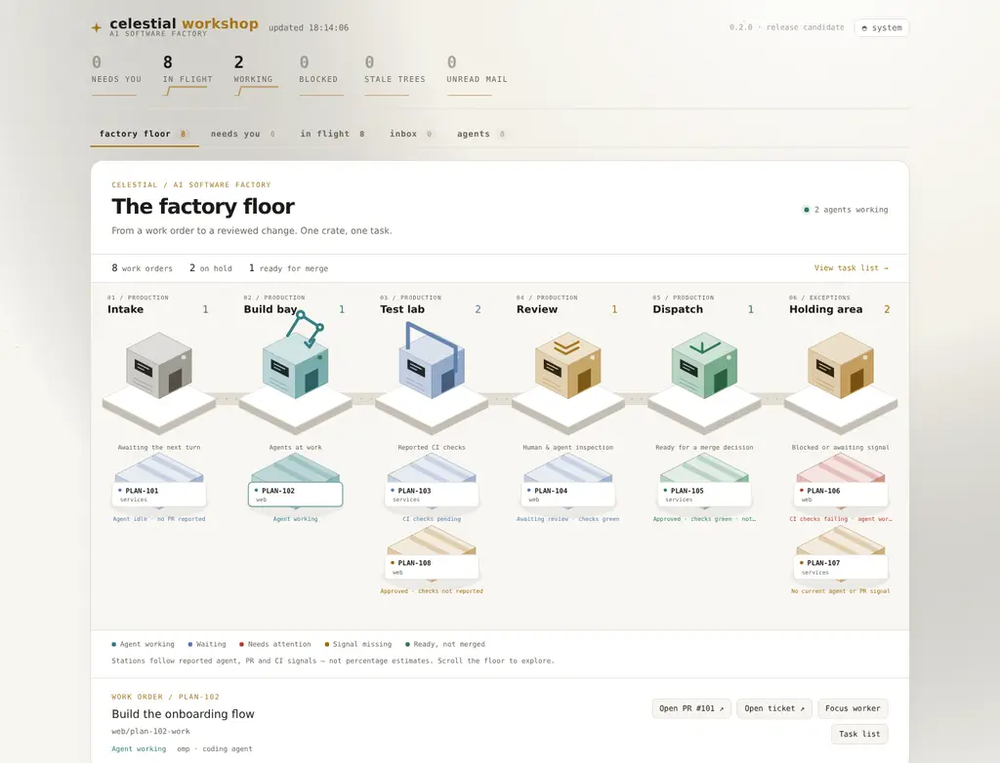

# Celestial — an AI software factory

**One coding agent per product: it builds, tests, opens PRs, gets each one reviewed and lands it — in a pane you can see and steer.**

One clone per dev box. Celestial organises work into *workspaces*, equips
coding agents (Claude Code, oh-my-pi, codex, opencode, pi), and runs each
product's agent in a visible [herdr](https://herdr.dev) pane or Rex session.
The product agent plans, writes, tests and opens pull requests itself; every
PR gets its own reviewer agent, and the product agent lands it through one
checked path (`cel solo land`) under your workspace policy. You stay at the
controls: inspect the work, answer blockers and make the decisions that need a
human.

[](LICENSE)



*Illustrative work in the live dashboard. No agent execution is simulated.*

---

## Why

Running one coding agent is easy. Running one per product across several
workspaces — each opening PRs, each PR reviewed, services on ports, tickets
moving — needs a production system. Celestial supplies the coordination,
visibility and housekeeping around the agents:

- **Every agent runs in a visible pane.** No invisible background agents;
  if it isn't in a pane, it didn't happen.
- **Policy is injected, not hoped for.** Each workspace declares merge rules,
  ticket schemes, runtimes and reviewers once; every agent launched there gets
  them in its system prompt.
- **Every PR is reviewed and landed the same way.** A per-PR reviewer records
  a verdict bound to the exact head; `cel solo land` merges only that head,
  green, under the workspace's merge policy.
- **The box cleans up after itself.** A steward tick collects merged
  worktrees, nudges stalled reviews, and names anything waiting on a human.

## Give this to your agent

You already have a coding agent — Claude Code, oh-my-pi, pi, codex, opencode.
Paste this into it and let it do the install:

```
Install Celestial on this machine and get it running:
1. git clone https://github.com/geoffwellman/celestial.git ~/celestial
2. Add  eval "$(~/celestial/bin/cel shellenv)"  to my shell rc and load it.
3. Run cel setup, then cel doctor. Fix everything red; ask me for anything
   that needs my account (gh auth login, claude setup-token, pi /login).
4. Ask me: a workspace name, my GitHub org, and the repos I want in it.
   Run cel ws new <name> --org <org>, add the repos to workspace.yaml, run
   cel ws sync <name>, then cel doctor again.
5. Start the box coordinator with cel core, then run cel fleet and
   cel dash --ensure. Show me both outputs and the dashboard URL, and tell
   me the one command I use from now on.
```

Setup installs third-party code and may invoke `sudo`; read the block before
you paste it, and read [requirements](#requirements) first. If you would
rather type it yourself, the same install is below.

## Quick start

```sh
git clone https://github.com/geoffwellman/celestial.git ~/celestial
eval "$(~/celestial/bin/cel shellenv)"  # add this line to your shell rc
cel setup                               # review the manifests before installing
cel doctor                              # verify prerequisites and account setup

cel ws new acme --org your-gh-user      # scaffold a workspace
cel ws sync acme                        # clone its repos, link skills, check tools
cel core                                # the box coordinator: routes every product
cd ~/ws/acme && cel run solo --product <p>   # or let `cel ws up` start each product's agent
```

`cel core` is the agent a person keeps open — one per box, across every
workspace. It reads root's mail, holds cross-product priorities, starts and
restarts product agents, and never builds. Each product's agent is where the
work happens.

Requires GNU/Linux; automatic prerequisite installation targets apt-based
distributions. Fresh binary installs support x86-64 and arm64. See
[requirements](#requirements) before running setup. Setup installs third-party
code and may invoke `sudo`; it does not supply provider subscriptions or log
you into GitHub, Linear or agent accounts.

### The shape a workspace declares

`workspace.yaml` may say what should be running in a workspace, and `cel ws up`
puts it back:

```yaml
layout:
  orchestrators: auto        # auto: one agent per product that wants one | manual | none
  panes:                     # optional extra panes, opened at `up`, in order
    - label: dash
      cwd: .
      cmd: cel dash --ensure # optional; an empty pane when absent
    - label: notes
      cwd: .
```

`products[].orchestrator` (`auto`/`manual`) decides per product underneath the
workspace-wide switch. The agent started is the product's solo agent. A
workspace with **no** `layout:` block behaves as `orchestrators: manual` with
no extra panes.

`up` is a reconcile, not a launcher: when herdr loses a live agent's name (it
clears it on restart), every surface that resolves a product agent by its
alias would report the product as dead — and the answer to a dead agent is to
start another one on top of the running one. So a live agent in a product's
own directory is that product's agent whatever herdr calls it: `cel fleet`
shows `orch unnamed` rather than `-`, `cel doctor` says which directory it is
in, `cel ws up` renames it, and `cel run orchestrator` refuses to start a
second one over it without `--force`.

## How it works

Three layers on disk, and a factory floor of agents above them.

```
~/celestial                the plane: mechanism only (this repo, public)
├── bin/cel                one CLI for everything
├── core/roles/            role prompts, injected at launch
├── core/skills/           skills linked into every agent
└── agents.yaml            which agents, how to install, how to inject

~/ws/<name>                a workspace: private content + overrides (own repo)
├── workspace.yaml         repos, policy, tickets, runtimes, env, services
├── layouts.yml            herdr layouts (wins over the plane's)
├── externals.yaml         extra tools (additive overlay)
├── skills/                workspace-scoped skills
└── repos/<product>/       the actual product clones (gitignored here)

~/.local/share/cel         box state: registry, published pages (never in git)
```

```
core                one per box - coordinates products, owns root's mail; never builds
   └── solo         one per product (1..n repos) - plans, builds, tests, opens PRs, lands
          ├── reviewer   one per PR it opens, one verdict per round
          └── lanes      optional: further solo agents on the same product, one per goal
```

A **workspace** is not a tier. It is the scope that holds configuration and
grouping: policy, ticket tracker, environment, profiles, dashboard. A
**product** is the unit one agent owns — one repo, or several that ship
together. Its agent's pane and mailbox are `<product>-orch`. `root` is the
mailbox name for "the top, whoever is listening", which is `cel core`.
`cel run root` still starts a standing director inside one workspace, but it
is not the path this README assumes. The product orchestrator and the solo
agent are one role (`core/roles/solo.md`; `project-orchestrator.md` points at
it): it builds small work itself and leads a [feature team](#feature-teams)
when a feature needs one.

`cel core` (also `cel console`, `cel run core` and `cel run console`) starts
the box's coordinator: one agent pane, standing in no workspace, that reads
`root`'s mail in every workspace, holds cross-product priorities and
blockers, reads state and code read-only, directs product agents by inbox,
starts and restarts them, and shows or sets a product's mode with `cel mode`.
It does not build or land PRs - the guard refuses those and names the product
agent's route. It runs from agents.yaml `defaults.core` (omp on gateway Opus),
resumes its last session, and refuses a second copy; `cel core --restart`
relaunches it in its own pane, `--fresh` starts a new conversation. Mail sent
to `core` lands in `root`.

### A workspace with its own GitHub account

`gh` keeps several accounts per host but only one is *active*, box-wide, so
`gh auth switch` for one workspace would re-identify every other workspace.
A workspace whose repos belong to a second account says so in
`workspace.yaml`:

```yaml
github:
  user: acct-b              # the gh account this workspace acts as
  ssh_host: github-acct-b   # optional: an ~/.ssh/config Host alias with acct-b's key
```

Every pane `cel run` starts for that workspace
gets `GH_TOKEN="$(gh auth token --user acct-b)"`, evaluated in the pane (the
value never passes through cel), and every `gh` call the plane makes for the
workspace (steward sweeps, `cel solo land`, reviewer PR lookup, `cel ws push`,
`cel gc`, `cel release`) runs with that account's token for that call only.
Nothing ever runs `gh auth switch`. If the account is not logged in, launches
and calls for that workspace refuse rather than fall back to the active
account. With `ssh_host`, `cel ws sync` clones over `git@github-acct-b:owner/repo.git`;
the `url:` in `workspace.yaml` keeps the canonical `git@github.com:` form.
Without a `github:` block nothing changes.

Two human steps, once per box:

1. `gh auth login` as acct-b (it is added beside the existing account; check with `gh auth status`).
2. An SSH key for acct-b, added to acct-b on GitHub, and an alias in `~/.ssh/config`:

   ```
   Host github-acct-b
     HostName github.com
     User git
     IdentityFile ~/.ssh/id_ed25519_acct_b
     IdentitiesOnly yes
   ```

`cel doctor` checks both for every workspace that declares `github.user`.


### Solo lanes: several big goals, one agent each

A product's agent holds one picture of the work. When a product has two or
three large feature sets that each want one agent holding the whole picture,
run them as lanes:

```
cel run solo --product celestial --lane ui      # pane and mailbox celestial-ui
cel run solo --product celestial --lane api     # pane and mailbox celestial-api
```

Each lane is a full solo agent - its own pane, mailbox, directory
(`.cel/solo/<product>/lane-<name>`) and resumable session - working in the
product's repos through its own branches and worktrees, opening and landing
its own PRs (`cel solo land`, same review and CI checks). Reviewers it starts
report back to it. The product's main agent (`<product>-orch`) keeps running
beside them. Lanes are told about each other and coordinate overlapping files
by inbox; nothing stops two lanes editing the same file, so give them goals
that touch different parts of the code. `cel fleet` lists a product's live
lanes; `/cel-restart` in a lane restarts that lane only.

A lane remembers explicitly named `--profile` and `--model` choices only after
a successful launch; a bare `--restart` keeps those saved choices. An
explicit new profile clears the old model override unless you also name a new
model. Workspace/profile defaults remain dynamic; dry runs, invalid choices
and failed launches do not replace saved choices. These overrides belong to
that lane, never the shared workspace profile.

To persist a model already used by a **managed Rex lane** without restarting
or changing its native session, name its exact current runtime PID and launch
model (not a requested in-session model change):

```sh
cel run solo --product <product> --lane <lane> --model <exact-model> --remember-current-model <pid> --dry-run
cel run solo --product <product> --lane <lane> --model <exact-model> --remember-current-model <pid>
```

This bounded command verifies the lane's live Rex receipt, PID start time,
runtime and actual `/proc` model argument before writing only its `launch-model`
override. It does not start/stop an agent, edit global profiles or alter native
session identity. It cannot be combined with restart, fresh, profile, thinking
or backend changes. Model syntax validation is offline; it is not a provider
availability check.

### Choose Herdr or Rex for new sessions

The terminal host is independent of the agent runtime and model. Herdr stays
the default; select Rex for a new session with:

```sh
cel run solo --product celestial --lane ui --session-backend rex
cel run reviewer --repo celestial --pr 123 --session-backend rex
cel core --session-backend rex
cel sessions --json
```

Or set `session_backend: rex` in a workspace's `workspace.yaml` for its new
`cel run` sessions. `--session-backend herdr` overrides it. Existing live agents
are never moved: a restart retains their current terminal host. After a process
has exited, normal new-launch defaults apply; keep `--session-backend rex` in
recovery commands unless the workspace default is Rex. Rex must already be
installed; Celestial does not adopt unrelated Rex sessions. A product agent,
lane, root or core gets its own named Rex session. A reviewer - and a team
member whose lead runs in Rex - opens as a window labelled with its alias in
its product agent's session instead, so a product's whole team is one session
group; when that session cannot be proven live it gets a session of its own,
and says so. The command prints its session (and window) and terminal IDs.
Use `rex ls`, `rex window ls -s <session>`, `rex capture -s <session> -b
<block>` and Rex's native controls, not Herdr commands, for those terminals.
Retiring a reviewer or member closes only its own window, never the session.

Role prompts, model/profile selection, workspace and gateway environment,
inbox identity and review gates are unchanged. Pi/OMP report their real turn
state and native conversation file through the inbox extension. Claude's
`SessionStart`/`UserPromptSubmit` hooks report its native UUID and idle/working
state; its existing inbox `Stop` hook reports idle only when there is no mail
to continue processing. Reports require the receipt's live runtime PID ancestry;
neither a guessed PID nor a backend environment label suffices. An explicit
Claude `--resume` UUID is also captured directly from launch arguments.
These hooks never type into a pending owner draft or wake idle Claude sessions.
Runtimes without native observation stay conservatively busy. A restart never
silently discards an unreported native conversation: it refuses unless `--fresh`
is explicit. Managed Rex sessions appear alongside Herdr agents in Celestial's
inventory; automatic Herdr pane cleanup never closes a Rex terminal.

### Rex server restarts and rex upgrades

A Rex server restart ends every program in its sessions. Each core, root,
orchestrator and solo-lane receipt records the `cel run` line that brings it
back (its role, product, lane, workspace and the profile/model/thinking you
named; a lane keeps its remembered choices). Every steward tick records the
running server instance and the live managed agents; when the instance changes,
each agent that was live under the old server and was not stopped, retired or
relaunched since is resumed ONCE through that line, into its saved session, and
root gets one summary. Reviewers never resume: they, and agents launched
before relaunch lines were recorded, are listed in the summary with
the command to run.

Before resuming, the restore repairs what a restart leaves behind. The new
server restores the old sessions as empty shells under the same labels: for
each agent being resumed, the sessions with its label are closed only when at
least one block was seen and every block's process report names child and
foreground as null - an omitted key, an error, an empty or unreadable session
counts as alive and is never touched. A
client-autostarted server runs with `--exit-empty`, so closing the last shell
can end it: if no server answers, a persistent one (`rex server start`, in its
own systemd scope, with `--tailscale` when the old one served the tailnet) is
started before any resume. If the old server served the tailnet and the new
one does not, `rex server tailscale on` is run and verified. The summary names
the server's version and API revision before and after.

The steward also keeps rex current, at most every 30 minutes:

```sh
cel sessions rex-upgrade --check   # newer rex? busy, not resumable, or unmanaged sessions?
cel sessions rex-upgrade           # one round now
```

A round runs only when apt's candidate for rex is newer than the installed
version and comes from `https://pkgs.superlogical.com` exactly (that host, not
one containing the name; `apt-cache policy rex`, without `apt-get update`). It
waits up to `CEL_REX_UPGRADE_IDLE_SECS` (120) for every live Rex agent to be
idle, and skips the round otherwise. Root is told once, and nothing changes,
while the round is blocked by any live agent it could not resume (a reviewer,
an older receipt, a missing saved session) or by ANY Rex session
that is not a live managed launch - a session you opened yourself, or an old
empty shell: stopping the server ends every session, and only managed agents
come back. Close those sessions (`rex ls`, `rex kill`) to let it proceed. Then
it records the agents, installs exactly the version it vetted
(`sudo -n apt-get install --only-upgrade -y rex=<version>`), restarts the
per-user Rex server in its own systemd scope if the package did not, resumes
each recorded agent, checks it is still alive after a short settle, and sends
root one summary. New Celestial launches wait while it runs.

### Retire a completed Rex reviewer, keep its evidence

```sh
cel sessions retire-reviewer widget#12 --workspace demo --dry-run
cel sessions retire-reviewer widget#12 --workspace demo
```

The targeted command, reviewer GC and `cel solo land` share the same native
proof. Idle alone is never eligibility: the PR must be merged or closed (an
open PR can still take a push or a re-review request, so its reviewer stays),
the PR's final head must have a completed canonical solo review round,
the actual Pi leaf must be settled, and no tool, background job, queued input,
inbox retry debt, unread mail or draft may remain. A completed `changes`
round is not an approval and retirement never changes its verdict.

After a successful merge, `cel solo land` retires that PR's Rex reviewer the
same way. A reviewer it has to keep (still mid-turn, mail owed, proof
unavailable) is named and left for the next `cel gc` sweep; retirement never
fails a land.

New canonical Rex/Pi reviewers expose a private native handshake. It samples
the real live leaf and in-memory debt, then rechecks them before supported
graceful shutdown. Only after the original runtime and owned infrastructure
have exited does the backend remove the exact empty Rex session and reconcile
its registry row. Extra terminals, replacement processes and unknown evidence
are protected. Older uninstrumented reviewers are kept, not silently reloaded
or stopped using a saved-file/idle guess. A reviewer that went by other means
(its pane is off the roster, its PID generation has exited and no retirement
proof is in flight) loses only its registry row to `cel gc`, so the PR can be
reviewed again; its receipt, checkout and native log stay.

The command returns JSON: `eligible` for a dry-run candidate, `retired` only
after verified settlement, `protected` for known outstanding work/unsupported
contexts, or `unknown` for missing proof or incomplete teardown. A partial
failure retains private prepared/exit evidence for an identity-checked retry;
do not purge the receipt or proof to force cleanup. Protocol messages live in
`<receipt>.retirement/`, outside the flat Rex runtime-receipt inventory.
If native shutdown committed before the controller copied its exit journal,
a non-dry retry can recover that missing copy from the exact durable protocol
request/response. Existing malformed or negative journals are never replaced
with a more favorable protocol response; a dry run does not repair journals.

Native history, archived instructions/verdict, checkout and review artifacts
are retained. Fresh rounds use a separate checkout rather than erasing a
retired round. Before every new-head or re-review handoff, run the canonical
`cel run reviewer --repo widget --pr 12 --workspace demo` first, then send its
inbox request: it reuses a live reviewer or starts the next round. Saved
retirement history is evidence, not permission to approve or close a new round.


### Scoped OpenCode gateway migration

OpenCode is pinned to the verified **2.2.5 CLI release**, not the legacy npm
package or GitHub's stale latest-release pointer. Updates install digest-checked
official assets at the existing executable's location (fresh installs use
`~/.local/bin`); they never restart an agent or change accounts.

The gateway path starts with a prepared per-agent native-v2 configuration:
`ompgw-codex/gpt-6.1-sol`, medium effort, evidenced 500K context/128K output
limits, and the existing credential reference. Nothing imports credentials or
edits global OpenCode settings. Roles live under
`.cel/opencode/<agent>/role-<role>.md`. The plugin is a directory package with
an explicit server export, not a standalone v1 hook file.

`cel gateway opencode-models` prints the read-only gateway chat inventory as
JSON. Advertised supported Codex/GPT and Anthropic chat IDs remain available
when exact cached capabilities are absent; those entries use native defaults,
not invented limits or sibling metadata. Exact capabilities enrich entries
where available. OMP-only aliases and unsupported image APIs stay excluded.
It uses only the existing private key and model-list/cache reads: no mint,
refresh, account inspection, inference, or native account integration.

```sh
cel gateway opencode-models --sync --workspace <registered-name> --agent <existing-alias> --dry-run
cel gateway opencode-models --sync --workspace <registered-name> --agent <existing-alias>
```

Sync accepts only the existing private, UID-owned, non-symlinked
`.cel/opencode/<alias>/role-orchestrator.opencode.json` and role file under the
registered workspace; arbitrary global paths are not accepted. Namespace
directories must be UID-owned and not group/world-writable; mode 0755 is
allowed while role/config files remain private. It refuses noncanonical/custom
configuration rather than discarding it. Dry-run writes
nothing and prints only inventory/eligibility and activation status. Publication
holds the sibling config lock, retains a private backup, and atomically replaces
the config with mode 0600. Root/agent Sol-medium defaults, role/plugin, gateway
route, URL and environment-key reference remain unchanged; unrelated scopes and
native sessions/PIDs/settings are not modified. **File publication is not live
availability:** an existing process captured inline configuration at launch.
The result reports `activationRequired`; coordinated activation at the same
native SID boundary belongs to its owner. This command never reloads/restarts.

```sh
cel run solo --product <product> --profile <scoped-profile> --session-backend rex --fresh --handoff /absolute/checkpoint.md
```

The native `--prompt` kickoff instructs a fresh session to read the handoff;
an archived OMP log is consultation material, never a native resume. Subsequent
continuation accepts only an existing migrated OpenCode `ses_...` root with
the exact directory and scoped agent. Without a catalog the exact Sol-medium
selection remains required; a canonical catalog additionally admits an
owner-selected eligible provider/model and its native variant, without an
automatic fallback or changing the launch default. Storage errors, pending
migrations and missing IDs refuse before stopping/relaunching a runtime:
v2's bare `--session` can otherwise create a missing session.

The canonical parent owns a private authenticated `serve --stdio` process.
Before attaching the TUI it verifies the actual server PID/version, exact
native plugin source/location and active status, migration readiness, saved
session identity, and scoped model availability. A private admission marker
prevents a loaded resume plugin from draining inbox mail before those checks.
Missing/failed plugins never admit an unguarded TUI. The server's stdin lease
and native child processes are owned by this launch, not a shared service.

The plugin preserves primary/child identity and delivers idle inbox messages
through native synthetic input, never terminal typing. Medium is persisted
in the native model selection and sent as Responses reasoning effort. Final
HTTP and WebSocket boundaries preserve the agent-owned affinity route despite
OpenCode's own header defaults. Shared guard policy covers native shell,
write, edit and patch hooks; `--auto` never waives explicit denials.

An existing completed v1 migration marker is not proof that a later v1 session
exists in v2. Preserve a consistent database/WAL-visible backup first. When
native lookup refuses, investigate on a disposable copy; do not reset a live
migration marker or replace shared native storage. Any supported native import
must preserve original parent/child IDs and history without overwriting an
unrelated session. Installation is not authorization to quit/reload a held
runtime. Never dump environments or credentials as identity evidence.

### Commands inside an agent

Core and solo agents all take the same small set of commands,
typed in the agent's own pane instead of remembering CLI flags. Each runs
`cel here <verb>` - a thin wrapper over one `cel` command - scoped to the
pane's own product unless one is named (core names one: `<product>` or
`<workspace>/<product>`). The output is posted into the conversation without
starting a turn, so the agent sees what its owner ran.

| In the agent | Runs | Does |
| --- | --- | --- |
| `/cel-mode [product] [solo]` | `cel mode` | show the product's mode, or set it to solo (restart at end of turn) |
| `/cel-status [product]` | `cel fleet --workspace <w>` (core: `cel fleet`) | agent, lanes, mail |
| `/cel-inbox` | `cel inbox read --for <me> --all-workspaces` | unread mail now (core: root's) |
| `/cel-decide` | `cel decide list` (others: `--workspace <w> --asker <me>`) | open owner questions |
| `/cel-review [repo#]<pr>` | `cel run reviewer` | start a reviewer pane (not core) |
| `/cel-land [repo#]<pr>` | `cel solo land` | merge through the checked path (not core) |
| `/cel-restart` | the `cel mode` restart waiter | restart this agent on its own session once its turn ends |
| `/cel-focus <product>` | `herdr agent focus <product>-orch` | core only |

omp and pi register them through the inbox extension
(`tools/hooks/inbox.omp.ts`); Claude Code gets `~/.claude/commands/cel-*.md`
links from `cel setup`/`cel update`. The `cel-` prefix is deliberate: omp has
built-in `/review` and `/restart`, Claude Code built-in `/status` and
`/review`.

`cel run <role>` starts any station with its role injected and permissions
pre-approved. `policy.pr_open: draft | ready` decides whether a PR opens as a
draft (default) or ready for review with the workspace reviewer requested.
`pr: none` on a repo entry (or as the workspace-level `policy.pr`) skips the
PR for that repo: the agent rebases onto origin's default branch and pushes,
fast-forward only.

### Solo mode

Every product is built by **one agent** that plans, writes, tests and ships it
itself, using everything its own runtime offers — its own git worktrees, its
harness's subagents in parallel, several branches and PRs at once:

```yaml
products:
  - name: atlas
    repos: [atlas-app]
    mode: solo          # the default when absent
```

`cel mode [<product>]` shows the mode; `cel mode <product> solo` sets it,
editing that one line of `workspace.yaml` in place (comments and layout
untouched) and restarting the product's live agent **on the same session**
once its current turn ends — so an agent can set its own mode.
`--no-restart` leaves the live agent alone until its next launch. Fan-out was
retired: a legacy `mode: fleet` is refused at launch (`cel run orchestrator`
names `cel mode <p> solo`), and `cel mode <p> fleet` is refused and writes
nothing. `cel run solo` starts the solo agent directly.

The solo agent is still *the product's agent*: same directory, pane name and
mailbox (`<product>-orch`) as an orchestrator, so mail, decisions, the
steward and the dashboard reach it unchanged. It launches with `CEL_ROLE=solo`;
the guard then lets it write code, commit, push, open PRs and start a
reviewer for its own PR, and refuses starting other agents and
`gh pr merge`. `role_profiles: { solo: <profile> }` binds its model; without
one it uses the orchestrator's binding.

Its PRs follow the workspace's PR and review policy, keyed by the PR itself:

- the reviewer records `cel solo review <repo>#<n> approved|changes --head
  <sha> --by <alias>` (an approval must equal the PR's current head; verdicts
  live in `<ws>/.cel/solo-reviews.json`) and sends findings to
  `<product>-orch`. The solo agent itself can never record a verdict on its
  own PR, and only it (or a person) lands one - not a reviewer;
- `cel solo land <repo>#<n>` merges with the checks in `lib/land.sh`:
  `merge: self`, the workspace account's own open non-draft
  PR, an approval of the exact head, no red check, no conflict, and every
  check the base branch requires - through classic branch protection or a
  repository/organisation ruleset - green on that head. It merges only that
  head (`--match-head-commit`), and CI on the head is the evidence the squash
  body cites. Only when neither protection nor any ruleset requires a check
  does the repo gate run locally instead, in a clean checkout at exactly that
  head; requirements that cannot be read refuse the land.

The rest of the box sees a solo product for what it is: `cel fleet` draws it as
`solo <agent state>  worktrees N` (JSON: `mode`, `solo_worktrees`), the
dashboard tags its agent row, the steward tells the agent - once per head - when
a PR of its is approved and green but unmerged, and `cel gc` removes its
worktrees under `<ws>/.cel/solo/<product>/` once their PR has merged or closed
and nothing in them is unsaved (a worktree with no PR yet is kept).

### Feature teams

Small work stays with the product's agent. A feature with two or more parts
that can be built at the same time, or one that needs a specialist (device
QA, design, data, a release check), gets a **team** that the product's agent
leads. The lead stays the only integrator: one integration branch and PR per
repo, reviewed by `cel run reviewer` and landed with `cel solo land` as above.
Members are short-lived scoped agents, admitted against the box-wide helper
budget that every product's reviewers and team members share - by default 8
helpers and 4 team members in all (`budget.max_live_agents`,
`budget.max_team_members`; `cel run reviewer` can be refused too). Product
agents (`<product>-orch`, solo lanes) and core are shown by `cel budget` but
never counted: a box running ten products still has all 8 helpers for their
reviewers. Only the product's orchestrator (`<product>-orch`, `CEL_ROLE` solo
or orchestrator and its product proven by `CEL_PRODUCT` or its mailbox)
starts and leads a team. A process with no agent identity is refused; the
owner asks the product's agent by `cel inbox` or answers its `cel decide`.

```
cel team start login --product shop --brief-file brief.md      # lead only
cel team event login candidate.updated --data '{"repo":"web","head":"<sha>","branch":"CEL-login"}'
cel team add login builder --repo web --owns 'src/auth/**' --focus backend --task-file t1.md
cel team add login qa --repo web --focus browser --task-file t2.md
cel team status login            # roster, liveness, candidate heads, verdict freshness, who owes next
cel team close login             # retires everyone; refuses over unpushed builder work
```

Everything a team is lives in `<ws>/.cel/teams/<feature>/` (feature ids are
`[a-z0-9][a-z0-9-]{1,40}`): `team.json` (the roster), `brief.md`,
`acceptance.yaml`, `contracts/`, `events.jsonl` (append-only),
`verdicts.json`, and a scope packet per member, `members/<alias>.md`. Every
write holds the folder's lock and JSON is replaced whole.

- **Roles** — `product`, `design`, `builder`, `qa`, `platform`, `release`,
  `analyst` (`core/roles/team-<role>.md`), each narrowed by an optional focus
  pack (`core/roles/focus/<role>/<focus>.md`, a short checklist). Only a
  builder writes code, on `team/<feature>/<member>` in its own worktree,
  inside the paths it `--owns`; it pushes that branch and never opens a PR.
  Two builders' `--owns` globs may not overlap in one repo; where overlap
  cannot be decided exactly it counts as overlapping and the refusal says why.
- **Adding a member** admits it against the box-wide agent budget first (a
  refusal is printed and nothing is written), then reserves its row, writes
  its scope packet and a one-time launch token, and launches it with `cel run
  member`. It is `reserved` until the launcher confirmed the exact agent AND
  the member ran `cel team ack`; a launch that never confirms stays reserved
  and is not relaunched.
- **Reporting** — members append `task.ready` (head + gate result),
  `preview.ready` and `decision` events with `cel team event ... --to
  <alias>` (which also mails), and judge the lead's candidate head with `cel
  team verdict <f> --repo r --head <sha> pass|changes|blocked|advisory
  --evidence <file>`. A newer `candidate.updated` makes older verdicts show
  as stale.
- **Owner decisions** go through the lead's `cel decide ask`; only the lead
  records a `decision` event. Members spend nothing unless the
  lead sets the team's spend cap from one (`cel team cap <f> "<cap>"`, kept in
  `team.json`); nothing in `brief.md`, which members can write, widens a
  member's authority or spend.
- **Closing** — `cel team retire <f> <alias>` closes one member's pane; `cel
  team close <f>` retires everyone and refuses while a builder's work is not
  on origin, unless `--force-keep` (which keeps those worktrees).

## The review loop

Declare a reviewer in `workspace.yaml` with a gateway-backed Claude or Codex model:

```yaml
review: { runtime: pi, model: sonnet }
```

`sonnet` resolves to the highest versioned Claude Sonnet ID in the live gateway
catalog; `opus` maps to `claude-opus-5-5`. Explicit advertised Claude IDs and
`ompgw-claude/<model>` IDs are preserved. `cel run reviewer` checks that the
gateway is installed, ready, has a Claude account, and advertises the selected
model before opening a pane. Missing gateway/model data refuses launch; pi's
ambient provider and Anthropic login are never used. Configure a reachable
Claude account with `cel gateway` before starting reviewers.

A Codex-family id (`gpt-6.1-sol`, or spelled `ompgw-codex/gpt-6-astra`) runs
the reviewer on the gateway's codex provider instead - `review: { runtime: pi,
model: gpt-6.1-sol }` or `cel run reviewer ... --model gpt-6.1-sol`. The launch
refuses when the gateway does not publish that id or holds no usable codex
account; an id is never substituted.


A product agent starts one reviewer pane per PR (`cel run reviewer --repo r
--pr n`, or `/cel-review`). Its inbox extension wakes the idle reviewer when
new mail arrives, so request-changes and re-review round trips do not wait for
someone to type. `review.runtime` stays in the workspace schema for
compatibility but no longer selects the reviewer runtime: a value other than
`pi` is ignored, and `cel run reviewer` warns naming the field. `review.model`
selects the requested model. A reviewer delivers one verdict per round with
`cel solo review <repo>#<n> approved|changes --head <sha> --by <alias>`, bound
to the exact commit it read, and mails its findings to the product agent,
which fixes, pushes and asks for re-review; you hear about it only on approval
or escalation. A steward tick (every 5 minutes by default, deterministic,
token-free) backstops the loop: verified disposable worktrees are removed,
stalled PRs are nudged, and blocked agents or preserved unlanded work are
named until dealt with. Unknown state is a reason to retain work, not
evidence that it is safe to delete.

## Agents talk without hijacking your keyboard

`herdr agent prompt` types into a pane, so a status report landing while you
are mid-sentence merges with your draft. Routine agent-to-agent traffic goes
through `cel inbox` instead - a JSONL mailbox per workspace, with a read
cursor per *reader* so a standing root pane and `cel core` can both drain
root's mail without stealing each other's place. Delivery is inbox-only, but
idle wake depends on runtime. Claude Code's global `UserPromptSubmit` hook
drains mail on submission; its launch-time `Stop` hook continues for mail
arriving during a turn. Managed **Rex Claude lanes** also start a receipt-bound
idle watcher through `claude-session.sh`. It sends a native Unix peer event,
not terminal text, into the same conversation without submitting the owner's
draft. Mail stays unread until Claude or its normal inbox hook reads it.
The Pi/OMP inbox extension watches mail, raises `ui.notify`, and injects unread
items into a turn. The Claude watcher does not depend on a `Monitor` tool.
Direct `herdr agent prompt` is limited to one-time launch kickoffs and the
owner's deliberate interrupts. Escalations remain inbox items, not pane
prompts.

**One name per mailbox.** A mailbox is named by the same string as the herdr
agent that reads it: `cel_alias_norm` (lowercase, `[a-z0-9_-]` only, starts
with a letter, at most 32 characters) is the single rule behind `cel run`,
the steward, every `cel inbox` sender, reader, counter and watcher, and an
explicit `CEL_INBOX_ME`. It is idempotent - normalising a name twice is
normalising it once - so mail to an agent's full name and mail
to its 32-character alias reach the same mailbox, even when the cut falls
right after a dash (that dash is kept: it is the alias herdr already holds).
Before this, such a name came out one character shorter the second time and
the mail sat in a phantom mailbox nobody opened. `cel inbox migrate
--workspace <w>` repairs mail already split that way. It is a dry run by
default and it does not guess: the canonical name must be a live agent or own
a worktree (a sender name or a cursor is typed by whoever runs a command, so
it can disprove a phantom but never prove a target); a legacy name with any
trace of its own is `unsafe` (two real recipients) and left alone; one with no
trace is `unverified`, because a genuine dead recipient looks exactly the same,
and is migrated only when the operator attests it with `--apply --only
<legacy-name>`. Applying keeps every message and id and each reader's unread
position, exactly once. It is journalled: the mailbox and cursors are saved
under `<inbox>/migrate-backup/` first, and if the run is killed the next send,
read or `migrate --apply` finishes it before touching the mailbox.

**Mail to `root` is for a person: `escalation`, `decision`, `blocked`.**
Status belongs in `cel fleet` and the dashboard, so nothing reports it to root
as mail; `cel inbox send root --kind status` warns and still sends.

A mailbox nobody reads is a **fault**, not silence. `cel fleet --json` carries
`mail: {to_root_unread, oldest_secs, reader}` per workspace — `reader` is the
live pane whose alias matches the mailbox, or a running `cel core`, or empty —
`cel doctor` says `alpha: root has 13 unread, oldest 7h, nobody reading it`,
and the steward raises one rolled-up `blocked` item per workspace (which takes
the desktop-notification path, as an `escalation` now does too) when an unread
escalation is older than `CEL_ROOT_UNREAD_SECS` with nobody alive to read it.

What is left gets **ranked**. `cel inbox open --for root --ranked` and the
dashboard card show the top `inbox.top_n` (3) of the
unread, then `and N more`. A decision model scores each message once against
four concrete levels (`0 informational` … `3 blocking work right now`) and
supplies *only* that level; counts, ages, ordering, the cut and the caching
are the code's. Below `triage.min_confidence` (0.6) a message keeps its kind's
default rank, so an unreachable model degrades to the old ordering rather than
losing messages.

## Watch and steer

- **`cel fleet`** — the whole box in one deterministic read: every workspace,
  every product (a repo in no declared product is its own), its mode, whether
  its agent and lanes are live, PRs, and root's mail. Token-free and free of
  agent judgement; `--json` for scripts. `cel core` answers from this, never
  from memory.
- **Liveness: what the pane is doing, not how long it has been quiet.** A
  runtime's own status can be wrong — a suite hung while herdr said
  `working`, an agent burned cores while it said `idle`. Code filters first,
  and each candidate costs one decision request carrying the last lines of its
  pane. The answer (`working`, `waiting_on_input`, `looping`, `crashed`,
  `finished`, `unclear`) is only ever REPORTED — no path from an answer to a
  kill or a prompt — and the timers decide alone whenever there is no model
  or the answer is below `liveness.min_confidence`. Configure under
  `liveness:` in `~/.local/share/cel/config.yaml`; `cel doctor` says whether
  it is on and which model answers.
- **Memory is part of that read.** `cel fleet` prints `mem` per product and
  `box 6.9G free of 24G` on each workspace's head line; `--json` carries the
  numbers and a `box` block. The steward raises one blocker under 10% naming
  the largest trees — it never kills anything.
- **`cel dash`** — one dashboard for the whole box: an attention queue ("needs
  you"), every in-flight branch joined with its agent + PR + CI state across
  every workspace, sticky filters, and a composer that mails a product agent.
  The old `/classic` page is retired and redirects to `/`.
- **`cel publish <file>`** — self-hosted pages server (tailnet-private by
  default, per-document promotion to a public tier). Published pages carry a
  feedback widget that routes straight back to the agent that published them —
  select text to comment on the exact passage. A public share carries the
  page's own screenshots, stylesheets and linked non-page files (same
  directory only, copied at share time, never symlinks); another page it
  links goes too only when named (`cel publish --public --include m.html`, or
  `"include"` in the promote call). The token serves exactly that list.
  `cel pages bundle <doc> [--include m.html]` adds them to a live share
  without changing its link or expiry.
- **`cel gc`** / **`cel steward`** — the cleanup and liveness machinery, also
  runnable by hand. `cel gc --orphans` reaps what the plane started and nobody
  owns any more: inbox watchers whose agent exited, test fixtures whose
  worktree is gone, bare shells on ptys no pane owns, gate runners whose suite
  was killed. The steward does it once a tick and says so in one line.
- **`cel box space`** / **`cel gc --box`** — the box is a resource the factory
  spends. `cel box space` measures what is large, what of it is reclaimable,
  and which of three classes it is in: **ours** (worktrees, `~/.cache/cel`),
  **regenerable** (docker images and build cache, toolchain caches — deleting
  costs a re-download, never data) and **someone's** (restore dumps, dated
  backups — reported with an age and a suggestion, and never swept by
  anything). `cel gc --box` sweeps the first two after the worktree pass. Docker
  removes only unreferenced, unprotected full image IDs (without force), plus
  build cache; there is no image age filter. `--dry-run` reports the same policy
  without deleting. The steward sweeps on a six-hour cadence and `cel doctor`
  warns below a free-space floor, naming the largest reclaimable class and the
  command that clears it. `cel box diag` is the
  same question asked by an alert: at most two bounded lines - docker's own
  images / build cache / volumes summary (left out when docker is absent,
  slow past `CEL_BOX_DIAG_TIMEOUT` seconds, default 30, or not this user's to
  query) and every running `docker build` / `buildx` with the agent whose pane
  or working directory it runs in - secret values in the build's argv
  (`--build-arg`, `--secret`, `-e`/`--env`, any `KEY=VALUE`) printed as `***`,
  and the herdr lookup held to the same time limit.

### Docker image retention and producer ownership

`cel box docker-safety` returns the version-1 JSON consumer contract, including
the resolved `keep_file`, `keep_dir`, `lock_file`, and `keep_label` (`cel.keep=true`).
`cel box sweep-docker [--dry-run]` runs only the Docker sweep, prints a byte
count (an upper bound in dry runs), and exits nonzero on unknown observations
or mutation failure; exit 2 means Docker is unavailable. No image/system,
container or volume prune is used. Build-cache prune remains a separate step.

For recurring 20 GiB recovery, reviewed runtime/handler pins, producer observations,
native notification verification and transactional service migration, see the
[disk headroom controller runbook](docs/disk-headroom.md). A low-disk reading
never expands cleanup eligibility or turns a producer candidate into a grant.

An image survives if **any tag** matches a keep pattern, its image label is
`cel.keep=true`, or any running/stopped container references its actual full
image ID. Labels protect containerless bases too. Built-ins retain `ubuntu:*`,
`alpine:*`, and `slot-studio-media-executor-base:*` (all immutable source tags).
The executor namespace `slot-studio-local/media-executor:*` is conservatively
retained unless the reserved producer-owned `keep_dir/slot-studio-executors.patterns`
contains validated, nonempty executor declarations. This file opts into bounded
cleanup and MUST represent the **COMPLETE live + rollback + in-flight image set**.
Legacy/global declarations and arbitrary producer files cannot enable narrowing,
even if they contain executor references. A missing, empty or unrelated-only
reserved file preserves the blanket; malformed/unreadable files refuse mutation.
Once opted in, exact live, rollback and in-flight tags allow superseded unused
executors to be swept; labels and actual container references remain vetoes.
Other image families retain their existing policy.

The operator-owned legacy `keep_file` defaults to
`${XDG_CONFIG_HOME:-$HOME/.config}/cel/docker-keep-patterns`. Each producer owns
one file, e.g. `other-producer.patterns`, inside `keep_dir`, defaulting to
`${XDG_CONFIG_HOME:-$HOME/.config}/cel/docker-keep-patterns.d`. **All files are
unioned with the legacy file and built-ins. Never replace another producer's
file or the global operator file.** Each selected `*.patterns` file contains
newline-delimited `repository:tag` shell globs (`*`, `?`, bracket sets/ranges);
blank lines and lines starting `#` are ignored. Patterns are data, never shell
code or filesystem expansions. Temporary files must not end in `.patterns`.
`CEL_BOX_DOCKER_KEEP_FILE` and `CEL_BOX_DOCKER_KEEP_DIR` select explicit paths;
missing explicit paths, unreadable/malformed declarations, selected symlinks
(including ancestors), failed inventory, unknown labels/tags, or failed
container inspection refuse all Docker mutation. Absent default paths are
allowed; absent executor ownership preserves the whole executor namespace.

**Producers must share the ownership lock**, including builds, image import,
tag moves and keep-file replacement. The sweep holds the lock and rechecks
references/retention immediately before each mutation; an active local Docker
build also vetoes the sweep. Docker has no atomic compare-and-delete tag API:
the lock contract is required, not protection against uncoordinated tag writers
or remote clients starting builds. Use the `lock_file` reported above (default
`${XDG_STATE_HOME:-$HOME/.local/state}/cel/docker-images.lock`):

```bash
lock="${XDG_STATE_HOME:-$HOME/.local/state}/cel/docker-images.lock"
keep_dir="${XDG_CONFIG_HOME:-$HOME/.config}/cel/docker-keep-patterns.d"
mkdir -p "${lock%/*}" "$keep_dir"
(
  set -e
  flock -x 9
  # The sole executor producer publishes its COMPLETE set before building.
  # Retain every required live/rollback/in-flight tag, not just these examples.
  tmp="$(mktemp "$keep_dir/.executors.XXXXXX")"
  printf '%s\n' 'slot-studio-local/media-executor:current-42' \
    'slot-studio-local/media-executor:rollback-41' \
    'slot-studio-local/media-executor:candidate-43' > "$tmp"
  chmod 600 "$tmp"
  mv -T -- "$tmp" "$keep_dir/slot-studio-executors.patterns"
  # Pre-admission precedes image creation and deployment; keep the shared lock.
  docker build -t slot-studio-local/media-executor:candidate-43 .
) 9>>"$lock"
```

Alternatively put `LABEL cel.keep=true` in the producer's Dockerfile. Existing
images cannot be relabelled in place: declare their tags in the keep file
before publishing/moving tags, or rebuild with the label under the lock.

Migration: keep the legacy global declarations and emergency fallback intact
until the executor publisher pre-admits each candidate **before build/deploy**,
publishes the COMPLETE live/rollback/in-flight set atomically, and has tested
the shared-lock contract. Only then create `slot-studio-executors.patterns`.
Do not bootstrap this opt-in from the old post-healthy-deploy global snapshot:
it can omit an already-building candidate. Under the same lock, remove only
producer-owned entries from the global file without discarding operator or
other-producer protections. A legacy executor wildcard remains a veto until
explicitly removed by the operator. Retain required rollback and pending
candidates until their ownership is genuinely retired, including failed or
unresolved deployments. Follow-main worktree candidates are observations, not
image keep declarations or cleanup grants. The receiver cannot infer omitted
required images from a syntactically valid set: completeness is the producer's
admission contract. `keep_dir` is additive to contract v1; existing `keep_file`
consumers remain compatible.


## What runs in the background

Four kinds of thing run without you: **one timer**, **long-lived servers**, **a
per-turn hook**, and **the agents themselves**. Nothing else is hidden.

### The steward — the only scheduled process

`cel steward` is a single pass over the whole box. Its checks do not call a
model, but they can remove verified disposable worktrees, retire eligible
idle agents, maintain servers and prompt agents. Those agents may then spend
tokens under their existing account permissions.

```bash
cel steward --install                  # systemd user timer, every 5 minutes
cel steward --install --interval 10    # a different cadence
cel steward --install --remove         # stop it
cel steward                            # one tick by hand
systemctl --user list-timers | grep cel-steward
journalctl --user -u cel-steward       # what it did, and when
```

A **systemd user timer** rather than a shell loop in a pane, because the
steward's whole job is to be running when nobody is watching, and a pane loop
dies silently with the herdr session. `Persistent=true`, so a tick missed while
the box slept runs on wake — a ticket moved to the trigger state overnight is
still waiting in the morning. Enable `loginctl enable-linger` or it stops when
you log out.

Each tick, in order:

| Step | What it does |
|---|---|
| **garbage collect** | retains dirty, unlanded, live or unverifiable work; retires only ownership-verified agents observed idle, never merely old processes |
| **review sweep** | for each repo, `gh pr list --author @me`: approved PRs, changes-requested with nobody working, and red gates with nobody working each nudge the owning product agent |
| **untracked PRs** | a PR older than a day whose branch carries no ticket id — invisible on the board, so it is surfaced |
| **blocked agents** | any agent waiting on input is named every tick, deliberately without dedup; that is your queue |
| **stalled agents** | an agent whose provider stream died sends no mail and reads as `idle`; a fatal pane marker quiet for 15 minutes, or an agent gone from the roster, escalates to root naming the pane, stall age, and what is unpushed |
| **stale mailboxes** | unread mail older than 30 minutes is surfaced to the owning agent for follow-up; the steward never types into the recipient's pane |
| **page feedback** | feedback whose publishing pane is gone stays a warning until someone drains it |
| **ready tickets** | tickets in the workspace's `trigger_state` with no branch anywhere are handed to the product's agent, else root — this is what makes "move it to Todo" start work |
| **servers** | `cel dash --ensure` - the one dashboard, never one per workspace; expired public shares are deleted, not merely refused |
| **ensure product agents** | every product declaring `orchestrator: auto` with no live pane gets its solo agent (`cel run orchestrator`), at most once every 30 minutes so a crash-looping one is not relaunched every tick |
| **updates** | once a day, whether this plane is behind — the newest release tag on the `release` channel, the commits on `origin/main` on the `main` channel, rolled up into one root item naming how many and which build you are on |

Nudges are **rate-limited per subject** (4 hours; the update check, 24) through
`~/.local/share/cel/steward-state`, so a stuck agent is reminded rather
than spammed.

### Servers — started on demand, kept alive by the steward

Each runs under `setsid`, so it outlives the pane or agent that started it, and
logs to `~/.local/share/cel/logs/`.

| Service | Where | Kept alive by |
|---|---|---|
| `cel dash` | one for the box: `dash: port:` in `~/.local/share/cel/config.yaml`, else `:7770`; a workspace's own `dash.port` is ignored (doctor names it) | the steward, every tick |
| `cel pages` | tailnet tier, `:7780` | `cel pages --ensure` |
| `cel pages --public` | internet-reachable tier, `:7781` | `cel pages --ensure` |
| `cel pages tunnel` | cloudflared/ngrok, for sharing without Tailscale | started by hand |

`--ensure` is idempotent: it starts the service only if it is not already
answering, so it is safe on a loop.

### Hooks — session-bound actions

Claude's global preferences install the submit hook; `cel run` adds the
active-turn Stop hook. Other hooks are configured where their runtime uses
them. Hook programs fail open on their own errors:

| Hook | Event | What it does |
|---|---|---|
| `inbox-drain.sh` | Claude `UserPromptSubmit` | drains the pane's mailbox when a turn is submitted; it does not wake an idle session |
| `inbox-stop.sh` | Claude `Stop` | blocks once for mail arriving during the active turn; it does not wake an idle session |
| `claude-session.sh` / `claude-idle-mail.py` | Claude async session/submit hooks, then native peer socket | reports the exact native session and retains one lifetime-bound watcher as Claude's own child; never writes terminal input |
| `inbox-guard.sh` | Claude `Stop` | when configured, blocks once for unresolved decisions/blockers and gives resolution steps; it does not wake an idle session |
| `orchestrator-guard.sh` | `PreToolUse` | **read-only coordinators**: from a root, core or orchestrator pane, refuses commits, pushes, merges, branch switches and edits under `repos/` (by shell or by the native edit tools); a solo pane may write and push but not start other agents or `gh pr merge`. In every pane the hook runs in - claude panes of any role; omp/pi root, orchestrator and solo panes - the forge API token (`~/.config/cel/forge`) is refused to shell commands and the native read/edit tools, and so is sourcing `lib/forge.sh` or calling its `_forge_*`/`forge_*` functions (also via `eval` or a variable; they reach the forge without `cel forge`'s checks) and running `cel forge` on a line that sets a `CEL_*` variable (even to empty). `cel forge pr close|ready` and `run rerun` are the product agent's alone, refused to core, root, members and reviewers. These are text tripwires, not a sandbox (a script file still runs); `cel forge` itself also checks who is asking, and changes nothing for a process with no agent identity, so shedding `CEL_*` variables gains nothing. `CEL_GUARD=0` opts a pane out; `CEL_GUARD_ALLOW_ONCE=1` approves one call |
| `learn-stow.sh` | `SessionEnd` | decays and budgets the workspace's `learnings.md` |

Inbox hooks use explicit `CEL_INBOX_ME`/`CEL_INBOX_WS` when the launcher
provides them; otherwise the inbox command derives identity from the working
directory.

`cel inbox watch` streams notices without moving a cursor. It is not itself
an idle-wake API. Claude's idle watcher instead uses the socket published to
its hooks as `CLAUDE_CODE_MESSAGING_SOCKET` (observed with native Claude Code
2.1.318). It requires an exact launch recipient/workspace, a live matching Rex
receipt, runtime PID ancestry, and the native conversation UUID. Before every
send, Linux `SO_PEERCRED` must match the receipt's PID/UID/start time; each event
also carries the native session ID. Missing support or ambiguous identity has
**no terminal-input fallback**. In particular, Rex `send`/`send-key` and screen
capture cannot atomically establish that an owner's composer is empty.

New launches register the watcher as an **asynchronous native command hook**
and keep it in the foreground of that hook. This preserves the native process
ancestry that lets Claude recognize an own-child message, including in
`bypassPermissions` mode, without changing inbound policy. Detaching the hook
watcher would erase that proof and cause bypass-mode Claude to hold its mail.
The adapter does not assert a fake peer permission mode or forge a sender.

The watcher polls every five seconds. Each unread generation has one stable
notification ID; later mail gets a new ID even when its unread count is
unchanged. Native duplicate suppression is time-limited, so retries reconcile
the exact hook-provided transcript first: a matching native queue/user receipt
suppresses further sends even after that window expires. This is notification
receipt, **not mailbox delivery**. Only complete, session/ID-matched top-level
rows count; nested API-request copies do not. Reads are bounded to 1 MiB per
poll. Partial, oversized, malformed, replaced or truncated transcripts retain
unread debt and suppress retries instead of guessing absence.

With an authoritative absent receipt and an idle target, the watcher retries
after 30 seconds and then every 120 seconds until recovery. The backoff is
capped, not the debt's lifetime: three transient failed writes do not strand
the same unread set forever. A lock and private atomic state beside the Rex
receipt (`<receipt>.inbox/state.json`) retain attempts, next retry time and the
pre-send transcript boundary across watcher restarts. Socket write success is
`notified_not_delivered`, never delivery. Native receipt suppresses retries;
uncertain evidence instead produces `blocked_receipt_unknown` (or
`blocked_read_error`) with an explicit reason and a transition-only stderr
notice. The watcher never guesses absence or consumes mail to clear a block.
An operator must inspect the native transcript or use the canonical launcher
to recover missing evidence. New mail rearms notification identity; an ordinary
prompt/Stop hook can still drain the backlog. Replacing the runtime PID,
native session or receipt ends the old watcher. No conversation is forked,
model changed, lane restarted or terminal draft submitted.

If the native runtime does not publish the socket, state says `unavailable`:
the prerequisite is native Claude peer messaging enabled for that session.
MCP channels are a separate preview facility, require launch-time registration
and consent/policy eligibility, and do not acknowledge notification delivery;
they are not silently substituted. Updating files alone cannot retrofit the
new async hook registrations into an already-idle old launch. A later
owner-authorized native resume can use the new launch hooks while preserving
the saved conversation/model; this patch never restarts a lane itself.

External attach is deliberately **not supported**. A user-settings file alone
cannot prove effective native permission policy across project/local, managed
and CLI layers, and the adapter must not guess consent or widen policy.
Existing launches acquire the new own-child hook through a root-coordinated
canonical resume preserving the exact saved conversation, actual model and
thinking settings. The [native inbound rules](https://code.claude.com/docs/en/cross-session-messaging#control-inbound-messages)
and [async hook contract](https://code.claude.com/docs/en/hooks#run-hooks-in-the-background)
describe why an own-child watcher is different from an external sender.

The opt-in integration `python3 tests/claude-idle-native.py` requires installed
Claude Code, Linux peer credentials/pidfds, and `python3-pexpect`. It runs a real
isolated native Claude against a deterministic loopback provider, with a fake
key and isolated HOME/config (no paid inference). It proves own-child idle wake
in the production bypass mode, three real Unix-socket permission failures and
recovery for the same unread set, exactly-once Stop-hook delivery, refusal of a
foreign session, receipt-based suppression beyond the native dedup window,
own-child watcher recovery and later mail. The unsubmitted owner draft is
preserved until the fixture's explicit Enter. Only fixture-local poll/backoff
constants are accelerated; the native runtime, kernel transport, identity,
receipts, inbox cursor and hooks remain real. No native permission policy is
changed. Evidence remains in the printed
fixture directory. Native support missing is a failure with the prerequisite,
not a source-test pass. The normal gate runs the credential-free selector,
identity, cursor, and retry regressions without launching Claude.

Launch diagnostics compare the canonical **effective product plan**: SOLO
role/profile overrides (including `workspace.local.yaml`), the actual runtime,
and the existing terminal backend. Native resume IDs and one-shot kickoff
prompts are not permanent launch requirements. Routing content, argv and PID
start identity invalidate cached verdicts; preserving a running explicit model
choice requires a product-local profile binding, not a global drift exemption.

Pi can rewrite its process title to bare `pi`, including NUL-padding the old
argv storage. That means launch flags are **unknown**, not absent. A matching
owned Rex receipt and exact direct-child inbox watcher can establish observed
inbox evidence; neither proves guard enforcement or a complete current launch.
Without that evidence, doctor warns and the steward requests inspection without
automatically restarting the runtime. Observable genuinely missing hooks remain
actionable. Native OpenCode is not tested for Pi/OMP-only extension flags.
Doctor reports unknown launches by name and never turns an empty inventory or
the absence of known drift into an all-current confirmation.

### Services

`cel services` is one list of everything this box is running on a port: the
services a workspace declares under `services:` and the box's own services.

```yaml
services:
  - name: builder                    # name + url only stays valid, and is
    url: http://localhost:4322       # observe-only: there is nothing to start
    cmd: pnpm --filter builder dev   # with a cmd it can be started and stopped
    cwd: repos/widget
    health: /                        # a path that must answer 200 within 2 s
    env: { MODE: dev }
    restart: auto                    # the steward tries once before it escalates
```

Each row carries `state` (`up` when the port is listening, `healthy` when the
health path answers, else `down`), the port, the pid and the resident memory of
the process tree in its cwd, how long it has been up, and **reach** — the URL
that works from somewhere that is not this box. `cel services start|stop|
restart|logs <name>` runs it in a herdr pane under the workspace's own pane and
remembers the pane in `<ws>/.cel/services.json`; a service without a `cmd` is
observe-only and says so.

Reach exists because every dev server and every preview binds `127.0.0.1`,
which from a laptop is the laptop. The dashboard already listens on the tailnet
IP, so it **proxies** them: `http://<tailnet-ip>:<dash-port>/svc/<port>/…` is
forwarded to loopback, WebSocket upgrades included, for ports that belong to a
known service only, and only with the dashboard's own control token —
a tailnet neighbour cannot browse this box's loopback.

**One dashboard for the box.** There used to be one server per workspace,
each polling the same herdr and gh and each drawing the same box-level rows,
so one gateway read as several. Now `cel dash` runs one server covering every
registered workspace; a workspace's services panel lists only its own
services, and anything tagged `box` (and the subscriptions) appears once in
the **Box** panel. The old per-workspace ports answer with a redirect to it
for one release; `cel doctor` names the dashboard and any leftover
per-workspace server (`cel dash --restart` stops them).

The steward probes every service that declares `health:` once per tick. Two
consecutive down ticks raise one rolled-up blocker to root naming the service
and the last line of its pane; back up clears it. `restart: auto` restarts it
once first, and says so in the blocker.

Some services belong to the **box** rather than to any workspace — the auth
gateway is used by every workspace and owned by none. They are
declared one JSON file per service in `~/.config/cel/services.d/` (`CEL_SERVICES_D`),
in exactly the shape of a `services:` row plus a bare `port:` shorthand, `0600`
in a `0700` directory because `env` may carry a bearer. They appear in
`cel services` under a `box` block — after the workspace's own rows, or alone
when you run it from outside every workspace — carry `workspace: "box"` in
`--json`, start and stop by name, are probed by the same steward sweep, and
keep their state in `~/.local/share/cel/services/<name>.json` rather than in
any workspace. `env` values whose key looks like a credential are rendered
`***` everywhere. `cel gateway install` writes the gateway's, and `cel doctor` says
how many the box declares and how many are healthy.

### The agents

Agents are terminal sessions, not services: Herdr by default, or Rex for
`cel run ... --session-backend rex`. They stop when their terminal does.

`cel preview <repo>#<pr>` runs any open pull request, from any
agent or shell: it checks out the PR head under
`.cel/previews/`, runs the block's optional `setup:` (install) and `seed:`
(fill `{data}`, the preview's own data directory) and then `cmd:`, and prints
the url - the tailnet address and, when the app listens there, a
`localhost:<port>` forward for clients that come in over ssh (Moshi).

```yaml
preview:
  setup: "bun install --frozen-lockfile"
  seed:  "cp -a ~/widget-data {data}"
  cmd:   "bun run dev -- --mock --host {host} --port {port} --data {data}"
  env:   { MODE: mock }
  url:   "http://{host}:{port}"
```

Every step runs under `env -i` - provider keys, gateway tokens, `GH_TOKEN`
and the workspace's own env never reach it - and a PR that tracks a `.env` or
`.dev.vars` file is refused. That is environment containment only - not
network isolation, and `HOME` is the real one, so files such as `~/.npmrc` or
a CLI's saved login stay readable - so a cmd that would otherwise call a paid
API says `--mock`. Each
preview is a `cel serve` server (8h TTL, `--ttl` to change): `cel preview
--list` shows them, `--stop` ends one, the same head is reused rather than
started twice, a new head replaces the old preview, and the steward stops a
preview - and removes its checkout - once its PR closes or merges.

## Profiles: runtime, model and effort per role

`runtime:` picks the CLI for a role; a **profile** picks the CLI *and* the
model *and* the reasoning level. Profiles are declared under
`worker_profiles:` (the key keeps its old name) and bound to roles:

```yaml
thinking: medium              # default level when no profile applies
worker_profiles:
  default: { runtime: omp,   model: openai-codex/gpt-5.5-sol, thinking: low }
  opus:    { runtime: pi,    model: claude-opus-5-5, via: gateway, thinking: medium }
role_profiles:
  solo: opus                  # the product agents and their lanes
  orchestrator: default       # fallback for solo when solo is unbound
  reviewer: default
```

A product or repo entry may narrow a binding for itself
(`products[].role_profiles`). `cel run solo|reviewer ... --profile <name>`
overrides once; a lane remembers it. `cel profiles` prints every profile, the
exact launch flags it resolves to, and the role bindings.

`agents.yaml` records each runtime's model flag and how it takes a reasoning
level — claude `--effort`, omp/pi `--thinking`, codex
`-c model_reasoning_effort=…`, opencode not at all; a level a runtime doesn't
accept is **clamped down its own ladder**. `fallback:` names the same model
reached a different way and is checked before the pane spawns: if the
primary's key is missing, the fallback is used and said out loud. Keys live in
the workspace's gitignored `env.local`; nothing but the model id ever reaches
this repo.

### Team workspaces

A team workspace has three layers:

| Layer | File | Committed | Holds |
|---|---|---|---|
| Team contract | `workspace.yaml` | yes | everything, including the default routing |
| Personal routing | `workspace.local.yaml` | no | routing overrides only |
| Secrets | `env.local` | no | keys |

The local file may change `role_profiles` (workspace-level and per
`products[]`/`repos[]` entry), add or replace `worker_profiles`, and override
`env:` keys. It may not change `policy`, `tickets`, `repos`, `products`,
gates, prefixes, merge or review settings, or `services` - and the policy
block rendered into CLAUDE.md/AGENTS.md always comes from `workspace.yaml`
alone. `cel doctor` fails if `workspace.yaml` is not committed.

Joining a team workspace: clone it (`cel ws add <url>`), copy
`workspace.local.example.yaml` to `workspace.local.yaml`, choose your
profiles, run `cel doctor`.

### Per-box routing

A team box under one login per person, each on a different provider, has a
problem `env.local` cannot solve: root and the orchestrators only ever get a
model from `role_profiles`, which lives in the workspace's own committed
file - one binding, shared by everyone who clones it. A login without the
credential that binding names has no route for either, short of an
uncommitted edit to a file everyone else also reads.

`workspace.local.yaml`, gitignored, sits beside `workspace.yaml` and overrides
`role_profiles` (workspace-level, and per `products[]`/`repos[]` entry,
matched by name) and adds `worker_profiles` - or replaces one whole, by name,
if it names one the committed file already has, so a local `sonnet` profile
never inherits a base `sonnet` profile's `via:`, `fallback:` or `thinking:`.
It is allowed to do only that: it cannot add a repo, change policy, or hide
anything a teammate reading `workspace.yaml` needs to know. Local always wins
over the committed file. `cel doctor` warns on anything else the file
declares (an unrelated top-level key, or a `products[]`/`repos[]` name with
no counterpart in the committed file) since the merge otherwise drops it
with no error.

```yaml
# workspace.local.yaml, gitignored, this box only
worker_profiles:
  sonnet: { runtime: claude, model: claude-sonnet-5, thinking: low }
role_profiles:
  orchestrator: opus   # a base profile - resolves fine, no local entry needed
  solo: sonnet          # a local profile - see worker_profiles above
```

`cel profiles` marks a binding or a profile that came from this file with
`(local)`.

### Subscriptions

Agents do not run on API keys alone. They run on two **signed-in
subscriptions** — Claude (through pi's OAuth and through Claude Code) and
Codex (ChatGPT, through omp) — and a five-hour window at 100% stops every
agent on that account just as hard as an empty balance does, without an error
message anywhere anyone looks.

`cel quota` asks both accounts directly and prints them above the API
balances: one row per signed-in account, each window with its percentage and
the local time it resets, and whether extra usage is still a path. A token is
stable id. The readings are cached for 60 seconds, so `cel fleet --json` and
the dashboard's Subscriptions card read the cache rather than calling a
provider on every draw.

The steward checks the windows once a tick and raises **one rolled-up item per
account** — a status over `CEL_SUB_WARN_PCT` (80), a blocker at 100 — and
takes it down again when the window drops. A profile routed at a spent 5h
window is vetoed before its pane spawns, the same way a dry balance is.

## Gateway — several subscriptions behind one door

One Codex or Claude subscription maxes out. `cel gateway` puts **all of them**
behind one loopback door and spreads agents across them, and shows what each
one has left.

```bash
cel gateway install          # CLIProxyAPI as one box service, loopback only
cel gateway status           # one row per account: provider, id, plan, email
cel gateway login claude     # sign another subscription in (--no-browser: device flow)
```

Under it is **one** process, `cli-proxy-api`: it is both the credential vault —
one OAuth JSON per account in a `0700` auth-dir under the box state directory,
never inside a repo — and an OpenAI/Anthropic-shaped surface on `127.0.0.1`
that mints the OAuth itself and picks an account **by session key**. It
replaced omp's broker + gateway pair, under which every agent queued on one
account, so one hitting its five-hour limit stalled the rest while another
account sat at 16%. omp is still installed — it is an agent runtime — but
nothing under `cel gateway` calls it.

`cel gateway install` writes the proxy's `config.yaml` (it has no flag-only
mode) with four settings that are not negotiable: `host: 127.0.0.1`, because
one api-key unlocks every subscription in the vault; `routing.session-affinity:
true`, because it defaults to **false** and false means an agent switches
account mid-conversation; no management block at all, so there is no remote
control surface to get wrong; and an auth-dir in the box state dir. Health is
`GET /healthz`, unauthenticated — the real probe the old gateway never had.

A profile reaches it with one field:

```yaml
worker_profiles:
  gw: { runtime: pi, model: codex/gpt-5.5, via: gateway }
```

For Pi profiles, `cel run <role> --profile gw` writes the gateway's providers
into pi's own agent dir, `~/.pi/agent/models.json` by default (merged — the owner's other providers are untouched,
and the model list comes from the gateway's own `/v1/models`, with plain ids:
Claude models go through pi's `anthropic-messages` surface, everything else
through `openai-completions`). Every gateway launch passes `OMP_GATEWAY_TOKEN`
and `CEL_SESSION_ID` as `env K=V` words on the launch line, scoped to the
launched process - nothing is exported into the pane's shell, so a later command
in that pane never inherits one agent's session key. Pi resolves its key there
and the generated provider stores only the variable name. Each agent uses its
own alias as the session affinity key.

**Pi and OMP never share an agent root.** Both read `PI_CODING_AGENT_DIR`, and
OMP's startup renames every Pi-style `--home-...--` session directory under its
root, with no check that a Pi process is live; Pi never re-creates a vanished
directory, so its later session writes fail (this lost the unsaved tail of two
live agents on 2026-10-17). Every launch therefore *pins*
`PI_CODING_AGENT_DIR` to the launched runtime's own resolved root - Pi
`~/.pi/agent`, OMP `~/.omp/agent` - and an inherited `PI_CODING_AGENT_DIR` is
ignored, never forwarded. Deliberate custom roots are explicit:
`CEL_PI_AGENT_DIR` (Pi) and `CEL_OMP_AGENT_DIR` (OMP). The same resolution feeds
the models writers, the child's environment and `cel doctor`. If the two roots
overlap - equal, aliased by symlink, or one inside the other - the launch is
refused (and `cel doctor` fails) with the roots named; nothing is moved.
This is prevention only: it does not repair a session already relocated, and a
running process keeps its old environment. Never start OMP against a root that
holds a live Pi's sessions; recovery of an already-affected agent belongs to the
retained-runtime lifecycle (explicit session file selection), not to a launch fix.

Three things are worth knowing before you rely on it:

- **Affinity defaults off upstream.** The config this writes turns it on; a
  hand-edited config that loses the line gives every agent a different account
  from turn to turn, which is worse than one account.
- **The proxy reports no usage.** Built-in usage accounting was removed
  upstream, so an account row carries no windows until the usage reader lands;
  "no usage probe" is not "0% used".
- **One api-key grants every subscription in the vault** to anything that can
  reach the port. The service binds loopback only, the config is `0600`, and
  nothing prints the key.

**The pinned release has a floor: 8.0.22.** `agents.yaml` pins CLIProxyAPI
8.0.29. Releases before 8.0.22 can bench a Claude account until the monthly
billing reset after a single 429 that carries an overage claim (upstream
#6465), so on a box with several accounts the pool shrinks for weeks. A
scratch run confirmed it: 7.3.14 never went back to the account inside 60s,
while 8.0.29 went back after the 3s Retry-After plus jitter. The config this
writes is unchanged. v8 reads the legacy layout as it is and does not rewrite
it on load, and the account files keep their names. Bumping the pin does
**not** upgrade a box that already has the gateway: setup keeps any base tool
already on `PATH`. Moving a box over is a deliberate step:

```bash
CEL_ROOT=<checkout> bash -c '. "$CEL_ROOT/lib/common.sh"; . "$CEL_ROOT/lib/install.sh"; install_pinned_binary base_tools cli-proxy-api'
cel services restart cel-auth-gateway
```

To roll back, copy the 7.3.14 binary back over `~/.local/bin/cli-proxy-api`
and restart the service. Restore the vault only if it is damaged, because
OAuth refresh tokens rotate and an old copy of a file holds tokens that are
already retired.

Its accounts land in the same places the signed-in subscriptions above do: the
QUOTA view's `via gateway` section, the dashboard's Subscriptions card, and
`cel gateway status --json` - one row per account, carrying `source: gateway`.

## Tickets

Set `tickets: { system: linear }` and the plane wires Linear's **official MCP
server** into Claude sessions at sync, while every other runtime shares
`cel-linear` (a thin GraphQL shim). The lifecycle contract —
In Progress on start, In Review + PR link on open, Done on merge — rides the
policy block into every agent.

## Commands

| Command | What |
|---|---|
| `cel setup` / `cel doctor` | install everything / verify the box |
| `cel fleet [--json]` | the whole box in one deterministic read: per product its mode, agent and lane liveness and memory, and root's mail per workspace |
| `cel update [--check·--rollback·--channel]` | move to the newest release tag (or to `origin/main` on the main channel), re-link and re-render, then verify; `--check` prints what you have not got yet and exits 1 when behind; `--rollback` undoes the last update; `--channel main·release` picks which stream this box follows |
| `cel ws new · add · sync · list · push · env` | workspace setup |
| `cel ws up · down · reset · status <name>` | a workspace has a declared shape and this puts it back: `up` reconciles (herdr workspace, declared panes, an agent per product that wants one, and a rename for any live agent herdr has lost the name of) and is safe to run twice; `down` stops the agents it owns and closes its **panes**, refusing over work that is neither pushed nor landed; `reset` is down-then-up; `status` is `up --dry-run` as a table. It never removes a worktree |
| `cel core` | the box coordinator: one agent over every workspace, root's mail; `cel console`, `cel run core` and `cel run console` are aliases |
| `cel run solo --product <p> [--lane <name>]` | start a product's agent, or a further lane for a parallel goal |
| `cel run [root·orchestrator·reviewer]` | start an agent, role injected; `orchestrator` starts the product's solo agent |
| `cel mode [<p>] [solo]` | show a product's mode, or set it to solo |
| `cel solo review · land <repo>#<n>` | record a reviewer's verdict bound to the head / merge an approved, green PR |
| `cel forge pr view · checks · reviews · list · create <repo>[#<n>]` | a PR in Celestial's words on GitHub or Forgejo alike (`--json` for the normalised value) |
| `cel forge pr close <repo>#<n> [--comment-file f]` · `cel forge pr ready <repo>#<n>` | close a PR (the comment posted first, the branch kept) or take it out of draft (Forgejo: the `WIP:` title prefix removed; a no-op if it is not a draft) - only the product's own agent (`CEL_ROLE` solo or orchestrator, its product from `CEL_PRODUCT` or its `<product>-orch` mailbox), on its OWN product's repos and its own account's PRs (or a migrated Forgejo PR, author Ghost). A process with no agent identity is refused: the owner closes or readies PRs in the forge's web UI (Forgejo or GitHub) or with `gh` |
| `cel forge run list <repo> [--branch b] [--sha <head>] · view <repo> <run-id> · logs <repo> <job-id> [--tail N] [--raw]` | CI runs, a run's jobs and a job's log, read-only for every role: Forgejo Actions over its API (no web login, no token in the agent's hands), GitHub through `gh run`; ids are the API's (the web page's run number shows as `web #N`), `--sha` lists a commit's runs with their job ids, and `view`/`logs` also take a run's or job's web page when it maps exactly; states are success · failure · cancelled · skipped · running · queued; `logs` drops per-line timestamps unless `--raw` (GitHub shows the job's failed steps) |
| `cel forge run rerun <repo> <job-id>` | run one job again on the same head (an approval of it stands) - only the product's own agent on its own product's repos; the owner reruns in the forge's web UI or with `gh run rerun` |
| `cel budget [--json]` | live helpers (reviewers, team members, other) against `budget.max_live_agents` (default 8) and team members against `budget.max_team_members` (default 4); product agents and core shown, not counted; and the memory floor |
| `cel team start · add · ack · event · verdict · status · retire · close` | a [feature team](#feature-teams) under the product's lead: budget-admitted, scoped members, head-bound verdicts, close that keeps unpushed work |
| `cel here <verb>` | what `/cel-<verb>` runs inside an agent |
| `cel profiles` | profiles, role bindings and the exact launch flags each resolves to |
| `cel steward --install [--interval m]` | run the steward on a timer (the thing that makes any of it proactive) |
| `cel quota [provider] [--json]` | the signed-in Claude and Codex subscriptions — every window, its percentage and when it resets — above the credit left per API provider; a route below its floor, or on a spent 5h window, is vetoed before a pane spawns |
| `cel learn add · list · reinforce · stow` | durable facts the workspace has established — pinned / aging / perishable — budgeted into every agent's policy block |
| `cel inbox open · resolve` | decisions stay open until resolved; reading one does not answer it; `--ranked` puts the most urgent unread first |
| `cel-verify <worktree>` | a structured verdict for a branch: gate result, red-then-green, diff, CI, review. The complete gate output of every attempt is kept as a private artifact (`$CEL_VERIFY_ARTIFACT_DIR`, default `~/.local/state/cel/verify`) and its path, size and sha256 are in `gate.artifact` beside the exact exit code. Output streams into the artifact from the start; a killed verifier (TERM/INT/HUP) records no_verdict, a SIGKILLed one leaves the artifact and an `attempt.json` still marked `running` (no verdict is ever faked); an artifact root inside any git work tree or not 0700/owned by you is refused (exit 4) |
| `cel dash` | the box's one dashboard |
| `cel publish` / `cel pages` | self-hosted documents |
| `cel gc [--reap h] [--orphans] [--box]` | reclaim merged worktrees + idle agents; `--orphans` reaps processes with no owner; `--box` sweeps docker and toolchain caches |
| `cel box space [--json]` | what is large on this box, what is reclaimable, and what is nobody's to delete |
| `cel box diag` | two bounded lines for a disk alert: docker images, build cache and volumes, and running docker builds with their owning agent |
| `cel box docker-safety` | versioned Docker retention contract and producer lock/declaration paths |
| `cel box sweep-docker [--dry-run]` | Docker-only fail-closed sweep; exact unprotected image IDs and unused build cache |
| `cel inbox send · read · count · watch` | agent messages that never type into a pane; `--all-workspaces` for core |
| `cel steward` | one proactive tick over the whole box |
| `cel spike` / `cel promote` | throwaway repo → real repo |

Retired on 2026-11-08 and refused for one release: `cel-fanout`, `cel run worker|scout|spike`, `cel mode <p> fleet`, `cel work`, `cel history`.

## What lives where

The repo is **mechanism only**. Your setup never lands in it:

| | Where | Committed? |
|---|---|---|
| The tool | `~/celestial` | public repo (this one) |
| Which workspaces exist on this box | `~/.local/share/cel/registry.yaml` | never |
| Published pages | `~/.local/share/cel/pages*` | never |
| Workspace content + overrides | `~/ws/<name>` (own private repo) | yours |
| Secrets | `<ws>/env.local` (gitignored) | never |

Workspace files always win over plane defaults: `layouts.yml` over the plane's
layouts, `externals.yaml` additively, `env:`/`env.local` over your profile,
workspace `skills/` scoped to that workspace's repos only.

### Cleanup safety

GC protects every removal path with process checks. It requires a clean
attached Git HEAD and proven default-branch ancestry, or a merged PR whose
recorded head is exactly the local HEAD. A missing/broken default, unknown
discovery or newer local commit blocks removal.

The reaper uses herdr foreground-process evidence, a workspace role-file
ownership stamp and a durable observed-idle clock under
`~/.local/state/cel/gc-idle.json`. Its first observation never kills.
Working/blocked/unknown agents, root/core, manually launched processes
and unsupported ownership stamps are retained regardless of age. Cooperating
Celestial operations share lifecycle locks; unrelated manual Git/herdr changes
cannot be made transactional with external tools. Atomic state replacement
prevents partial readers, but is not a promise of power-loss durability.

### Private HTTP services

Private pages and dashboard listeners are local/tailnet control surfaces, not
multi-user authenticated applications. Do not tunnel them onto the public
internet. Published private HTML is trusted active same-origin content.
Only the separate token-addressed public pages tier is intended for sharing.

Private requests require an exact trusted Host. Browser mutations also require
an allowed Origin and a per-process `X-Cel-CSRF` token; built-in controls supply
it automatically. For reverse proxies or extra tailnet names, configure
`CEL_PAGES_TRUSTED_ORIGINS` / `CEL_DASH_TRUSTED_ORIGINS` with comma-separated
exact origins such as `https://control.example` before starting the service.
Forwarded headers never grant trust. Wildcard binding does not grant arbitrary
Host access. Restart after configuration changes.

Local automation reads `{csrfToken}` from `GET /api/session`, then supplies
that value in `X-Cel-CSRF` with `Content-Type: application/json` on mutations.
The session endpoint has no CORS permission and is not available on the public
tier. Generated tokens rotate on restart; stale browser tabs need a reload.
Optional `CEL_PAGES_CSRF_TOKEN` / `CEL_DASH_CSRF_TOKEN` overrides require at least
32 URL-safe characters; treat them as secrets. This is anti-CSRF and
DNS-rebinding protection, **not account authentication**: a directly trusted
local/tailnet caller can obtain the token.

## Requirements

GNU/Linux with Bash, GNU coreutils, `/proc`, Git, Python 3 and
curl **7.55.0 or newer**. Tests and the Node services use Node **24.x**; YAML
processing uses Python `yq` (the jq wrapper), not the Go program of the same
name. [herdr](https://herdr.dev) supplies panes. A systemd user session is
required only for the optional steward timer. macOS and other kernels are
rejected before CLI dispatch.

`cel setup` installs missing prerequisites through apt when available;
otherwise it tells you what to install manually. Fresh application versions
and native checksums live in [`agents.yaml`](agents.yaml), external plugin
commits in [`externals.yaml`](externals.yaml), and Pi extension versions in
[`tools/pi/extensions.txt`](tools/pi/extensions.txt). External overlays must
declare `source` and a full 40-character Git `ref`; legacy version-only
declarations are rejected.

The current pi, omp and Claude Code pins are 1.2.0, 18.10.4 and 2.1.300.
Updating Pi on an already-configured box is explicit because `cel setup` keeps
installed runtime versions. Apply the pin in [`agents.yaml`](agents.yaml) with
its scoped npm installer (currently `npm install -g --ignore-scripts "@earendil-works/pi-coding-agent@1.2.0"`), then restart existing Pi panes and verify `pi --version`. Do not install the unrelated bare `pi` npm package.
Gateway-backed Pi upgrades are a matched rollout: `gateway_pi_models_write`
must emit the provider key, protocol, URL, and model list consumed by the same
revision's `cel run`, whose shell launch line exports that key. Update them
together and keep the generated-config/launch regression green.

`cel gateway pi-models --list` shows every gateway-advertised Claude/Codex chat
model; `--json` includes capability-default and unsupported-transport details.
Missing capability metadata never removes an advertised chat model. Exact
reasoning, vision, context/output limits and compatibility come from the installed
Pi catalog and matching authoritative local metadata, not sibling model names.
`cel gateway pi-models --refresh` updates only Pi model metadata. It preserves
provider URLs, authentication/header resolvers, unrelated providers, existing
legacy entries and defaults; it never restarts sessions, changes their selected
models, mints credentials or makes inference calls. Discovery reads the existing
private gateway key and fails if it is missing rather than repairing credentials.

Pins govern **fresh setup**, not a hermetic machine image. Existing executables
are retained (GitHub CLI must be at least 2.90), distribution packages follow
your package sources, and npm transitive dependencies, plugin build
dependencies and later upstream self-updates are not locked by Celestial.
Previously installed plugins from unrelated marketplaces are not silently
removed. Installation/download failures are reported rather than called
success. Review manifests and upstream code before installing.

### Optional Elephant-Goldfish Model plugin

[Elephant-Goldfish Model](https://github.com/google/elephant-goldfish-model)
(EGM) adds opt-in specification drafting, fresh-context design reviews and
implementation-drift skills. It uses the harness's existing model and
permissions; it is not a model provider or a replacement for Celestial's
independent PR review/landing policy.

```sh
cel plugins list
cel plugins install egm --runtime omp --dry-run
cel plugins install egm --runtime omp
# Other supported Celestial runtimes:
cel plugins install egm --runtime claude
cel plugins install egm --runtime codex
cel plugins install egm --runtime pi
cel plugins install egm --runtime opencode
```

All five runtimes are supported: `cel plugins install egm --runtime
omp|claude|codex|pi|opencode [--dry-run]`. Choose only the runtime you want.
This never runs as part of default setup, workspace sync or update, and never
restarts an existing agent; new sessions load the plugin. Select its
discovered skills in Claude Code or Codex; OMP exposes commands such as
`/skill:egm-brainstorm`, `/skill:egm-draft` and `/skill:egm-review`. Goldfish
reviews require actual fresh-context subagents; installation/discovery alone
does not prove a completed review.

- **Pi:** the pinned bundle is registered as one Pi package (`pi install`
  with the local path), so skills load in place. Pi has no native subagents,
  so the fresh-context review skills (`egm-review`, `egm-review-loop`,
  `egm-brainstorm`) stop and say so unless a Pi subagent extension is
  installed.
- **OpenCode:** the global config gains a `skills` entry pointing into the
  pinned bundle and the 9 reviewer personas as `subagent` agents. This is
  compatible with Celestial's scoped launch; the default agent is unchanged.
  A global config written as JSON with comments, or one with conflicting
  names, is refused and the manual lines to add are printed instead.

[`optional-plugins.yaml`](optional-plugins.yaml) pins the full upstream Git
revision. Celestial verifies that checkout, preserves the bundled `skills/`,
`agents/` and `resources/document_standards/`, and registers it with the
selected runtime (a revision-named local marketplace for OMP, Claude Code and
Codex). Edited cached bundles are preserved and refused rather than reset.
Skills-only copying is deliberately unsupported.


## Development and security

See [architecture](docs/architecture.md),
[contributing](CONTRIBUTING.md), [security policy](SECURITY.md), and the
[release checklist](docs/release-checklist.md). CI runs the shell/HTTP suite,
source-and-history hygiene checks and a pinned credential scanner. Private
release vocabulary stays outside this repository; the public generic check
alone is not proof that a particular organisation's information is absent.

## Releasing a product

The plane runs a factory, so it can cut a release of the things the factory
makes — and releasing celestial itself is one ordinary instance of that, not
the only meaning. It owns no versioning semantics: a repo declares how it is
released in `workspace.yaml`, and `cel release` knows which workflow,
dispatches it, follows it and reports what came out.

```yaml
repos:
  - name: gizmo
    release:
      workflow: release.yaml          # file name in .github/workflows/
      input: bump                     # the dispatch input's NAME; its value is
                                      # the command's second argument
      accepts: [major, minor, patch]  # optional: the only allowed values
      tag: "v{version}"               # optional: how the resulting tag is named
  - name: widget
    release:
      workflow: release.yml
      input: version
      accepts: semver                 # the literal word: any x.y.z
      version_file: VERSION           # optional: what `status` reads as "current"
      changelog: changelog.d/         # optional: fragments, for --dry-run
```

```
cel release <product> <version|bump>     # dispatch it
cel release <product> <value> --repo <r> # when a product has two releasable repos
cel release <product> <value> --dry-run  # the plan and the pending notes; dispatches nothing
cel release status [<product>] [--all-workspaces] [--json]
```

A product is one or more repos; exactly one of them may declare a `release:`
block, or you name it with `--repo`. A repo with no block is not releasable
and says so. **Before anything is spent** the command checks, in order, that
the repo is releasable, that the value is one the workflow accepts (a listed
word, or semver and greater than the current version), that `gh` is there,
and that *you may dispatch it* — `gh repo view --json viewerPermission` must
say `WRITE`, `MAINTAIN` or `ADMIN`. Otherwise it refuses locally and tells you
where that product's releases come from, because the previous version of this
command passed every local check for anyone who was not the maintainer and
then took a 403 from GitHub at the last step, looking like it should have
worked. On a TTY the run is followed to its conclusion and the resulting tag
and Release URL are printed. `cel release status` gives one row per releasable
repo: current version, commits since that tag, any run in flight, the newest
Release.

Celestial's own workspace declares exactly this block for celestial
(`workflow: release.yml`, `input: version`, `accepts: semver`, `version_file:
VERSION`, `changelog: changelog.d/`, `tag: "v{version}"`), which is why
`cel release celestial 0.3.0` and — in a workspace where it is the only
releasable repo — the short `cel release 0.3.0` both do what they always did.

The pieces celestial uses on itself are ordinary, documented and reusable by
any repo that wants that shape: [`tools/release/cut.py`](tools/release/cut.py)
rewrites `VERSION` and assembles `changelog.d/` fragments into a dated
section, [`tools/release/notes.py`](tools/release/notes.py) prints one
section (including the pending one) without touching the tree, and
[`.github/workflows/release.yml`](.github/workflows/release.yml) is the
worked example of wiring them into a `workflow_dispatch` that opens the bump
PR and publishes the Release from the tag. Copy that shape, or declare
whatever workflow you already have — the plane only needs to be told its name
and its input.

## Versioning & updates

Celestial follows [semver](https://semver.org); `VERSION` + `v*` tags are the
truth and every release is announced on
[GitHub Releases](https://github.com/geoffwellman/celestial/releases) with
notes from [CHANGELOG.md](CHANGELOG.md) — **Watch → Custom → Releases** to get
notified. On the box, `cel version` tells you what you're running as
`celestial v0.2.0+31 (d43910c, main)`: the nearest tag, **the commits since
it**, the sha and the branch — the `+31` is the part people quote, because a
version alone says v0.2.0 for thirty-odd merges.

Cutting a version of celestial is the same verb every other product gets:
`cel release celestial <x.y.z>` (or the **Release**
workflow's `Cut` job in the Actions tab) runs the suite and the hygiene scans,
bumps `VERSION`, turns `[Unreleased]` into that version's section and opens a
`release: v<x.y.z>` pull request — main takes no direct pushes, so the bump is
reviewed like any other change. Merging it tags `v<x.y.z>` and publishes the
GitHub Release from the same notes, on its own. `--dry-run` shows what would
ship, `cel release status` shows the current version, commits since the tag
and the newest Release, and the
[release checklist](docs/release-checklist.md) has the long form. A change
worth a changelog line adds its own `changelog.d/<branch>.md` — first line the
category heading (`### Added`, `### Changed`, `### Fixed`, `### Removed`), the
rest the entry — and the cut assembles those fragments into the section and
deletes them, so two open pull requests never edit the same `CHANGELOG.md` line.

A box follows one of two **channels**, set in `~/.local/share/cel/config.yaml`
(box-level, created 0600) and switched with `cel update --channel
main|release`:

```yaml
update:
  channel: release      # release (default) | main
```

On `release` — the default, and what you want unless you are working on the
plane itself — `cel doctor`, the steward and `cel update --check` compare you
to the newest release tag and `cel update` lands on it. On `main` they compare
you to `origin/main`: `--check` names how many commits are ahead of your
build, lists their subjects oldest first and the `[Unreleased]` notes you
haven't got, and `cel update` fast-forwards to main's tip. Both channels
refuse to touch a dirty tree or one that is off `main`, record where they came
from, and undo with `cel update --rollback`.

## Licence

[MIT](LICENSE) © Geoff Wellman
