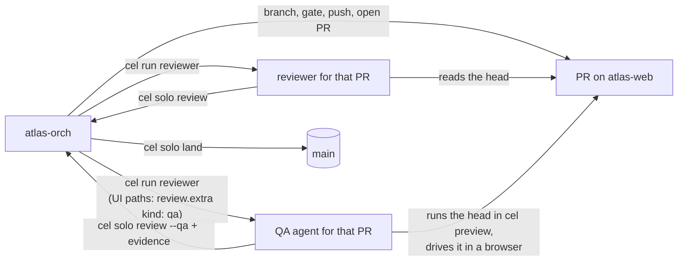
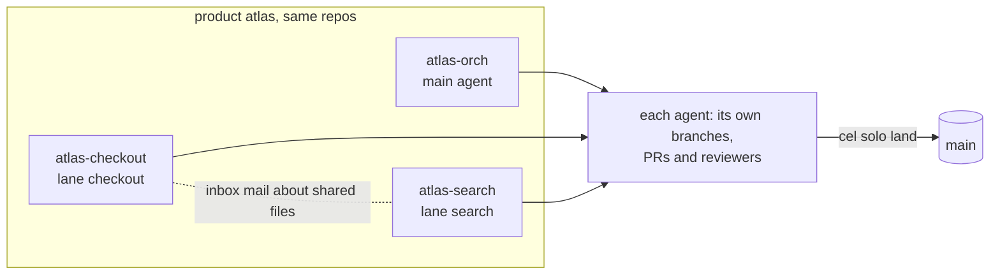
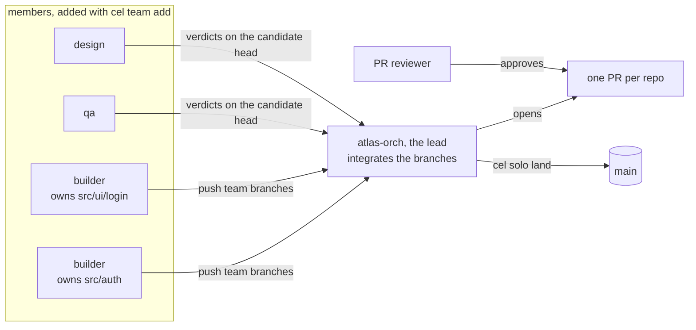
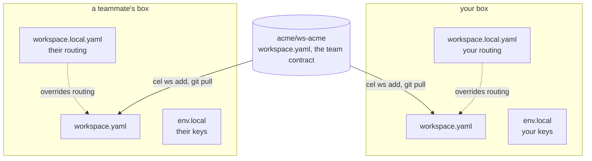

# Setups at a glance

"Team" means two different things in Celestial. A **feature team** is a group
of short-lived agents that one product's agent leads for one feature
(`cel team`). A **team workspace** is one workspace shared by several people,
each on their own box. [Configure your teams](configure-teams.md#configure-your-teams) sets up
both.

## One box: core, product agents, reviewers

Every setup is built on this one: `cel core` per box directs one agent per
product, and each PR gets its own reviewer. It is drawn, with the config that
selects it, on the front page:
[One box](../README.md#one-box-core-product-agents-reviewers).

## One product, solo (the default)

Choose this for almost everything: one agent holds the whole product, uses its
own worktrees and subagents, and lands each PR once its reviewer approved that
exact head and the checks are green - and, for a PR touching the paths
`review.extra` names, once each QA agent (or focus reviewer) has too. Selected
by `mode: solo` on the product, which is also the default when absent, and
`policy: { merge: self }` (with `merge: humans-only` the agent opens the PR
and stops). Details: [Solo mode](solo-mode.md#solo-mode).

## Solo lanes: several goals on one product

Choose lanes when one product has two or three large goals that each want one
agent holding the whole picture, in different parts of the code. Nothing in
`workspace.yaml` starts a lane: start one with
`cel run solo --product atlas --lane checkout`. A repo one lane owns outright
can say so (`repos[].lane`), so its PR mail goes to that lane. Details:
[Solo lanes](how-it-works.md#solo-lanes-several-big-goals-one-agent-each).

## A feature team, led by the product's agent

Choose a team when a feature has two or more parts that can be built at the
same time, or needs a specialist (device QA, design, data, a release check).
The product's agent stays the only integrator: builders push
`team/<feature>/<member>` branches and never open PRs, qa and design judge the
lead's candidate head, and the lead opens one PR per repo, gets it reviewed
and lands it with `cel solo land`. Selected by: `role_profiles` lines
`team-<role>` and `member` for the members' models, and the box's `budget:`
for how many may run. The product's agent runs the `cel team` commands.
Details: [Feature teams](feature-teams.md#feature-teams).

## A team workspace, shared by several people

Choose this when several people, or one person on several boxes, work on the
same products. Everyone shares `workspace.yaml` through git: repos, products,
policy, review, the default routing, and `people:` - who is on the team.
Each person keeps a gitignored `workspace.local.yaml` that changes only
routing (which profile each role runs on), per-box `env:` and `me:` (which
person this login is), and an `env.local` with their own keys. A product's
`home:` names the one login that runs its agents, so two teammates' boxes
never both build it. Details: [Team workspaces](profiles.md#team-workspaces) and
[Per-box routing](profiles.md#per-box-routing).

## How agents reach models: the gateway

Several subscriptions behind one loopback door, and which runtimes go through
it, are drawn on the front page:
[the gateway](../README.md#how-agents-reach-models-the-gateway). Details:
[Gateway](gateway.md#gateway--several-subscriptions-behind-one-door).
